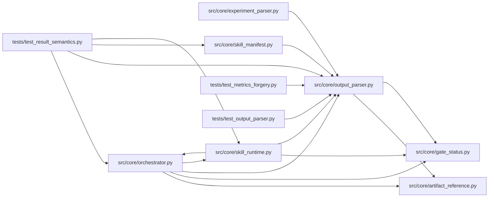

# output_parser Module

**Path:** `src/core/output_parser.py`

## Description

``OutputParser`` protocol + concrete parsers (ARC-011 P1-010..012).

This module introduces the ``OutputParser`` protocol — the abstraction every
consumer reaches through to turn experiment output (``prepare.py`` stdout or
agent-emitted ``ITERATION_RESULT:`` markers) into a structured result dict.

Two concrete implementations land alongside the protocol:

* ``DelimitedKVParser`` (P1-011) — extracts the ``---`` delimited key:value
  block parsing that lived in ``experiment_parser.parse_prepare_output``.
* ``JSONMarkerParser`` (P1-012) — extracts the ``ITERATION_RESULT:`` JSON-line
  scanning that lived in ``experiment_parser.parse_iteration_marker``.

The extraction is **behavior-identical**: every parser body is unchanged, and
the X-002 parity suite is preserved. ``experiment_parser.py`` keeps the four
historical module-level functions (``parse_prepare_output``,
``parse_iteration_marker``, ``is_hpo_study_output``, ``parse_hpo_study_output``)
as thin facades over the new classes so the parity engine
(``tests/parity/_engine.py``, which dispatches by string function name and
imports ``from src.core.experiment_parser import ...``) keeps resolving without
a fixture re-capture. Mirrors the P1-007 ``results_store`` back-compat shim.

Design decisions baked in here:

* **Not ``@runtime_checkable``.** ``isinstance`` against a ``Protocol`` only
  checks attribute presence (false confidence on signatures). This is a
  typing-time contract; consumers accept it as a typed parameter. Mirrors the
  ``LLMProvider`` / ``StateStore`` decisions.
* **Two methods, not one.** ``parse_prepare_output`` and
  ``parse_iteration_marker`` have different semantics (delimited KV-block vs
  JSON-line-scan) and the orchestrator calls them at different points, so the
  protocol carries both rather than collapsing them into a single overloaded
  ``parse``. ``SkillRuntime.parse_iteration`` (P1-023) composes both.
* **``session_nonce`` is accepted but ignored (P1-010 deviation).** The
  ``SkillRuntime`` design calls for nonce validation on ``parse_iteration`` to
  reject forged metrics blocks, but **zero nonce-validation code exists today**
  and introducing it is a Phase-4 behavior change (P4 anti-forgery epic). The
  ``parse_iteration`` signature here accepts ``session_nonce: bytes`` for
  forward-compatibility, but ``JSONMarkerParser.parse_iteration`` ignores it and
  delegates to the unchanged marker scanner. Recorded as an AC-deviation in the
  CHANGELOG and this module docstring (P1-007 house style).

``IterationResult`` is a ``TypedDict`` alias over the flat dict shape produced
by ``IterationMetrics.to_dict()`` (``experiment_parser.py``): ``status``,
``primary_metric``, ``metric_name``, ``direction``, ``training_gates_passed``,
``all_gates_passed``, ``training_time_s`` plus any splatted ``extra`` keys.
``TypedDict`` (not a dataclass) is deliberate — callers (orchestrator, parity
engine) keep treating the result as a plain mutable dict, so a typing-only
alias preserves byte-identical behavior with zero construction churn.

## Imports

| Source | Symbols |
|--------|---------|
| `__future__` | `annotations` |
| `dataclasses` | `dataclass`, `field` |
| `hmac` | `hmac` |
| `json` | `json` |
| `logging` | `logging` |
| `math` | `math` |
| `re` | `re` |
| `src.core.artifact_reference` | `ARTIFACT_REFERENCE_KEYS`, `normalize_optional_artifact_ref` |
| `src.core.gate_status` | `coerce_bool`, `normalize_training_gate_aliases` |
| `typing` | `Any`, `Mapping`, `Optional`, `Protocol`, `TypedDict`, `cast` |

## Local dependency map

<!-- Auto-generated local dependency summary. Do not edit by hand. -->

### Internal neighbors

| Direction | Module |
|---|---|
| Inbound | [experiment_parser](../modules/experiment_parser.md) |
| Inbound | [orchestrator](../modules/orchestrator.md) |
| Inbound | [skill_manifest](../modules/skill_manifest.md) |
| Inbound | [skill_runtime](../modules/skill_runtime.md) |
| Inbound | [test_metrics_forgery](../modules/test_metrics_forgery.md) |
| Inbound | [test_output_parser](../modules/test_output_parser.md) |
| Inbound | [test_result_semantics](../modules/test_result_semantics.md) |
| Outbound | [artifact_reference](../modules/artifact_reference.md) |
| Outbound | [gate_status](../modules/gate_status.md) |

## Classes

| Class | Line | Bases | Description |
|-------|------|-------|-------------|
| [ResultSpec](../entities/ResultSpec.md) | 123 | — | The declared result semantics (built from ``output_parser``). |
| [NormalizedResult](../entities/NormalizedResult.md) | 158 | — | One normalized result with its trusted raw evidence preserved. |
| [IterationResult](../entities/IterationResult.md) | 485 | `TypedDict` | Structured result of parsing one experiment output. |
| [OutputParser](../entities/OutputParser.md) | 507 | `Protocol` | The experiment-output parsing contract (ARC-011 P1-010). |
| [DelimitedKVParser](../entities/DelimitedKVParser.md) | 546 | — | Parse the ``---`` delimited key:value block from ``prepare.py`` stdout. |
| [JSONMarkerParser](../entities/JSONMarkerParser.md) | 599 | — | Parse an ``ITERATION_RESULT:`` JSON line from agent output. |

## Functions

| Function | Signature | Decorators | Description |
|----------|-----------|------------|-------------|
| `_coerce_kv_value` | `(key: str, value: str) -> Any` | — | Legacy-compatible coercion of one raw KV pair into a typed value. |
| `extract_raw_result` | `(text: str, spec: ResultSpec, *, allow_bare_json: bool = True) -> Optional[dict[str, Any]]` | — | Extract the raw result payload in the DECLARED form. |
| `normalize_result` | `(raw: Mapping[str, Any], spec: ResultSpec) -> NormalizedResult` | — | Apply the declared result semantics to one raw payload. |
| `parse_result_text` | `(text: str, spec: ResultSpec, *, allow_bare_json: bool = True) -> Optional[NormalizedResult]` | — | Parse ``text`` in the declared format and normalize the result. |
| `parse_and_verify_text` | `(text: str, spec: ResultSpec, *, session_nonce: Optional[bytes] = None, nonce_field: Optional[str] = None, require_signed_metrics: bool = False, allow_bare_json: bool = True) -> Optional[IterationResult]` | — | Contract parse plus the W11 nonce check — the runtime's one entry. |
| `_parse_delimited_block` | `(stdout: str) -> IterationResult` | — | Parse the ``---`` delimited block — body moved from parse_prepare_output. |
| `_scan_iteration_marker` | `(text: str, marker_prefix: str = _ITERATION_MARKER) -> Optional[IterationResult]` | — | Scan for a marker-prefixed JSON line — body moved from |
| `_verify_nonce` | `(result: Optional[IterationResult], *, session_nonce: Optional[bytes], nonce_field: Optional[str], require_signed_metrics: bool) -> Optional[IterationResult]` | — | Verify the W11 anti-forgery nonce in a parsed result (P4-003/P4-005). |
