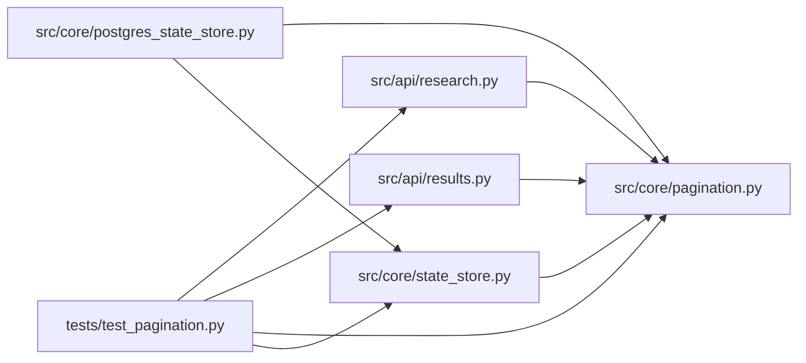

# pagination Module

**Path:** `src/core/pagination.py`

## Description

Opaque keyset-cursor pagination helpers (ARC-011 P0-015..019).

Provides the cursor contract shared by the list endpoints on
``ResultsStore`` (sessions / iterations / pipelines) and the API layer.

Design: ARC-011 P0-016 (recorded in this module's docstring). The cursor is an opaque
base64url token wrapping a versioned JSON tuple ``(sort_key, tiebreak)``. The
``sort_key`` is a value that sorts the same way lexicographically / numerically
as the column indexed by the keyset (an ISO-8601 UTC timestamp ``started_at``
for sessions/pipelines, or an integer ``iteration`` for iterations). The
``tiebreak`` is a stable, unique value per row — the explicit ``id`` primary
key (the implicit ``rowid`` is not indexable in the target SQLite build, so we
use ``id``; for ``iterations`` ``id`` is the INTEGER PK ≡ rowid, for
sessions/pipelines it is the TEXT PK). The tiebreak makes ordering deterministic
when two rows share a sort key.

Decode is **fail-open**: any malformed, truncated, or wrong-version token
decodes to ``None`` so the caller treats it as page 1 rather than erroring.

## Imports

| Source | Symbols |
|--------|---------|
| `__future__` | `annotations` |
| `base64` | `base64` |
| `json` | `json` |
| `typing` | `Any`, `Callable`, `Dict`, `Mapping`, `Optional`, `Sequence`, `Tuple` |

## Local dependency map

<!-- Auto-generated local dependency summary. Do not edit by hand. -->

### Internal neighbors

| Direction | Module |
|---|---|
| Inbound | [research](../modules/research.md) |
| Inbound | [results](../modules/results.md) |
| Inbound | [postgres_state_store](../modules/postgres_state_store.md) |
| Inbound | [state_store](../modules/state_store.md) |
| Inbound | [test_pagination](../modules/test_pagination.md) |

## Classes

| Class | Kind | Line | Bases / Target | Description |
|-------|------|------|----------------|-------------|
| [RowExtractor](../entities/RowExtractor.md) | Type alias | 31 | `Callable[[Mapping[str, Any]], CursorTuple]` | — |

## Functions

| Function | Signature | Decorators | Description |
|----------|-----------|------------|-------------|
| `clamp_limit` | `(limit: Optional[int]) -> int` | — | Clamp a caller-supplied limit to ``[1, MAX_PAGE_SIZE]``. |
| `encode_cursor` | `(sort_key: Any, tiebreak: Any) -> str` | — | Encode a ``(sort_key, tiebreak)`` tuple into an opaque base64url token. |
| `decode_cursor` | `(token: Optional[str]) -> Optional[CursorTuple]` | — | Decode an opaque cursor token. |
| `compute_next_cursor` | `(items: Sequence[Mapping[str, Any]], limit: int, extractor: RowExtractor) -> Optional[str]` | — | Return the opaque cursor for the next page, or ``None`` when exhausted. |
| `build_cursor_page` | `(items: Sequence[Mapping[str, Any]], limit: int, extractor: RowExtractor) -> Dict[str, Any]` | — | Build a cursor-paginated envelope ``{items, limit, next_cursor}``. |
