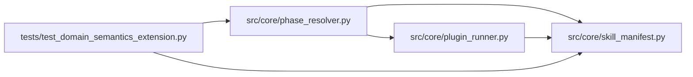

# phase_resolver Module

**Path:** `src/core/phase_resolver.py`

## Description

Phase-advancement resolver: the G1 plugin escape, executed for real.

The declarative contract carries ``phase_advancement.mode=plugin`` (the
sanctioned G1 escape for completion rules that resist declarative
expression) but the runtime previously rejected the mode outright. This
module executes the skill's ``phases.py`` plugin under the governed
``PluginRunner`` — the qualified isolation/capability rules — and returns
a hybrid verdict: the declarative evidence-key share is a necessary
condition and the plugin owns the remaining completion rule.

Every invocation is attempt-bound: the receipt records the plugin path,
capability grant, input/output digests, and the pinned plugin output
schema version. Plugin failure, timeout, capability violation, bad JSON,
or a schema/version mismatch fail closed with an explicit error — there
is never a silent fallback to the declarative share. Unsupported modes
(notably ``trial_identity.resolve: mode=plugin``) keep their existing
explicit rejection.

## Imports

| Source | Symbols |
|--------|---------|
| `__future__` | `annotations` |
| `dataclasses` | `asdict`, `dataclass`, `field` |
| `hashlib` | `hashlib` |
| `json` | `json` |
| `pathlib` | `Path` |
| `src.core.plugin_runner` | `PluginResult`, `PluginRunner` |
| `src.core.skill_manifest` | `PluginCaps`, `PluginEntry` |
| `typing` | `Any`, `Mapping`, `Optional`, `Sequence` |

## Local dependency map

<!-- Auto-generated local dependency summary. Do not edit by hand. -->

### Internal neighbors

| Direction | Module |
|---|---|
| Inbound | [test_domain_semantics_extension](../modules/test_domain_semantics_extension.md) |
| Outbound | [plugin_runner](../modules/plugin_runner.md) |
| Outbound | [skill_manifest](../modules/skill_manifest.md) |

## Classes

| Class | Line | Bases | Description |
|-------|------|-------|-------------|
| [PluginAdvancementError](../entities/PluginAdvancementError.md) | 33 | `RuntimeError` | Base error for plugin phase advancement (explicit, fail-closed). |
| [PluginAdvancementRejected](../entities/PluginAdvancementRejected.md) | 37 | `PluginAdvancementError` | The declaration itself is unsupported (explicit rejection). |
| [PluginAdvancementFailed](../entities/PluginAdvancementFailed.md) | 41 | `PluginAdvancementError` | The plugin ran but its verdict cannot be trusted (fail-closed). |
| [PluginReceipt](../entities/PluginReceipt.md) | 46 | — | Attempt-bound evidence of one resolver invocation. |
| [AdvancementVerdict](../entities/AdvancementVerdict.md) | 62 | — | The hybrid phase-advancement verdict. |

## Functions

| Function | Signature | Decorators | Description |
|----------|-----------|------------|-------------|
| `_digest` | `(payload: Mapping[str, Any]) -> str` | — | — |
| `_declarative_share` | `(evidence_keys: Sequence[str], evidence: Mapping[str, Any]) -> bool` | — | — |
| `resolve_phase_advancement` | *(async)* `(*, skill_dir: Path, plugin_entry: Optional[PluginEntry], mode: str, phase_id: str, evidence_keys: Sequence[str], evidence: Mapping[str, Any], attempt_id: str, runner: Optional[PluginRunner] = None) -> AdvancementVerdict` | — | Resolve one phase's advancement under the declared mode. |
