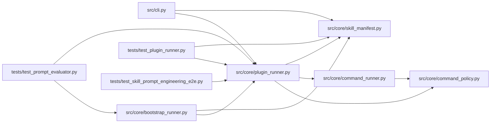

# plugin_runner Module

**Path:** `src/core/plugin_runner.py`

## Description

Governed subprocess runner for skill-supplied plugins (ARC-011 X-004 / P5-005).

This module implements the **plugin execution contract** recorded in the X-004
security spike (§6; design recorded in this module's docstring). Every skill-supplied
Python file — ``bootstrap.py``, ``parser.py``, ``preflight.py``,
``resolve_identity.py`` — runs in its own confined subprocess via this runner,
never ``import``-ed into the server process (X-004 D2).

Design contract (X-004 §6, verbatim where load-bearing):

* **Invocation:** ``PluginRunner.run(skill_dir, plugin, kind, input_json, *,
  caps, timeout_s) -> PluginResult``.
* **Subprocess:** ``sys.executable <plugin>``, no shell, ``start_new_session=True``
  (process-group for tree-kill). Mirrors ``GovernedCommandRunner``'s spawn shape.
* **ABI:** JSON on stdin, JSON on stdout, exit 0/non-zero. The plugin module
  exposes a pure function; the runner does the marshalling.
* **Capability block (default-deny):** ``caps.fs_write`` / ``network_egress`` /
  ``env`` / ``timeout_s`` / ``max_rss_mb`` / ``max_cpu_s``. Default per-kind
  caps come from ``skill_loader._DEFAULT_CAPS_BY_KIND`` (X-004 §6).
* **Env (X-004 §4.2 — strict):** ``PATH`` / ``LANG`` / ``HOME`` /
  ``PYTHONUNBUFFERED`` / venv ``PYTHONPATH`` + only manifest-declared ``env``
  keys. **No secrets, no ``AWS_*``, no service tokens.** This is strictly
  narrower than ``command_runner._CHILD_ENV_ALLOWLIST`` (the agent path), by
  design — plugins have no legitimate need for any of those.
* **Failure semantics (fail-closed):** crash / timeout / invalid-JSON /
  non-zero-exit ⇒ ``PluginResult(ok=False)`` + audit; **the exception never
  propagates to the server process** (the single-instance W14 guarantee).
* **Path confinement (D4):** the plugin's CWD is the session workspace;
  ``skills/`` is reachable read-only; writes are confined to the workspace when
  ``caps.fs_write == "workspace"``. Reuses ``command_policy._is_within``.

The ``BootstrapRunner`` (P5-005, ``bootstrap_runner.py``) is the first
consumer; ``parser`` / ``preflight`` / ``resolve_identity`` plugins follow the
same contract.

Design decisions (P1-007 house style):

* **Sync subprocess + thread offload.** Like ``GovernedCommandRunner.run``,
  the blocking ``Popen`` poll loop lives on a worker thread; the public
  ``run()`` is ``async`` and wraps the body in ``asyncio.to_thread`` so a hard
  timeout / cancel can reap the tree via ``_terminate_process_group_without_communicate``.
* **No env inheritance.** The plugin child env is built fresh from the X-004
  §4.2 strict allow-list — it does NOT call ``command_runner._build_child_env``
  (that one is the agent path and carries experiment-legitimate creds plugins
  must never see).
* **Resource monitoring.** A psutil watcher thread enforces ``max_rss_mb`` /
  ``max_cpu_s``; on breach the tree is killed and the result is fail-closed.
* **Auditing is the caller's job.** ``PluginRunner`` returns a ``PluginResult``
  with ``error``/``returncode``/``timed_out``; the caller (``BootstrapRunner``
  / orchestrator) writes the ``audit_events`` row. Keeps the runner free of the
  DB handle (X-004 D3 — plugins' execution context gets no server internals).

## Imports

| Source | Symbols |
|--------|---------|
| `__future__` | `annotations` |
| `asyncio` | `asyncio` |
| `dataclasses` | `dataclass`, `field` |
| `json` | `json` |
| `logging` | `logging` |
| `os` | `os` |
| `pathlib` | `Path` |
| `psutil` | `psutil` |
| `src.core.command_policy` | `_is_within` |
| `src.core.command_runner` | `_terminate_process_group_without_communicate` |
| `src.core.skill_manifest` | `PluginCaps`, `PluginKind` |
| `subprocess` | `subprocess` |
| `sys` | `sys` |
| `threading` | `threading` |
| `time` | `time` |
| `types` | `MappingProxyType` |
| `typing` | `Any`, `Literal`, `Mapping`, `Optional` |

## Local dependency map

<!-- Auto-generated local dependency summary. Do not edit by hand. -->

### Internal neighbors

| Direction | Module |
|---|---|
| Inbound | [cli](../modules/cli.md) |
| Inbound | [bootstrap_runner](../modules/bootstrap_runner.md) |
| Inbound | [test_plugin_runner](../modules/test_plugin_runner.md) |
| Inbound | [test_prompt_evaluator](../modules/test_prompt_evaluator.md) |
| Inbound | [test_skill_prompt_engineering_e2e](../modules/test_skill_prompt_engineering_e2e.md) |
| Outbound | [command_policy](../modules/command_policy.md) |
| Outbound | [command_runner](../modules/command_runner.md) |
| Outbound | [skill_manifest](../modules/skill_manifest.md) |

### External packages

| Language | Used packages | Undeclared packages |
|---|---:|---:|
| python | 1 | 1 |

## Classes

| Class | Line | Bases | Description |
|-------|------|-------|-------------|
| [PluginResult](../entities/PluginResult.md) | 161 | — | Outcome of one plugin invocation (X-004 §6 failure semantics). |
| [PluginRunner](../entities/PluginRunner.md) | 189 | — | Execute one skill plugin in a confined governed subprocess (X-004 §6). |
| [_PluginRunBody](../entities/PluginRunBody.md) | 357 | — | Inputs bundled for the worker-thread sync body. |
| [_ResourceWatcher](../entities/ResourceWatcher.md) | 381 | — | Polls a live plugin subprocess's RSS / CPU and flags cap breaches (D6). |

## Functions

| Function | Signature | Decorators | Description |
|----------|-----------|------------|-------------|
| `_build_plugin_env` | `(*, declared_env_keys: Mapping[str, str] \| None = None, source_env: Mapping[str, str] \| None = None) -> dict[str, str]` | — | Build the env dict for a plugin subprocess (X-004 §4.2, strict). |
| `_tail` | `(text: str, *, max_chars: int = 2000) -> str` | — | Return the trailing slice of ``text`` for error context. |
