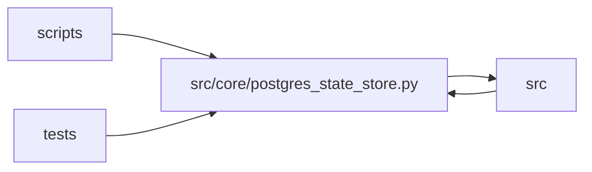

# postgres_state_store Module

**Path:** `src/core/postgres_state_store.py`

## Description

``PostgresStateStore`` — the multi-worker Postgres backend (ARC-011 P6-002).

A 1:1 translation of :class:`SQLiteStateStore` to raw asyncpg, satisfying the
same 48-method :class:`StateStore` protocol. The port is **mechanical** at the
SQL level (``?`` → ``$N``, ``AUTOINCREMENT`` → ``BIGSERIAL``, ``INSERT OR
REPLACE`` → ``ON CONFLICT … DO UPDATE``) so the X-002 parity suite and the
dual-backend sweep (P6-002b) verify behavior is byte-identical.

Design input: ARC-011 P6-001 (recorded in this module's docstring). Key points:

* **Raw asyncpg, not SQLAlchemy** (D-driver): mirrors SQLiteStateStore's
  hand-written-SQL shape for parity; ``pg_advisory_xact_lock`` is first-class.
* **Connection sharing via ContextVar** (D-connection-sharing): the 48 protocol
  methods keep their signatures. A :class:`contextvars.ContextVar` carries the
  in-flight transaction's connection; the additive ``session_lock`` method
  acquires a pooled connection, begins a transaction, takes the advisory lock,
  and publishes its connection via the ContextVar. Each method joins the
  in-flight txn if one is held, else grabs its own short-lived connection.
* **No ``self._write_lock``**: Postgres MVCC + atomic ``ON CONFLICT`` make the
  in-process asyncio.Lock unnecessary. ``SQLiteStateStore`` keeps it.
* **Fencing support** (D-fencing, feeds P6-004): the schema adds
  ``research_sessions.lock_epoch``; the four post-command write methods accept
  an optional ``lock_epoch`` precondition so a stale worker's late write is
  discarded (0 rows). When the precondition is omitted the write is
  unconditional — matching SQLite semantics and keeping the parity suite green.

Single-host, N-worker, one shared DB (D-scope-single-host). Same-session
concurrency is serialized by the advisory lock (held via ``session_lock``);
cross-session concurrency relies on MVCC.

## Imports

| Source | Symbols |
|--------|---------|
| `__future__` | `annotations` |
| `asyncpg` | `asyncpg` |
| `contextlib` | `asynccontextmanager` |
| `contextvars` | `contextvars` |
| `datetime` | `datetime`, `timezone` |
| `json` | `json` |
| `logging` | `logging` |
| `src.core.artifact_reference` | `normalize_optional_artifact_ref` |
| `src.core.gate_status` | `consistency_report_passed` |
| `src.core.observability` | `log_research_event` |
| `src.core.pagination` | `clamp_limit` |
| `src.core.state_store` | `SQLiteStateStore` |
| `typing` | `Any`, `AsyncIterator`, `Dict`, `List`, `Optional`, `Sequence` |
| `uuid` | `uuid` |

## Local dependency map

<!-- Auto-generated local dependency summary. Do not edit by hand. -->

> Module-level dependencies exceed the generated-diagram limits, so the diagram and table below group them by top-level package. Counts report the number of module neighbors in each package.

### Internal neighbors

| Direction | Module |
|---|---|
| Inbound | `scripts` (1) |
| Inbound | `src` (1) |
| Inbound | `tests` (5) |
| Outbound | `src` (5) |

### External packages

| Language | Used packages | Undeclared packages |
|---|---:|---:|
| python | 1 | 0 |

> All 12 module neighbor(s) are summarized by package because the module-level view exceeds the 12-node limit.

## Classes

| Class | Line | Bases | Description |
|-------|------|-------|-------------|
| [PostgresStateStore](../entities/PostgresStateStore.md) | 338 | — | Multi-worker Postgres implementation of :class:`StateStore`. |

## Functions

| Function | Signature | Decorators | Description |
|----------|-----------|------------|-------------|
| `_json_object` | `(raw: Any) -> Dict[str, Any]` | — | — |
| `_truthy` | `(value: Any) -> Optional[bool]` | — | — |
| `_row_to_dict` | `(row: Any) -> Dict[str, Any]` | — | — |
| `_parse_rowcount` | `(status: str) -> int` | — | Parse asyncpg's ``UPDATE N`` / ``DELETE N`` command-tag row count. |
| `is_postgres_dsn` | `(url: Optional[str]) -> bool` | — | True when ``url`` selects the Postgres backend (D-backend-by-config). |
| `build_state_store` | `(settings: Any) -> Any` | — | Factory selecting the store backend from ``settings.database_url``. |
