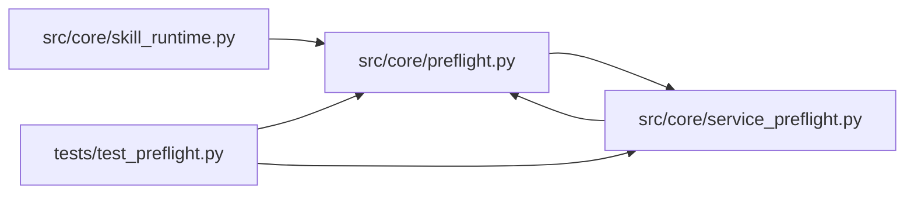

# preflight Module

**Path:** `src/core/preflight.py`

## Description

``PreflightCheck`` protocol + concrete checks (ARC-011 P1-019..021).

This module introduces the ``PreflightCheck`` protocol — the abstraction over a
single service-dependency health check. It formalizes the dispatch fork that
previously lived inline in ``service_preflight.run_service_preflight`` (the
``if target.transport == "tcp": _check_tcp_target(...) else: _check_target(...)``
branch):

* ``HTTPHealthCheck`` (P1-020) — wraps ``service_preflight._check_target``.
* ``TCPConnectCheck`` (P1-020) — wraps ``service_preflight._check_tcp_target``
  (generic TCP-connect probe for skill-declared ``tcp`` preflight targets).

``service_preflight.build_service_preflight_targets`` (P1-021) now returns
``list[PreflightCheck]`` and ``run_service_preflight`` dispatches via
``target.check(client)`` instead of the transport fork. The four public free
functions (``run_service_preflight``, ``build_not_run_preflight``,
``require_preflight_ready``, ``sanitize_service_url``) keep their signatures so
the consumers (``session_manager._run_preflight``, ``main.py`` readiness /
monitoring endpoints, ``research_manifest``) are unchanged. The 7
``test_service_preflight.py`` tests are the behavioral gate.

The extraction is **behavior-identical**: every check body is unchanged. Mirrors
the P1-010..012 ``OutputParser``, P1-015..017 ``PromotionTarget``, and
P1-006/007 ``StateStore`` precedents.

Design decisions baked in here:

* **Not ``@runtime_checkable``.** Typing-time contract only — mirrors
  ``LLMProvider`` / ``StateStore`` / ``OutputParser`` / ``PromotionTarget``.
* **``check`` is async.** Health checks are network I/O (HTTP GET or TCP
  connect); the protocol keeps them async. The TCP check ignores the ``client``
  arg (it opens its own socket) — the protocol documents this.
* **``ServicePreflightTarget`` stays in ``service_preflight.py``** as the frozen
  dataclass descriptor; the check classes are constructed from it. This keeps
  the descriptor (a value object) separate from the check (a behavior object),
  matching the existing structure.

## Imports

| Source | Symbols |
|--------|---------|
| `__future__` | `annotations` |
| `httpx` | `httpx` |
| `src.core` | `service_preflight` |
| `src.core.service_preflight` | `ServicePreflightTarget` |
| `typing` | `Any`, `Protocol` |

## Local dependency map

<!-- Auto-generated local dependency summary. Do not edit by hand. -->

### Internal neighbors

| Direction | Module |
|---|---|
| Inbound | [service_preflight](../modules/service_preflight.md) |
| Inbound | [skill_runtime](../modules/skill_runtime.md) |
| Inbound | [test_preflight](../modules/test_preflight.md) |
| Outbound | [service_preflight](../modules/service_preflight.md) |

### External packages

| Language | Used packages | Undeclared packages |
|---|---:|---:|
| python | 1 | 0 |

## Classes

| Class | Line | Bases | Description |
|-------|------|-------|-------------|
| [PreflightCheck](../entities/PreflightCheck.md) | 49 | `Protocol` | A single service-dependency health check (ARC-011 P1-019). |
| [HTTPHealthCheck](../entities/HTTPHealthCheck.md) | 74 | — | HTTP health-endpoint probe (ARC-011 P1-020). |
| [TCPConnectCheck](../entities/TCPConnectCheck.md) | 103 | — | TCP-connect probe (ARC-011 P1-020). |

## Functions

| Function | Signature | Decorators | Description |
|----------|-----------|------------|-------------|
| `preflight_check_from_target` | `(target: ServicePreflightTarget, *, timeout_s: float = 3.0) -> PreflightCheck` | — | Build the right ``PreflightCheck`` for a ``ServicePreflightTarget``. |
