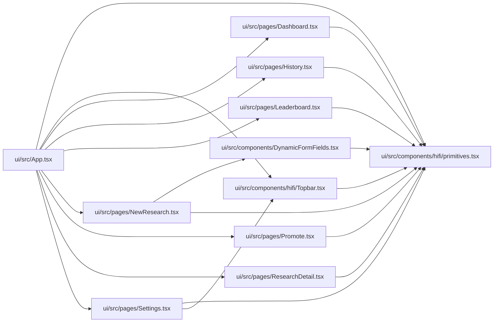

# primitives Module

**Path:** `ui/src/components/hifi/primitives.tsx`

## Description

_Auto-generated from `ui/src/components/hifi/primitives.tsx`._

## Imports

| Source | Symbols |
|--------|---------|
| `react` | `CSSProperties`, `ReactNode` |

## Module Signals

| Signal | Values |
|--------|--------|
| Exports | `Field`, `FieldProps`, `Icon`, `IconName`, `IconProps`, `MetricChart`, `MetricChartProps`, `MetricPoint`, `PhaseBar`, `PhaseBarItem`, `PhaseBarProps`, `Segmented`, `SegmentedOption`, `SegmentedProps`, `Sparkline`, `SparklineProps`, `Stat`, `StatProps`, `StatusBadge` |
| Constants | `ICON_PATHS`, `STATUS_MAP` |

## Local dependency map

<!-- Auto-generated local dependency summary. Do not edit by hand. -->

### Internal neighbors

| Direction | Module |
|---|---|
| Inbound | [App](../modules/App.md) |
| Inbound | [DynamicFormFields](../modules/DynamicFormFields.md) |
| Inbound | [Topbar](../modules/Topbar.md) |
| Inbound | [Dashboard](../modules/Dashboard.md) |
| Inbound | [History](../modules/History.md) |
| Inbound | [Leaderboard](../modules/Leaderboard.md) |
| Inbound | [NewResearch](../modules/NewResearch.md) |
| Inbound | [Promote](../modules/Promote.md) |
| Inbound | [ResearchDetail](../modules/ResearchDetail.md) |
| Inbound | [Settings](../modules/Settings.md) |

### External packages

| Language | Used packages | Undeclared packages |
|---|---:|---:|
| typescript | 1 | 0 |

## Classes

| Class | Kind | Line | Bases / Target | Description |
|-------|------|------|----------------|-------------|
| [IconProps](../entities/IconProps.md) | Class | 46 | — | — |
| [StatProps](../entities/StatProps.md) | Class | 105 | — | — |
| [SparklineProps](../entities/SparklineProps.md) | Class | 136 | — | — |
| [MetricPoint](../entities/MetricPoint.md) | Class | 169 | — | — |
| [MetricChartProps](../entities/MetricChartProps.md) | Class | 175 | — | — |
| [PhaseBarItem](../entities/PhaseBarItem.md) | Class | 289 | — | — |
| [PhaseBarProps](../entities/PhaseBarProps.md) | Class | 295 | — | — |
| [FieldProps](../entities/FieldProps.md) | Class | 329 | — | — |
| [SegmentedOption](../entities/SegmentedOption.md) | Class | 349 | — | — |
| [SegmentedProps](../entities/SegmentedProps.md) | Class | 354 | — | — |
| [IconName](../entities/IconName.md) | Type alias | 44 | — | — |

## Functions

| Function | Signature | Decorators | Description |
|----------|-----------|------------|-------------|
| `Icon` | `({ name, size = 16, color = 'currentColor', stroke = 1.5, style, className }: IconProps)` | — | — |
| `StatusBadge` | `({ s }: { s: string })` | — | — |
| `Stat` | `({ label, value, sub, delta, deltaDir, valueSize }: StatProps)` | — | — |
| `Sparkline` | `({ data, color, height = 32, fill = false }: SparklineProps)` | — | — |
| `MetricChart` | `({ points, height = 280, showAxis = true, showBest = true }: MetricChartProps)` | — | — |
| `PhaseBar` | `({ phases, active }: PhaseBarProps)` | — | — |
| `Field` | `({ label, required, help, children }: FieldProps)` | — | — |
| `Segmented` | `({ options, value, onChange }: SegmentedProps)` | — | — |
