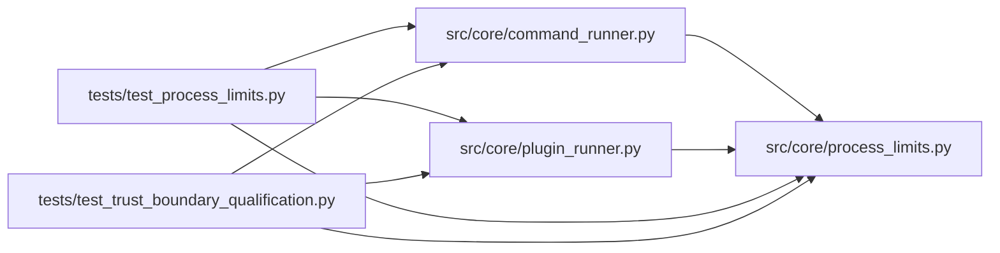

# process_limits Module

**Path:** `src/core/process_limits.py`

## Description

Bounded resource use, output, and cancellation for candidate subprocesses.

This module is the resource layer of the universal execution boundary. Every
candidate-controlled subprocess (skill plugins, governed evaluator commands)
runs under finite, configurable caps and is stopped as a whole process tree the
moment a cap is breached — the parent never waits for the child to finish
before reacting, and never buffers output without a bound.

Enforcement map (kernel where available, parent-side where not):

* **cumulative CPU** — the tree guard sums CPU across the whole process tree
  against the cap (true cumulative accounting, not per-interval deltas) and
  terminates immediately; ``prlimit --cpu`` adds a per-process kernel backstop.
* **process-tree memory** — the tree guard sums RSS across the tree and
  terminates immediately on breach.
* **wall time** — the drain loop enforces the deadline and terminates
  immediately on expiry.
* **process count** — the tree guard counts descendants and terminates
  immediately above the cap.
* **filesystem quota** — ``prlimit --fsize`` (kernel, per-file). This is the
  one cap with no parent-side enforcement: when it is configured and the
  ``prlimit`` binary is unavailable the capability is **rejected** rather than
  run unbounded.
* **output quota** — the drain loop counts delivered bytes and terminates
  immediately past the configured bound; capture itself is chunk-bounded.

Termination is bounded: :data:`TERMINATION_BOUND_S` is the documented tested
bound from the moment a violation is observed to the moment the process tree
is gone (SIGTERM, short bounded wait, SIGKILL, short bounded wait). Callers
receive an explicit ``cleanup_incomplete`` status when descendants survive
that window; successful cleanup leaves no orphaned child.

## Imports

| Source | Symbols |
|--------|---------|
| `__future__` | `annotations` |
| `dataclasses` | `dataclass`, `field` |
| `os` | `os` |
| `psutil` | `psutil` |
| `selectors` | `selectors` |
| `shutil` | `shutil` |
| `signal` | `signal` |
| `subprocess` | `subprocess` |
| `threading` | `threading` |
| `time` | `time` |
| `typing` | `Callable`, `Optional` |

## Local dependency map

<!-- Auto-generated local dependency summary. Do not edit by hand. -->

### Internal neighbors

| Direction | Module |
|---|---|
| Inbound | [command_runner](../modules/command_runner.md) |
| Inbound | [plugin_runner](../modules/plugin_runner.md) |
| Inbound | [test_process_limits](../modules/test_process_limits.md) |
| Inbound | [test_trust_boundary_qualification](../modules/test_trust_boundary_qualification.md) |

### External packages

| Language | Used packages | Undeclared packages |
|---|---:|---:|
| python | 1 | 1 |

## Classes

| Class | Line | Bases | Description |
|-------|------|-------|-------------|
| [UnenforceableResourceCapabilityError](../entities/UnenforceableResourceCapabilityError.md) | 58 | `RuntimeError` | A configured resource cap cannot be enforced on this host (fail-closed). |
| [ProcessResourceCaps](../entities/ProcessResourceCaps.md) | 63 | — | Finite resource caps for one candidate-controlled subprocess tree. |
| [TreeResourceGuard](../entities/TreeResourceGuard.md) | 173 | — | Polls one subprocess tree and terminates it the moment a cap is breached. |
| [DrainOutcome](../entities/DrainOutcome.md) | 247 | — | Result of one bounded drain: captured bytes plus attributed status. |

## Functions

| Function | Signature | Decorators | Description |
|----------|-----------|------------|-------------|
| `terminate_process_tree` | `(proc: 'subprocess.Popen') -> bool` | — | Terminate one subprocess tree within a bounded cleanup window. |
| `rlimit_prefix` | `(caps: ProcessResourceCaps) -> list[str]` | — | Spawn prefix applying kernel rlimits, or a refusal for unenforceable caps. |
| `bounded_drain` | `(proc: 'subprocess.Popen', *, input_bytes: Optional[bytes], caps: ProcessResourceCaps, guard: Optional[TreeResourceGuard] = None) -> DrainOutcome` | — | Run one subprocess to completion under bounded capture and caps. |
| `_has_pending` | `(sel: 'selectors.DefaultSelector') -> bool` | — | True while any stream is still registered (pipes may be idle but open). |
| `signal_violation` | `(returncode: Optional[int]) -> Optional[str]` | — | Attribute a signal death to its resource cap (kernel enforcement path). |
