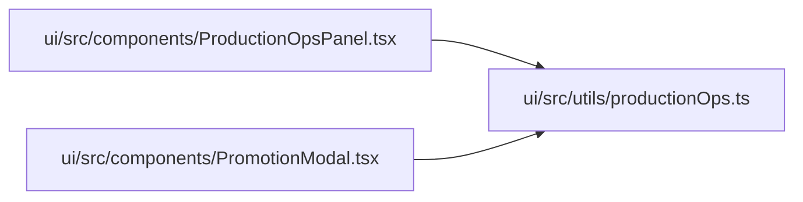

# productionOps Module

**Path:** `ui/src/utils/productionOps.ts`

## Description

_Auto-generated from `ui/src/utils/productionOps.ts`._

## Module Signals

| Signal | Values |
|--------|--------|
| Exports | `OpsTone`, `PromotionScopeName`, `blockerLabels`, `formatMetric`, `humanizeBlocker`, `productionReady`, `scopeLabel`, `scopeSummary`, `toneClasses`, `toneForStatus`, `warningTone` |
| Constants | `BLOCKER_MESSAGES`, `SCOPE_LABELS` |

## Local dependency map

<!-- Auto-generated local dependency summary. Do not edit by hand. -->

### Internal neighbors

| Direction | Module |
|---|---|
| Inbound | [ProductionOpsPanel](../modules/ProductionOpsPanel.md) |
| Inbound | [PromotionModal](../modules/PromotionModal.md) |

## Classes

| Class | Kind | Line | Bases / Target | Description |
|-------|------|------|----------------|-------------|
| [BlockerDetailShape](../entities/BlockerDetailShape.md) | Class | 4 | — | — |
| [ProductionWarningShape](../entities/ProductionWarningShape.md) | Class | 9 | — | — |
| [PromotionScopeStatusShape](../entities/PromotionScopeStatusShape.md) | Class | 15 | — | — |
| [ProductionOperationsShape](../entities/ProductionOperationsShape.md) | Class | 25 | — | — |
| [OpsTone](../entities/OpsTone.md) | Type alias | 1 | — | — |
| [PromotionScopeName](../entities/PromotionScopeName.md) | Type alias | 2 | — | — |

## Functions

| Function | Signature | Decorators | Description |
|----------|-----------|------------|-------------|
| `humanizeBlocker` | `(code: string) -> string` | — | — |
| `blockerLabels` | `(blockers: string[], details: BlockerDetailShape[]) -> string[]` | — | — |
| `scopeLabel` | `(scope: PromotionScopeName) -> string` | — | — |
| `toneForStatus` | `(status: string \| null) -> OpsTone` | — | — |
| `toneClasses` | `(tone: OpsTone) -> string` | — | — |
| `scopeSummary` | `(scope: PromotionScopeStatusShape) -> {   label: string;   tone: OpsTone;   message: string;   canConfirm: boolean; }` | — | — |
| `warningTone` | `(warning: ProductionWarningShape) -> OpsTone` | — | — |
| `formatMetric` | `(value: unknown) -> string` | — | — |
| `productionReady` | `(ops: ProductionOperationsShape \| null) -> boolean` | — | — |
