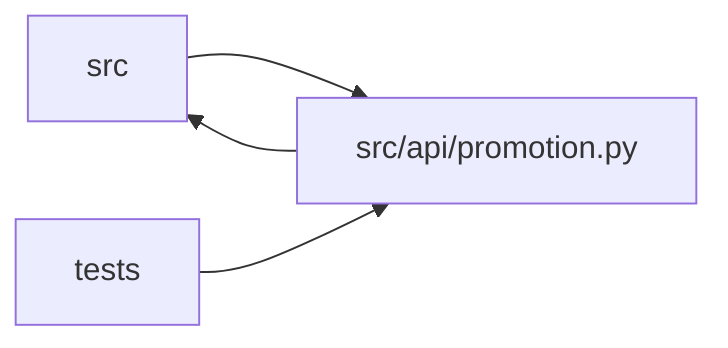

# promotion Module

**Path:** `src/api/promotion.py`

## Description

Config promotion endpoints — preview and confirm pushing configs to host.

## Imports

| Source | Symbols |
|--------|---------|
| `__future__` | `annotations` |
| `fastapi` | `APIRouter`, `Depends`, `HTTPException`, `Request` |
| `hashlib` | `hashlib` |
| `hmac` | `hmac` |
| `pydantic` | `BaseModel`, `ConfigDict`, `Field`, `model_validator` |
| `src.api.audit` | `record_api_audit_event` |
| `src.api.auth` | `require_api_auth` |
| `src.config` | `secret_value`, `settings` |
| `src.core.config_promoter` | `ConfigPromoter`, `ConfigPromoter`, `ConfigPromoter` |
| `src.core.legacy_alias` | `model_type_to_skill_id`, `model_type_to_skill_id` |
| `src.core.promotion_approval` | `APPROVAL_METHOD`, `CANDIDATE_FIELDS`, `candidate_fields`, `canonical_approval_message` |
| `src.core.promotion_target` | `FilePathPromotionTarget`, `promotion_target_from_manifest` |
| `typing` | `Any`, `Dict`, `Optional` |

## Local dependency map

<!-- Auto-generated local dependency summary. Do not edit by hand. -->

> Module-level dependencies exceed the generated-diagram limits, so the diagram and table below group them by top-level package. Counts report the number of module neighbors in each package.

### Internal neighbors

| Direction | Module |
|---|---|
| Inbound | `src` (1) |
| Inbound | `tests` (9) |
| Outbound | `src` (7) |

### External packages

| Language | Used packages | Undeclared packages |
|---|---:|---:|
| python | 2 | 1 |

> All 17 module neighbor(s) are summarized by package because the module-level view exceeds the 12-node limit.

## Classes

| Class | Line | Bases | Description |
|-------|------|-------|-------------|
| [PromotionRollbackRequest](../entities/PromotionRollbackRequest.md) | 110 | `BaseModel` | — |
| [PromotionApproval](../entities/promotion_PromotionApproval.md) | 119 | `BaseModel` | — |
| [PromotionPreviewRequest](../entities/promotion_PromotionPreviewRequest.md) | 132 | `BaseModel` | Unsigned discovery must be possible before an operator can sign a candidate. |
| [PromotionScopeRequest](../entities/promotion_PromotionScopeRequest.md) | 147 | `BaseModel` | — |

## Functions

| Function | Signature | Decorators | Description |
|----------|-----------|------------|-------------|
| `init` | `(promoter, store, *, skill_registry: Any = None)` | — | Wire the promoter, store, and optional skill registry (P3-017). |
| `reset` | `() -> None` | — | Clear all module globals to their uninitialised state. |
| `_audit` | *(async)* `(request: Request, *, action: str, outcome: str, research_id: str \| None = None, metadata: dict \| None = None, error_message: str \| None = None)` | — | — |
| `_inject_target_kind` | `(result: Dict[str, Any], *, skill_id: str = '') -> Dict[str, Any]` | — | P3-017: add ``target_kind`` to a promotion preview/confirm result. |
| `_approval_payload` | `(approval: PromotionApproval \| None) -> dict \| None` | — | — |
| `_verify_production_approval_signature` | `(research_id: str, payload: PromotionScopeRequest) -> None` | — | Cryptographically verify the production approval signature (W18). |
| `_confirm_audit_metadata` | `(payload: PromotionScopeRequest) -> dict[str, Any]` | — | Metadata recorded in the ``promotion.confirm`` audit event (W18 / AC #4). |
| `_promoter_for_session` | *(async)* `(research_id: str) -> tuple[Any, str]` | — | Pick the promoter for a session (P1-3, centralized by P7-007). |
| `promote_preview` | *(async)* `(request: Request, research_id: str, payload: PromotionPreviewRequest \| None = None)` | `@router.post('/research/{research_id}/promote/preview')` | Dry-run: returns what would change if the best config were promoted. |
| `promote_confirm` | *(async)* `(request: Request, research_id: str, payload: PromotionScopeRequest \| None = None)` | `@router.post('/research/{research_id}/promote/confirm')` | Write the best config to the host bind mount. |
| `list_promotions` | *(async)* `()` | `@router.get('/promotions')` | History of all config promotions. |
| `rollback_development_promotion` | *(async)* `(http_request: Request, model_type: str, instrument: str, timeframe: str, request: PromotionRollbackRequest = PromotionRollbackRequest())` | `@router.post('/promotions/{model_type}/{instrument}/{timeframe}/rollback')` | Restore the latest development config for an instrument/timeframe. |
