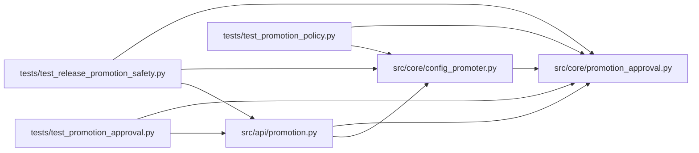

# promotion_approval Module

**Path:** `src/core/promotion_approval.py`

## Description

Pure production-approval v2 encoding and candidate binding (no I/O).

The HMAC covers the caller's candidate, never a substituted current winner.
Core confirmation must compare that candidate to its actual preview before writes.

## Imports

| Source | Symbols |
|--------|---------|
| `__future__` | `annotations` |
| `collections.abc` | `Mapping` |
| `hashlib` | `hashlib` |
| `json` | `json` |
| `re` | `re` |
| `typing` | `Any` |

## Local dependency map

<!-- Auto-generated local dependency summary. Do not edit by hand. -->

### Internal neighbors

| Direction | Module |
|---|---|
| Inbound | [promotion](../modules/promotion.md) |
| Inbound | [config_promoter](../modules/config_promoter.md) |
| Inbound | [test_promotion_approval](../modules/test_promotion_approval.md) |
| Inbound | [test_promotion_policy](../modules/test_promotion_policy.md) |
| Inbound | [test_release_promotion_safety](../modules/test_release_promotion_safety.md) |

## Functions

| Function | Signature | Decorators | Description |
|----------|-----------|------------|-------------|
| `canonical_json` | `(value: Mapping[str, Any]) -> bytes` | — | Stable UTF-8 JSON: sorted keys, compact separators, ASCII escapes, no NaN. |
| `target_identity` | `(descriptor: Mapping[str, Any]) -> str` | — | Hash identity()'s kind/path/endpoint descriptor, excluding credentials. |
| `candidate_fields` | `(candidate: Mapping[str, Any] \| None) -> dict[str, Any]` | — | Require exact candidate types: integer iteration and lowercase SHA256s. |
| `validate_candidate_binding` | `(approval: Mapping[str, Any] \| None, preview: Mapping[str, Any]) -> None` | — | Fail closed if the approved candidate differs from the actual preview. |
| `canonical_approval_message` | `(research_id: str, scope: str, approval: Mapping[str, Any]) -> bytes` | — | Encode v2 signed provenance and candidate. Scope must already be canonical. |
