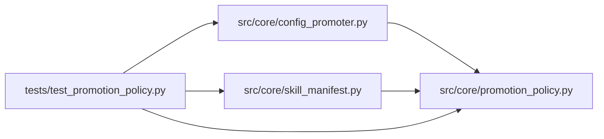

# promotion_policy Module

**Path:** `src/core/promotion_policy.py`

## Description

Compiled promotion policy: scope graph and domain evidence requirements.

The skill's declared ``promotion_target.scopes`` compile into a validated
scope graph: declared prior-scope dependencies, per-scope domain evidence
requirements, and mandatory operator-approval flags. The compile is strict —
undeclared prior references, unknown evidence names, and cyclic dependencies
are explicit errors, never silently dropped.

Historical sessions whose skill declares no scopes keep the legacy policy
path unchanged; a non-ML skill that declares its scopes needs no fabricated ML
evidence.

## Imports

| Source | Symbols |
|--------|---------|
| `__future__` | `annotations` |
| `dataclasses` | `dataclass`, `field` |
| `typing` | `Any`, `Iterable`, `Mapping`, `Optional` |

## Local dependency map

<!-- Auto-generated local dependency summary. Do not edit by hand. -->

### Internal neighbors

| Direction | Module |
|---|---|
| Inbound | [config_promoter](../modules/config_promoter.md) |
| Inbound | [skill_manifest](../modules/skill_manifest.md) |
| Inbound | [test_promotion_policy](../modules/test_promotion_policy.md) |

## Classes

| Class | Line | Bases | Description |
|-------|------|-------|-------------|
| [ScopePolicyError](../entities/ScopePolicyError.md) | 20 | `ValueError` | Raised for invalid or unimplementable scope declarations. |
| [ScopeNode](../entities/ScopeNode.md) | 41 | — | One compiled scope: its approval constraint, dependencies, evidence. |

## Functions

| Function | Signature | Decorators | Description |
|----------|-----------|------------|-------------|
| `compile_scope_graph` | `(scopes: Iterable[Any]) -> dict[str, ScopeNode]` | — | Compile declared scope declarations into a validated graph. |
| `scope_requirements` | `(graph: Mapping[str, ScopeNode], scope: str) -> Optional[ScopeNode]` | — | The compiled requirements for one scope, or None when undeclared. |
