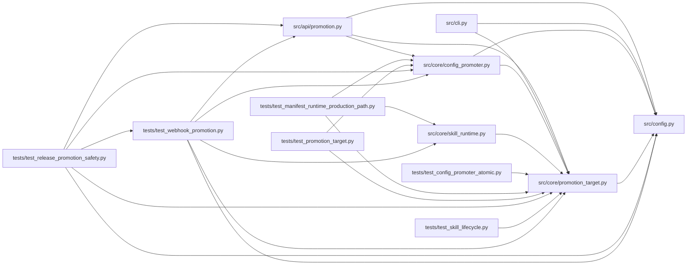

# promotion_target Module

**Path:** `src/core/promotion_target.py`

## Description

``PromotionTarget`` protocol + ``FilePathPromotionTarget`` implementation
(ARC-011 P1-015 / P1-016).

This module introduces the ``PromotionTarget`` protocol — the abstraction over
*where* a promoted config gets written and *how* the path is derived. It
formalizes the file-write surface that previously lived as ``@staticmethod`` /
module-level helpers on ``ConfigPromoter``:

* ``target_path``            ← ``ConfigPromoter._get_target_path``
* ``metadata_sidecar_path``  ← ``ConfigPromoter._metadata_sidecar_path``
* ``rollback_snapshot_path`` ← ``ConfigPromoter._rollback_snapshot_path``
* ``rollback_metadata_sidecar_path`` ← ``ConfigPromoter._rollback_metadata_sidecar_path``
* ``extract_strategy_market``← ``ConfigPromoter._extract_strategy_market``
* ``write`` (atomic)         ← ``ConfigPromoter._write_text_file`` /
  module-level ``_atomic_write_text``

``ConfigPromoter`` keeps its three public methods (``preview`` / ``confirm`` /
``rollback``) — the gate-evaluation logic stays there. P1-017 makes
``ConfigPromoter`` accept an injected ``PromotionTarget`` (defaulting to
``FilePathPromotionTarget()``) and delegate the file writes to it.

Scope (D5): ``PromotionEvidenceCollector`` is intentionally **outside** this
protocol — it is a separate infra-probing resolver that writes to the DB
iteration row (not the host config path), and its own docstring frames it as
feeding ``ConfigPromoter.preview`` rather than being part of the write surface.

The extraction is **behavior-identical**: every path-derivation string and the
atomic-write (tmp+fsync+``os.replace`` + directory fsync) body are unchanged.
The X-002 parity fixture ``promotion_preview/development_scope_basic.json``
bakes ``target_path: "<host_configs>/<skill>/<subject>_<variant>.yaml"``,
so the derivation must stay byte-identical. Mirrors the P1-010..012
``OutputParser`` and P1-006/007 ``StateStore`` precedents.

Design decisions baked in here:

* **Not ``@runtime_checkable``.** Typing-time contract only — mirrors
  ``LLMProvider`` / ``StateStore`` / ``OutputParser``.
* **``write`` is async.** The atomic write is dispatched via
  ``asyncio.to_thread`` (it does blocking fsync + os.replace); the protocol
  keeps it async so the caller (``ConfigPromoter``, already async) awaits it.
* **Path methods are sync.** They are pure string derivation; no I/O.

## Imports

| Source | Symbols |
|--------|---------|
| `__future__` | `annotations` |
| `asyncio` | `asyncio` |
| `dataclasses` | `dataclass` |
| `os` | `os` |
| `pathlib` | `Path` |
| `src.config` | `settings` |
| `tempfile` | `tempfile` |
| `typing` | `Any`, `Optional`, `Protocol` |

## Local dependency map

<!-- Auto-generated local dependency summary. Do not edit by hand. -->

### Internal neighbors

| Direction | Module |
|---|---|
| Inbound | [promotion](../modules/promotion.md) |
| Inbound | [cli](../modules/cli.md) |
| Inbound | [config_promoter](../modules/config_promoter.md) |
| Inbound | [skill_runtime](../modules/skill_runtime.md) |
| Inbound | [test_config_promoter_atomic](../modules/test_config_promoter_atomic.md) |
| Inbound | [test_manifest_runtime_production_path](../modules/test_manifest_runtime_production_path.md) |
| Inbound | [test_promotion_target](../modules/test_promotion_target.md) |
| Inbound | [test_release_promotion_safety](../modules/test_release_promotion_safety.md) |
| Inbound | [test_skill_lifecycle](../modules/test_skill_lifecycle.md) |
| Inbound | [test_webhook_promotion](../modules/test_webhook_promotion.md) |
| Outbound | [config](../modules/config.md) |

## Classes

| Class | Line | Bases | Description |
|-------|------|-------|-------------|
| [PromotionTarget](../entities/promotion_target_PromotionTarget.md) | 56 | `Protocol` | Where a promoted config is written and how its path is derived |
| [FilePathPromotionTarget](../entities/promotion_target_FilePathPromotionTarget.md) | 148 | — | Write promoted configs to the host filesystem (ARC-011 P1-016). |
| [WebhookPromotionTarget](../entities/WebhookPromotionTarget.md) | 264 | — | Promote by POSTing the winning config to an HTTP endpoint (P1-3). |
| [WebhookDeliveryError](../entities/WebhookDeliveryError.md) | 447 | `RuntimeError` | A webhook promotion delivery failed after all retries (fail-closed). |
| [SkillRegistryPromotionTarget](../entities/SkillRegistryPromotionTarget.md) | 509 | — | Promote a draft skill into the live registry (ARC-011 P5-011). |
| [SkillPromotionResult](../entities/SkillPromotionResult.md) | 599 | — | Outcome of a successful ``SkillRegistryPromotionTarget.promote`` call. |
| [SkillPromotionError](../entities/SkillPromotionError.md) | 607 | `ValueError` | Raised when a skill promotion precondition fails (P5-011). |

## Functions

| Function | Signature | Decorators | Description |
|----------|-----------|------------|-------------|
| `_atomic_write_text` | `(path: str, content: str) -> None` | — | Sync helper: tmp+fsync+os.replace atomic write. |
| `promotion_target_from_manifest` | `(skill_manifest: Any) -> 'PromotionTarget'` | — | Build the development-scope ``PromotionTarget`` from a skill manifest's |
