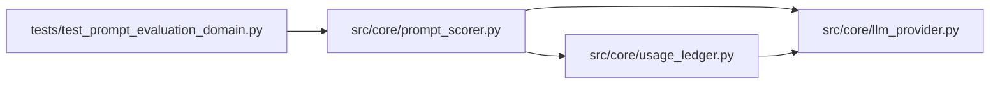

# prompt_scorer Module

**Path:** `src/core/prompt_scorer.py`

## Description

The prompt-evaluation domain: a controlled real scorer, pinned data.

The domain qualifies prompt evaluation with a declared scorer identity and
version, pinned test/holdout datasets, explicit request/result schemas,
and honest failure behavior: a scorer failure is a hard refusal and never
silently invokes a simulator. Optimization evidence (train split) and
held-out qualification evidence (holdout split) are distinguishable in
every result, held-out data is digest-protected against candidate
mutation, scorer usage is accounted in the usage ledger, and the fixed
endpoint/data configuration is pinned into the run spec so continuation
reproduces it exactly. The offline demo mode exists and is labeled as
demo — it is never qualification evidence.

## Imports

| Source | Symbols |
|--------|---------|
| `__future__` | `annotations` |
| `dataclasses` | `asdict`, `dataclass`, `field` |
| `hashlib` | `hashlib` |
| `json` | `json` |
| `src.core.llm_provider` | `Usage` |
| `src.core.usage_ledger` | `UsageEvent` |
| `typing` | `Any`, `Iterable`, `Mapping`, `Optional`, `Sequence` |

## Local dependency map

<!-- Auto-generated local dependency summary. Do not edit by hand. -->

### Internal neighbors

| Direction | Module |
|---|---|
| Inbound | [test_prompt_evaluation_domain](../modules/test_prompt_evaluation_domain.md) |
| Outbound | [llm_provider](../modules/llm_provider.md) |
| Outbound | [usage_ledger](../modules/usage_ledger.md) |

## Classes

| Class | Line | Bases | Description |
|-------|------|-------|-------------|
| [ScorerUnavailable](../entities/ScorerUnavailable.md) | 27 | `Exception` | The declared scorer could not be reached or refused the request. |
| [DatasetTampered](../entities/DatasetTampered.md) | 34 | `Exception` | A pinned dataset no longer matches its digest. |
| [ScorerIdentity](../entities/ScorerIdentity.md) | 39 | — | Who scores the outputs, and at which pinned endpoint. |
| [PinnedDataset](../entities/PinnedDataset.md) | 52 | — | A digest-pinned evaluation split (train or holdout). |
| [ControlledLocalScorer](../entities/ControlledLocalScorer.md) | 178 | — | The declared real scorer: outputs scored against pinned examples. |
| [ScorerClient](../entities/ScorerClient.md) | 232 | — | The scorer client: failures are hard refusals, never fallbacks. |
| [OfflineDemoScorer](../entities/OfflineDemoScorer.md) | 258 | — | The offline demo mode: clearly labeled, never qualification evidence. |

## Functions

| Function | Signature | Decorators | Description |
|----------|-----------|------------|-------------|
| `pin_dataset` | `(*, role: str, dataset_id: str, examples: Sequence[Mapping[str, str]]) -> PinnedDataset` | — | Pin a split: every example carries nonempty input/expected strings. |
| `verify_dataset` | `(dataset: PinnedDataset) -> PinnedDataset` | — | Re-hash the split: candidate mutation of held-out data is refused. |
| `build_score_request` | `(*, candidate_id: str, dataset: PinnedDataset, outputs: Sequence[Mapping[str, str]]) -> dict[str, Any]` | — | The declared request shape: real outputs keyed to dataset inputs. |
| `_normalize` | `(text: str) -> str` | — | — |
| `_score_outputs` | `(dataset: PinnedDataset, outputs: Sequence[Mapping[str, str]]) -> tuple[float, list[dict[str, Any]]]` | — | — |
| `record_scorer_usage` | *(async)* `(store: Any, *, result: Mapping[str, Any]) -> bool` | — | Account scorer usage in the usage ledger (evaluator role). |
| `scorer_pin` | `(*, identity: ScorerIdentity, datasets: Iterable[PinnedDataset]) -> dict[str, Any]` | — | The fixed endpoint/data configuration for the run spec. |
| `bind_promotion_to_candidate` | `(*, candidate_digest: str, holdout_result: Mapping[str, Any]) -> dict[str, Any]` | — | Candidate-bound promotion: evidence travels with its candidate. |
