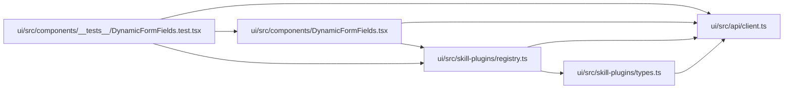

# registry Module

**Path:** `ui/src/skill-plugins/registry.ts`

## Description

_Auto-generated from `ui/src/skill-plugins/registry.ts`._

## Imports

| Source | Symbols |
|--------|---------|
| `../api/client` | `FormField` |
| `./types` | `SkillPluginRenderer` |

## Module Signals

| Signal | Values |
|--------|--------|
| Exports | `register`, `reset`, `resolve`, `unregister` |
| Constants | `_renderers` |

## Local dependency map

<!-- Auto-generated local dependency summary. Do not edit by hand. -->

### Internal neighbors

| Direction | Module |
|---|---|
| Inbound | [DynamicFormFields.test](../modules/DynamicFormFields.test.md) |
| Inbound | [DynamicFormFields](../modules/DynamicFormFields.md) |
| Outbound | [client](../modules/client.md) |
| Outbound | [types](../modules/types.md) |

## Functions

| Function | Signature | Decorators | Description |
|----------|-----------|------------|-------------|
| `register` | `(renderer: SkillPluginRenderer) -> () => void` | — | Register a skill plugin renderer. Idempotent on `renderer.id` — re-registering |
| `unregister` | `(id: string) -> void` | — | Remove a renderer by id. |
| `resolve` | `(field: FormField) -> SkillPluginRenderer \| null` | — | Resolve a renderer for the given field, or `null` if no plugin handles it. |
| `reset` | `() -> void` | — | Test-only: clear the registry. |
