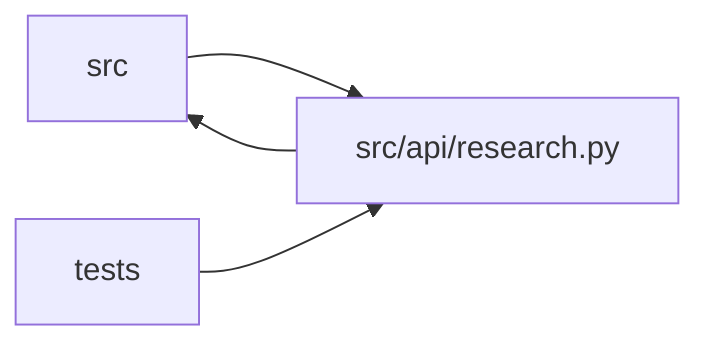

# research Module

**Path:** `src/api/research.py`

## Description

Research session management endpoints.

## Imports

| Source | Symbols |
|--------|---------|
| `__future__` | `annotations` |
| `collections.abc` | `Awaitable`, `Callable` |
| `fastapi` | `APIRouter`, `Depends`, `Header`, `HTTPException`, `Query`, `Request` |
| `glob` | `glob` |
| `hashlib` | `hashlib` |
| `json` | `json` |
| `logging` | `logging` |
| `os` | `os` |
| `pydantic` | `BaseModel`, `Field`, `field_validator`, `model_validator` |
| `src.api.audit` | `record_api_audit_event` |
| `src.api.auth` | `require_api_auth` |
| `src.config` | `settings` |
| `src.core.legacy_alias` | `is_known_model_type`, `model_type_to_skill_id`, `skill_id_to_model_type` |
| `src.core.llm_provider` | `estimate_session_cost` |
| `src.core.pagination` | `DEFAULT_PAGE_SIZE`, `MAX_PAGE_SIZE`, `build_cursor_page`, `compute_next_cursor`, `decode_cursor` |
| `src.core.skill_manifest` | `ManifestValidationError` |
| `src.core.skill_paths` | `sanitize_path_segment` |
| `src.core.skill_registry` | `SkillNotRegisteredError`, `default_registry` |
| `src.core.skill_runtime` | `SkillConfigError` |
| `typing` | `Any`, `Dict`, `Mapping`, `Optional` |
| `yaml` | `yaml` |

## Local dependency map

<!-- Auto-generated local dependency summary. Do not edit by hand. -->

> Module-level dependencies exceed the generated-diagram limits, so the diagram and table below group them by top-level package. Counts report the number of module neighbors in each package.

### Internal neighbors

| Direction | Module |
|---|---|
| Inbound | `src` (1) |
| Inbound | `tests` (8) |
| Outbound | `src` (10) |

### External packages

| Language | Used packages | Undeclared packages |
|---|---:|---:|
| python | 3 | 1 |

> All 19 module neighbor(s) are summarized by package because the module-level view exceeds the 12-node limit.

## Classes

| Class | Line | Bases | Description |
|-------|------|-------|-------------|
| [StartResearchRequest](../entities/research_StartResearchRequest.md) | 521 | `BaseModel` | — |
| [EstimateCostRequest](../entities/EstimateCostRequest.md) | 588 | `BaseModel` | Body for ``POST /research/estimate-cost`` — the New-Research preview. |
| [ContinueResearchRequest](../entities/ContinueResearchRequest.md) | 894 | `BaseModel` | Request body for continuing a timed-out/completed session. |
| [RuntimeResumeRequest](../entities/RuntimeResumeRequest.md) | 908 | `ContinueResearchRequest` | Explicit operator action for resuming a restart-recovered session. |

## Functions

| Function | Signature | Decorators | Description |
|----------|-----------|------------|-------------|
| `_started_at_id_cursor` | `(row: Mapping[str, Any]) -> tuple[Any, Any]` | — | Cursor extractor for sessions/pipelines (sorted by started_at DESC, id DESC). |
| `init` | `(session_manager, store)` | — | — |
| `_start_metadata` | `(req: 'StartResearchRequest') -> dict[str, Any]` | — | — |
| `_continue_metadata` | `(req: 'ContinueResearchRequest') -> dict[str, Any]` | — | — |
| `_runtime_resume_metadata` | `(req: 'RuntimeResumeRequest') -> dict[str, Any]` | — | — |
| `_audit` | *(async)* `(request: Request, *, action: str, outcome: str, research_id: str \| None = None, pipeline_id: str \| None = None, metadata: dict[str, Any] \| None = None, error_message: str \| None = None)` | — | — |
| `_dual_shape_session` | `(session: Dict[str, Any]) -> Dict[str, Any]` | — | Augment a session dict with canonical (skill_id/subject_id/variant) |
| `_translate_legacy_request` | `(req: 'StartResearchRequest') -> None` | — | D3 translation shim (ARC-012 P7-010): translate a legacy |
| `_skill_config_http_error` | `(skill_id: str, exc: SkillConfigError) -> HTTPException` | — | Map a start-time ``SkillConfigError`` to a structured 4xx (P7-010). |
| `_translate_canonical_request` | `(req: 'StartResearchRequest') -> list[dict[str, Any]]` | — | Translate a canonical request (skill_id/subject_id/variant) to the |
| `_validate_skill_params` | `(skill_id: str, params: Dict[str, Any] \| None, schema: Any) -> None` | — | Validate ``skill_params`` against the skill's ``param_schema`` (P3-013 AC). |
| `_json_hash` | `(payload: Any) -> str` | — | — |
| `_run_idempotent` | *(async)* `(*, operation: str, parent_id: str, key: str \| None, request_payload: Dict[str, Any], call: Callable[[], Awaitable[Dict[str, Any]]]) -> Dict[str, Any]` | — | — |
| `estimate_research_cost` | *(async)* `(req: EstimateCostRequest)` | `@router.post('/research/estimate-cost')` | Expected-cost preview for a planned session (P2 ops). |
| `start_research` | *(async)* `(request: Request, req: StartResearchRequest)` | `@router.post('/research/start', status_code=201)` | — |
| `list_research` | *(async)* `(status: Optional[str] = None, model_type: Optional[str] = None, instrument: Optional[str] = None, limit: int = Query(default=DEFAULT_PAGE_SIZE, ge=1, le=MAX_PAGE_SIZE), offset: int = Query(default=0, ge=0, deprecated=True), cursor: Optional[str] = None)` | `@router.get('/research')` | Paginated session listing. |
| `list_audit_events` | *(async)* `(limit: int = 100, action: Optional[str] = None, research_id: Optional[str] = None, pipeline_id: Optional[str] = None)` | `@router.get('/audit-events')` | — |
| `get_research` | *(async)* `(research_id: str)` | `@router.get('/research/{research_id}')` | — |
| `stop_research` | *(async)* `(request: Request, research_id: str)` | `@router.post('/research/{research_id}/stop')` | — |
| `pause_research` | *(async)* `(request: Request, research_id: str)` | `@router.post('/research/{research_id}/pause')` | — |
| `resume_research` | *(async)* `(request: Request, research_id: str)` | `@router.post('/research/{research_id}/resume')` | — |
| `continue_research` | *(async)* `(request: Request, research_id: str, req: ContinueResearchRequest = None, idempotency_key: str \| None = Header(default=None, alias='Idempotency-Key'))` | `@router.post('/research/{research_id}/continue', status_code=201)` | Continue a timed-out or completed session as a new chained session. |
| `runtime_resume_research` | *(async)* `(request: Request, research_id: str, req: RuntimeResumeRequest, idempotency_key: str \| None = Header(default=None, alias='Idempotency-Key'))` | `@router.post('/research/{research_id}/runtime-resume', status_code=201)` | Resume a restart-recovered session only after explicit operator action. |
| `delete_research` | *(async)* `(request: Request, research_id: str)` | `@router.delete('/research/{research_id}')` | — |
| `list_models` | *(async)* `()` | `@router.get('/models')` | Legacy alias for GET /skills — one entry per installed skill. |
| `system_status` | *(async)* `()` | `@router.get('/status')` | — |
