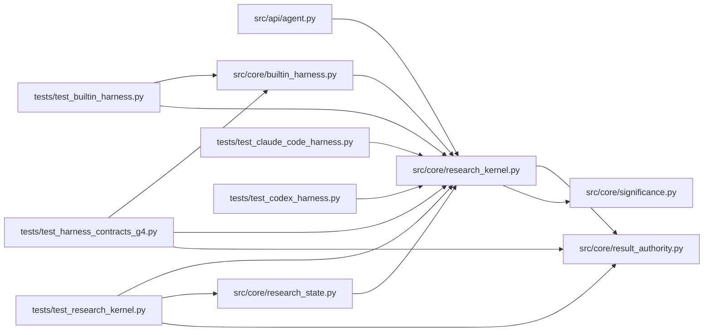

# research_kernel Module

**Path:** `src/core/research_kernel.py`

## Description

The research kernel: lifecycle decisions without harness types.

The kernel owns the research lifecycle decisions — attempt scheduling,
objective/phase adjudication, budgets, verified evidence, and promotion
eligibility — behind stable value contracts, so different agent harnesses
and research domains can share one loop.

Boundary: provider conversation, tool serialization, context compaction,
and model retry behavior live in the built-in driver (``orchestrator`` /
``llm_provider``), never here. This module and its transitive imports must
not depend on provider SDKs or message-block types; ``tests/test_kernel_
boundary.py`` enforces the import boundary.

## Imports

| Source | Symbols |
|--------|---------|
| `__future__` | `annotations` |
| `dataclasses` | `dataclass`, `field` |
| `src.core.result_authority` | `verify_result_receipt` |
| `src.core.significance` | `qualification_status` |
| `time` | `_time` |
| `typing` | `Any`, `Mapping`, `Optional`, `Protocol`, `Sequence` |

## Local dependency map

<!-- Auto-generated local dependency summary. Do not edit by hand. -->

### Internal neighbors

| Direction | Module |
|---|---|
| Inbound | [agent](../modules/agent.md) |
| Inbound | [builtin_harness](../modules/builtin_harness.md) |
| Inbound | [research_state](../modules/research_state.md) |
| Inbound | [test_builtin_harness](../modules/test_builtin_harness.md) |
| Inbound | [test_claude_code_harness](../modules/test_claude_code_harness.md) |
| Inbound | [test_codex_harness](../modules/test_codex_harness.md) |
| Inbound | [test_harness_contracts_g4](../modules/test_harness_contracts_g4.md) |
| Inbound | [test_research_kernel](../modules/test_research_kernel.md) |
| Outbound | [result_authority](../modules/result_authority.md) |
| Outbound | [significance](../modules/significance.md) |

## Classes

| Class | Line | Bases | Description |
|-------|------|-------|-------------|
| [AttemptPlan](../entities/AttemptPlan.md) | 28 | — | The kernel's scheduling decision for the next attempt slot. |
| [ObjectiveDecision](../entities/ObjectiveDecision.md) | 38 | — | The adjudicated verdict and phase decision for one attempt. |
| [BudgetDecision](../entities/BudgetDecision.md) | 49 | — | Which declared budgets bound the run, and whether one is exhausted. |
| [EvidenceDecision](../entities/EvidenceDecision.md) | 58 | — | The verification state of one evaluator result. |
| [PromotionDecision](../entities/PromotionDecision.md) | 66 | — | Promotion eligibility for the run's best candidate. |
| [AttemptResult](../entities/AttemptResult.md) | 76 | — | What a driver reports back for one attempt — stable and harness-free. |
| [ResearchOutcome](../entities/ResearchOutcome.md) | 91 | — | The completed lifecycle: attempts run and the final decisions. |
| [KernelDriver](../entities/KernelDriver.md) | 320 | `Protocol` | What a harness must provide to run a research lifecycle. |

## Functions

| Function | Signature | Decorators | Description |
|----------|-----------|------------|-------------|
| `plan_attempt` | `(*, attempt_index: int, outcome: str, max_attempts: Optional[int] = None, retry_state: Optional[str] = None, next_attempt_after: Optional[float] = None, now: Optional[float] = None) -> AttemptPlan` | — | Attempt scheduling: what the next attempt slot should do. |
| `decide_objective` | `(*, verdict: str, metric: Optional[float] = None, best_metric: Optional[float] = None, direction: str = 'maximize', phase_id: Optional[str] = None, phase_advanced: Optional[bool] = None, stop_requested: bool = False) -> ObjectiveDecision` | — | Objective/phase adjudication for one attempt. |
| `improves_on_best` | `(metric: Optional[float], best_metric: Optional[float], direction: str = 'maximize') -> bool` | — | Direction-correct winner selection (minimize objectives invert). |
| `decide_budget` | `(*, session: Mapping[str, Any], iterations: Sequence[Mapping[str, Any]], cost_usd: Optional[float] = None, elapsed_s: Optional[float] = None) -> BudgetDecision` | — | Budget adjudication over the declared caps. |
| `verify_evidence` | `(*, receipt: Mapping[str, Any], payload: Mapping[str, Any], key: Optional[str], attempt_id: Optional[str] = None) -> EvidenceDecision` | — | Verified evidence: a result's authority is proven, never asserted. |
| `decide_promotion` | `(*, candidate: Sequence[float], reference: Optional[Sequence[float]] = None, config: Any = None, verdict: Optional[str] = None, holdout_evidence: Optional[bool] = None, promotion_blocked: bool = False, best_iteration: Optional[int] = None) -> PromotionDecision` | — | Promotion eligibility: qualification first, then blockers. |
| `_first_number` | `(value: Any) -> Optional[float]` | — | — |
| `run_kernel_lifecycle` | `(driver: KernelDriver, *, session: Mapping[str, Any], max_attempts: int = 8, candidate_samples: Optional[Sequence[float]] = None, reference_samples: Optional[Sequence[float]] = None, promotion_config: Any = None, context: Optional[Mapping[str, Any]] = None) -> ResearchOutcome` | — | Complete one research lifecycle through the kernel's decisions. |
