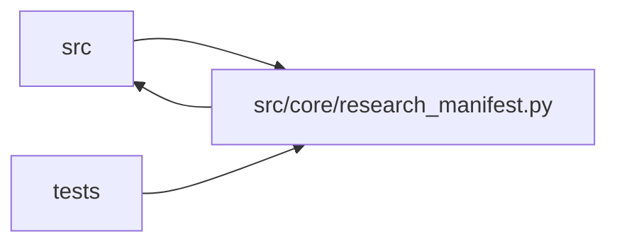

# research_manifest Module

**Path:** `src/core/research_manifest.py`

## Description

Immutable research-session manifests for autoresearch runs.

## Imports

| Source | Symbols |
|--------|---------|
| `__future__` | `annotations` |
| `datetime` | `datetime`, `timezone` |
| `hashlib` | `hashlib` |
| `json` | `json` |
| `pathlib` | `Path` |
| `pydantic` | `BaseModel`, `ConfigDict`, `Field`, `field_validator`, `model_validator` |
| `src.config` | `settings`, `settings` |
| `src.core.legacy_alias` | `is_known_model_type`, `model_type_to_skill_id`, `skill_id_to_model_type` |
| `src.core.llm_provider` | `resolve_effective_provider`, `resolve_model_roles` |
| `src.core.run_spec` | `build_run_spec`, `skill_package_dir`, `provenance_report` |
| `src.core.service_preflight` | `build_not_run_preflight`, `sanitize_service_url` |
| `src.core.skill_paths` | `session_workspace_path` |
| `src.core.skill_registry` | `default_registry` |
| `typing` | `Any`, `Dict`, `Mapping`, `Optional`, `Tuple` |

## Local dependency map

<!-- Auto-generated local dependency summary. Do not edit by hand. -->

> Module-level dependencies exceed the generated-diagram limits, so the diagram and table below group them by top-level package. Counts report the number of module neighbors in each package.

### Internal neighbors

| Direction | Module |
|---|---|
| Inbound | `src` (2) |
| Inbound | `tests` (8) |
| Outbound | `src` (7) |

### External packages

| Language | Used packages | Undeclared packages |
|---|---:|---:|
| python | 1 | 0 |

> All 16 module neighbor(s) are summarized by package because the module-level view exceeds the 12-node limit.

## Classes

| Class | Line | Bases | Description |
|-------|------|-------|-------------|
| [ResearchSessionManifest](../entities/ResearchSessionManifest.md) | 74 | `BaseModel` | Complete immutable manifest for one autonomous research session. |

## Functions

| Function | Signature | Decorators | Description |
|----------|-----------|------------|-------------|
| `_schema_dict` | `(schema: Any) -> Optional[Dict[str, Any]]` | — | — |
| `_skill_package_dir` | `(skill_id: str) -> Optional[str]` | — | — |
| `_canonical_digest` | `(value: Any) -> Optional[str]` | — | — |
| `build_research_manifest` | `(*, research_id: str, instrument: str, timeframe: str, model_type: str = '', tag: str, quick_mode: bool, max_iterations: int, max_budget_usd: float, timeout_s: int, focus_hint: Optional[str], overrides: Optional[Dict[str, Any]] = None, skill_id: Optional[str] = None, skill_params: Optional[Dict[str, Any]] = None, parent_snapshot: Optional[Dict[str, Any]] = None, pinned_run_spec_sections: Optional[Mapping[str, Any]] = None) -> ResearchSessionManifest` | — | Build and validate a complete manifest from request/server state. |
| `_resolve_identity` | `(*, model_type: str, skill_id: Optional[str]) -> tuple[str, str]` | — | Resolve (legacy ``model_type``, canonical ``skill_id``). |
| `_lookup_skill_manifest` | `(skill_id: Optional[str]) -> Any` | — | Resolve a skill id against the registry; ``None`` when unresolvable. |
| `_ml_manifest_defaults` | `(*, research_id: str, instrument: str, timeframe: str, model_type: str, skill_id: str, tag: str, quick_mode: bool, max_iterations: int, max_budget_usd: float, timeout_s: int, focus_hint: Optional[str]) -> Dict[str, Any]` | — | The incumbent legacy-ML section set — byte-identical to the v2 builder |
| `_spend_enforcement` | `(max_iterations: int, timeout_s: int) -> Dict[str, Any]` | — | How the run's spend is bounded — labeled with its limits. |
| `_model_identity` | `(skill_manifest: Any) -> Dict[str, Any]` | — | Requested versus effective provider/model identity — reported, never |
| `_skill_manifest_defaults` | `(*, research_id: str, instrument: str, timeframe: str, skill_id: str, tag: str, quick_mode: bool, max_iterations: int, max_budget_usd: float, timeout_s: int, focus_hint: Optional[str], skill_manifest: Any, skill_params: Optional[Dict[str, Any]] = None, parent_snapshot: Optional[Dict[str, Any]] = None, pinned_run_spec_sections: Optional[Mapping[str, Any]] = None) -> Dict[str, Any]` | — | Skill-driven sections (ARC-012 P7-003): everything is sourced from the |
| `manifest_pretty_json` | `(manifest: ResearchSessionManifest) -> str` | — | — |
| `_default_objective` | `(model_type: str) -> str` | — | — |
| `_default_model_family` | `(model_type: str) -> str` | — | — |
| `_deep_merge` | `(base: Dict[str, Any], overrides: Dict[str, Any]) -> Dict[str, Any]` | — | — |
| `load_persisted_manifest` | `(text: str) -> Tuple[Optional['ResearchSessionManifest'], Dict[str, Any]]` | — | Read a persisted artifact with its provenance report — never invent. |
