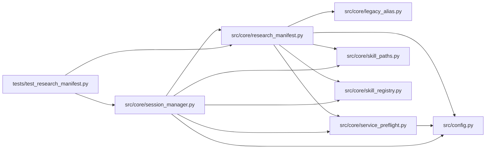

# research_manifest Module

**Path:** `src/core/research_manifest.py`

## Description

Immutable research-session manifests for autoresearch runs.

## Imports

| Source | Symbols |
|--------|---------|
| `__future__` | `annotations` |
| `datetime` | `datetime`, `timezone` |
| `hashlib` | `hashlib` |
| `json` | `json` |
| `pydantic` | `BaseModel`, `ConfigDict`, `Field`, `field_validator`, `model_validator` |
| `src.config` | `settings` |
| `src.core.legacy_alias` | `is_known_model_type`, `model_type_to_skill_id`, `skill_id_to_model_type` |
| `src.core.service_preflight` | `build_not_run_preflight`, `sanitize_service_url` |
| `src.core.skill_paths` | `session_workspace_path` |
| `src.core.skill_registry` | `default_registry` |
| `typing` | `Any`, `Dict`, `Optional` |

## Local dependency map

<!-- Auto-generated local dependency summary. Do not edit by hand. -->

### Internal neighbors

| Direction | Module |
|---|---|
| Inbound | [session_manager](../modules/session_manager.md) |
| Inbound | [test_research_manifest](../modules/test_research_manifest.md) |
| Outbound | [config](../modules/config.md) |
| Outbound | [core_legacy_alias](../modules/core_legacy_alias.md) |
| Outbound | [service_preflight](../modules/service_preflight.md) |
| Outbound | [skill_paths](../modules/skill_paths.md) |
| Outbound | [skill_registry](../modules/skill_registry.md) |

### External packages

| Language | Used packages | Undeclared packages |
|---|---:|---:|
| python | 1 | 0 |

## Classes

| Class | Line | Bases | Description |
|-------|------|-------|-------------|
| [ResearchSessionManifest](../entities/ResearchSessionManifest.md) | 73 | `BaseModel` | Complete immutable manifest for one autonomous research session. |

## Functions

| Function | Signature | Decorators | Description |
|----------|-----------|------------|-------------|
| `build_research_manifest` | `(*, research_id: str, instrument: str, timeframe: str, model_type: str = '', tag: str, quick_mode: bool, max_iterations: int, max_budget_usd: float, timeout_s: int, focus_hint: Optional[str], overrides: Optional[Dict[str, Any]] = None, skill_id: Optional[str] = None) -> ResearchSessionManifest` | — | Build and validate a complete manifest from request/server state. |
| `_resolve_identity` | `(*, model_type: str, skill_id: Optional[str]) -> tuple[str, str]` | — | Resolve (legacy ``model_type``, canonical ``skill_id``). |
| `_lookup_skill_manifest` | `(skill_id: Optional[str]) -> Any` | — | Resolve a skill id against the registry; ``None`` when unresolvable. |
| `_ml_manifest_defaults` | `(*, research_id: str, instrument: str, timeframe: str, model_type: str, skill_id: str, tag: str, quick_mode: bool, max_iterations: int, max_budget_usd: float, timeout_s: int, focus_hint: Optional[str]) -> Dict[str, Any]` | — | The incumbent legacy-ML section set — byte-identical to the v2 builder |
| `_skill_manifest_defaults` | `(*, research_id: str, instrument: str, timeframe: str, skill_id: str, tag: str, quick_mode: bool, max_iterations: int, max_budget_usd: float, timeout_s: int, focus_hint: Optional[str], skill_manifest: Any) -> Dict[str, Any]` | — | Skill-driven sections (ARC-012 P7-003): everything is sourced from the |
| `manifest_pretty_json` | `(manifest: ResearchSessionManifest) -> str` | — | — |
| `_default_objective` | `(model_type: str) -> str` | — | — |
| `_default_model_family` | `(model_type: str) -> str` | — | — |
| `_deep_merge` | `(base: Dict[str, Any], overrides: Dict[str, Any]) -> Dict[str, Any]` | — | — |
