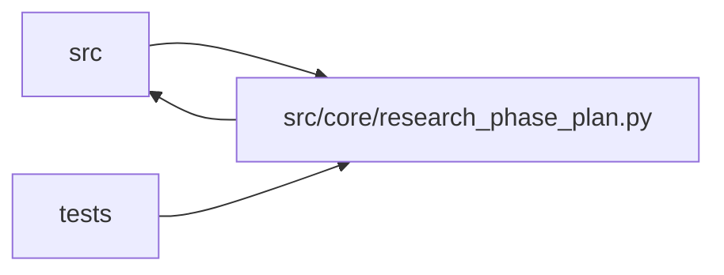

# research_phase_plan Module

**Path:** `src/core/research_phase_plan.py`

## Description

Phase-state helpers for autoresearch sessions (live machinery).

P1-2 split: the historical trading-skill phase tables (DIRECTION_PHASES /
VOLATILITY_PHASES / FALLBACK_PHASES), the legacy ``model_type`` lookup
(``phases_for_model``), the historical RL OOS evidence keys, and the DM-14
primary-sweep knob table moved to ``src/compat/legacy_phase_tables.py`` —
kept only so pre-migration DB rows still render. They are re-exported here
for every existing importer. New skills declare their own ``phase_plan`` in
the manifest; nothing in this module may grow new historical vocabulary.

## Imports

| Source | Symbols |
|--------|---------|
| `__future__` | `annotations` |
| `datetime` | `datetime`, `timezone` |
| `json` | `json` |
| `src.compat.legacy_phase_tables` | `_PHASE_PRIMARY_SWEEP_KEYS`, `DIRECTION_PHASES`, `FALLBACK_PHASES`, `RL_OOS_EVIDENCE_KEYS`, `VOLATILITY_PHASES`, `phases_for_model` |
| `src.core.artifact_reference` | `normalize_optional_artifact_ref` |
| `src.core.consistency_validator` | `ACCEPTED_ADAPTIVE_NOOP_REASONS`, `EVIDENCE_ARTIFACT_PHASES`, `_is_synthetic_promotion_iteration`, `check_adaptive_feature_sweep`, `check_evidence_artifact` |
| `src.core.objective_comparator` | `ObjectiveComparator`, `objective_comparator_for_skill_id` |
| `src.core.skill_registry` | `default_registry` |
| `typing` | `Any`, `Dict`, `Iterable`, `List`, `Mapping`, `Optional`, `Sequence` |

## Local dependency map

<!-- Auto-generated local dependency summary. Do not edit by hand. -->

> Module-level dependencies exceed the generated-diagram limits, so the diagram and table below group them by top-level package. Counts report the number of module neighbors in each package.

### Internal neighbors

| Direction | Module |
|---|---|
| Inbound | `src` (3) |
| Inbound | `tests` (17) |
| Outbound | `src` (5) |

> All 25 module neighbor(s) are summarized by package because the module-level view exceeds the 12-node limit.

## Functions

| Function | Signature | Decorators | Description |
|----------|-----------|------------|-------------|
| `build_phase_state` | `(*, session: Dict[str, Any], iterations: Iterable[Dict[str, Any]], hpo_studies: Optional[Iterable[Dict[str, Any]]] = None, promotions: Optional[Iterable[Dict[str, Any]]] = None, iterations_remaining: Optional[int] = None, phases: Optional[List[Dict[str, Any]]] = None) -> Dict[str, Any]` | — | Derive an operator-facing phase plan and next action. |
| `phase_state_json` | `(state: Dict[str, Any]) -> str` | — | — |
| `incomplete_phase_ids` | `(state: Dict[str, Any]) -> List[str]` | — | Return phase ids whose status is not 'completed' in a built state. |
| `phase_cap_exceeded` | `(state: Dict[str, Any], iterations_in_phase: int) -> bool` | — | True when the active phase's `max_iterations` cap has been reached. |
| `_declared_phases_for_session` | `(session: Mapping[str, Any]) -> Optional[List[Mapping[str, Any]]]` | — | The skill manifest's declared phase rules for this session, or None. |
| `_completed_phase_ids` | `(iterations: List[Dict[str, Any]], hpo_studies: List[Dict[str, Any]], promotions: List[Dict[str, Any]], model_type: Optional[str], comparator: Optional['ObjectiveComparator'] = None, phases: Optional[Sequence[Mapping[str, Any]]] = None) -> set[str]` | — | Mark phases complete using a hybrid contract: |
| `_is_rejected_duplicate` | `(iteration: Dict[str, Any]) -> bool` | — | True when the iteration row was rejected by canonical-config dedup |
| `_is_failed_iteration` | `(iteration: Dict[str, Any]) -> bool` | — | True when the iteration's training run failed (no valid result). |
| `_hpo_study_completed` | `(hpo_studies: List[Dict[str, Any]]) -> bool` | — | True when the ``hpo_screening`` phase has nothing left to screen. |
| `_iterations_in_phase` | `(iterations: List[Dict[str, Any]], phase_id: str) -> List[Dict[str, Any]]` | — | Return iterations whose ``search_phase`` column matches ``phase_id``. |
| `_phase_has_genuine_dwell` | `(iterations: List[Dict[str, Any]], phase_id: str, *, min_iterations: int) -> bool` | — | Return True when the agent dwelt in ``phase_id`` for ``min_iterations``. |
| `_min_iter` | `(phase_id: str, model_type: Optional[str]) -> int` | — | Look up a phase's ``min_iterations`` floor from the model's phase list. |
| `_adaptive_phase_completed` | `(iterations: List[Dict[str, Any]]) -> bool` | — | — |
| `_latest_feature_schema_baseline` | `(iterations: List[Dict[str, Any]]) -> Dict[str, Any]` | — | — |
| `_feature_schema_changed` | `(evidence: Dict[str, Any], baseline: Dict[str, Any]) -> bool` | — | — |
| `_feature_schema_evidence` | `(metrics: Dict[str, Any]) -> Dict[str, Any]` | — | — |
| `_adaptive_enabled` | `(metrics: Dict[str, Any]) -> bool` | — | — |
| `_has_promotion_evidence` | `(iterations: List[Dict[str, Any]], promotions: List[Dict[str, Any]], *, prior_best: Optional[Dict[str, Any]] = None) -> bool` | — | — |
| `_select_current_phase` | `(phases: List[Dict[str, Any]], completed: set[str], blocked: Optional[str]) -> str` | — | — |
| `_phase_status` | `(phase_id: str, current_phase: str, completed: set[str], blocked: Optional[str], phases: List[Dict[str, Any]]) -> str` | — | — |
| `_phase_headroom_hint` | `(phase_id: str, iterations: List[Dict[str, Any]]) -> str` | — | DM-14: estimate the agent's expected lift from another iteration in |
| `_next_action` | `(phases: List[Dict[str, Any]], current_phase: str, blocked: Optional[str], *, all_phases_complete: bool = False, headroom_hint: Optional[str] = None, iterations_remaining: Optional[int] = None, max_iterations: int = 0) -> str` | — | — |
| `_count_stalled_iterations` | `(rows: List[Dict[str, Any]], phases: List[Dict[str, Any]], current_phase: str) -> int` | — | Return how many consecutive trailing iterations produced no later-phase evidence. |
| `_blocked_reason` | `(iterations: List[Dict[str, Any]]) -> Optional[str]` | — | — |
| `_has_metric` | `(iteration: Dict[str, Any], *keys: str) -> bool` | — | — |
| `_metric_values` | `(iteration: Dict[str, Any], *keys: str) -> List[Any]` | — | — |
| `_evidence_passed` | `(value: Any) -> bool` | — | — |
| `_has_tsfm_adapter_evidence` | `(iteration: Dict[str, Any]) -> bool` | — | — |
| `_has_tsfm_fallback_evidence` | `(iteration: Dict[str, Any]) -> bool` | — | — |
| `_dict_at` | `(root: Dict[str, Any], key: str) -> Dict[str, Any]` | — | — |
| `_first_non_none` | `(*values: Any) -> Any` | — | — |
| `_int_or_none` | `(value: Any) -> Optional[int]` | — | — |
| `_int_value` | `(value: Any, *, default: int = 0) -> int` | — | — |
| `_truthy` | `(value: Any) -> bool` | — | — |
| `_parse_json` | `(raw: Any) -> Any` | — | — |
| `_metrics_of` | `(it: Mapping[str, Any]) -> Dict[str, Any]` | — | Return the parsed metrics_json dict for an iteration row, or {}. |
| `_prior_run_ids_for_phase` | `(iterations: List[Dict[str, Any]], phase_id: str) -> frozenset` | — | Collect mlflow_run_ids from iterations that do NOT carry phase evidence. |
| `_prior_best_metrics` | `(iterations: Sequence[Mapping[str, Any]], *, comparator: Optional['ObjectiveComparator'] = None) -> Dict[str, Any]` | — | Return metrics of the best non-promotion-family iteration. |
