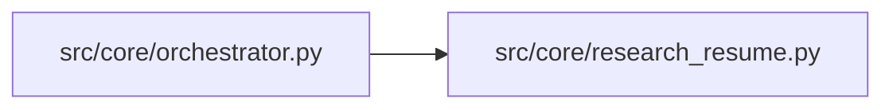

# research_resume Module

**Path:** `src/core/research_resume.py`

## Description

Cross-session research resume: the summary domain bridge.

The orchestrator is domain-agnostic by policy (no legacy model/instrument/
timeframe access); the mapping from a session config onto the legacy-keyed
cross-session summary query lives here, explicitly.

## Imports

| Source | Symbols |
|--------|---------|
| `__future__` | `annotations` |
| `typing` | `Any`, `List`, `Optional` |

## Local dependency map

<!-- Auto-generated local dependency summary. Do not edit by hand. -->

### Internal neighbors

| Direction | Module |
|---|---|
| Inbound | [orchestrator](../modules/orchestrator.md) |

## Functions

| Function | Signature | Decorators | Description |
|----------|-----------|------------|-------------|
| `cross_session_summary` | *(async)* `(store: Any, config: Any, *, exclude_research_id: Optional[str] = None, limit: int = 20) -> List[Any]` | — | The recorded cross-session iteration summary for this session. |
