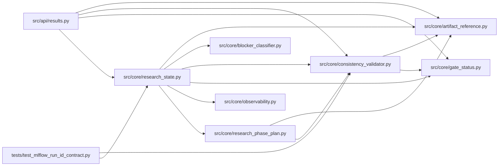

# research_state Module

**Path:** `src/core/research_state.py`

## Description

Operator-facing autoresearch state summaries.

## Imports

| Source | Symbols |
|--------|---------|
| `__future__` | `annotations` |
| `json` | `json` |
| `src.core.artifact_reference` | `first_valid_artifact_ref` |
| `src.core.blocker_classifier` | `blocker_details` |
| `src.core.consistency_validator` | `parse_consistency_report` |
| `src.core.gate_status` | `training_gates_passed_from`, `training_gates_passed_from_iteration` |
| `src.core.observability` | `alert_suggestions` |
| `src.core.research_phase_plan` | `build_phase_state` |
| `typing` | `Any`, `Dict`, `Iterable`, `List`, `Optional` |

## Local dependency map

<!-- Auto-generated local dependency summary. Do not edit by hand. -->

### Internal neighbors

| Direction | Module |
|---|---|
| Inbound | [results](../modules/results.md) |
| Inbound | [test_mlflow_run_id_contract](../modules/test_mlflow_run_id_contract.md) |
| Outbound | [artifact_reference](../modules/artifact_reference.md) |
| Outbound | [blocker_classifier](../modules/blocker_classifier.md) |
| Outbound | [consistency_validator](../modules/consistency_validator.md) |
| Outbound | [gate_status](../modules/gate_status.md) |
| Outbound | [observability](../modules/observability.md) |
| Outbound | [research_phase_plan](../modules/research_phase_plan.md) |

## Functions

| Function | Signature | Decorators | Description |
|----------|-----------|------------|-------------|
| `build_research_state` | `(*, session: Dict[str, Any], iterations: Iterable[Dict[str, Any]], hpo_studies: Iterable[Dict[str, Any]], promotions: Iterable[Dict[str, Any]], planned_trials: Iterable[Dict[str, Any]] = (), audit_events: Iterable[Dict[str, Any]] = ()) -> Dict[str, Any]` | — | Build a reconstructable state payload without reading workspace files. |
| `_session_phase_state` | `(session: Dict[str, Any]) -> Optional[Dict[str, Any]]` | — | — |
| `_top_candidates` | `(iterations: List[Dict[str, Any]]) -> List[Dict[str, Any]]` | — | — |
| `_failed_or_pruned` | `(iterations: List[Dict[str, Any]]) -> List[Dict[str, Any]]` | — | — |
| `_candidate_summary` | `(row: Dict[str, Any]) -> Dict[str, Any]` | — | — |
| `_duplicate_rejections` | `(iterations: List[Dict[str, Any]]) -> List[Dict[str, Any]]` | — | — |
| `_is_duplicate_rejection` | `(row: Dict[str, Any]) -> bool` | — | — |
| `_gate_failure_reasons` | `(iterations: List[Dict[str, Any]]) -> List[Dict[str, Any]]` | — | — |
| `_artifact_hashes` | `(iterations: List[Dict[str, Any]]) -> List[Dict[str, Any]]` | — | — |
| `_rl_profit_score` | `(metrics: Dict[str, Any]) -> Optional[float]` | — | — |
| `_rl_economic_replay_summary` | `(metrics: Dict[str, Any], snapshot: Dict[str, Any]) -> Optional[Dict[str, Any]]` | — | — |
| `_feature_readiness_metrics` | `(metrics: Dict[str, Any]) -> Dict[str, Any]` | — | — |
| `_rl_economic_replay` | `(metrics: Dict[str, Any]) -> Dict[str, Any]` | — | — |
| `_mlflow_links` | `(iterations: List[Dict[str, Any]]) -> List[Dict[str, Any]]` | — | — |
| `_latest_promotion` | `(session: Dict[str, Any], promotions: List[Dict[str, Any]]) -> Optional[Dict[str, Any]]` | — | — |
| `_rollback_target` | `(promotion: Optional[Dict[str, Any]]) -> Any` | — | — |
| `_metadata_field` | `(promotion: Optional[Dict[str, Any]], key: str) -> Any` | — | — |
| `_paper_status` | `(promotion: Optional[Dict[str, Any]]) -> Any` | — | — |
| `_decode_hpo_study` | `(row: Dict[str, Any]) -> Dict[str, Any]` | — | — |
| `_decode_planned_trial` | `(row: Dict[str, Any]) -> Dict[str, Any]` | — | — |
| `_search_plan_summary` | `(hpo_studies: List[Dict[str, Any]], planned_trials: List[Dict[str, Any]]) -> Dict[str, Any]` | — | — |
| `_research_outcome` | `(*, session: Dict[str, Any], iterations: List[Dict[str, Any]], phase_state: Dict[str, Any], production_operations: Dict[str, Any]) -> Optional[str]` | — | — |
| `_terminal_reason` | `(*, session: Dict[str, Any], iterations: List[Dict[str, Any]], research_outcome: Optional[str]) -> Optional[str]` | — | — |
| `_iteration_budget_reached` | `(session: Dict[str, Any], iterations: List[Dict[str, Any]]) -> bool` | — | — |
| `_has_unfinished_phase` | `(phase_state: Dict[str, Any]) -> bool` | — | — |
| `_promotion_is_blocked` | `(production_operations: Dict[str, Any]) -> bool` | — | — |
| `_production_operations_summary` | `(*, session: Dict[str, Any], iterations: List[Dict[str, Any]], promotions: List[Dict[str, Any]], latest_promotion: Optional[Dict[str, Any]], audit_events: List[Dict[str, Any]], phase_state: Dict[str, Any]) -> Dict[str, Any]` | — | — |
| `_best_candidate_row` | `(iterations: List[Dict[str, Any]]) -> Optional[Dict[str, Any]]` | — | — |
| `_operations_candidate` | `(row: Optional[Dict[str, Any]], metrics: Dict[str, Any], snapshot: Dict[str, Any]) -> Optional[Dict[str, Any]]` | — | — |
| `_promotion_blockers` | `(session: Dict[str, Any], latest_promotion: Optional[Dict[str, Any]]) -> List[str]` | — | — |
| `_promotion_scope_status` | `(*, session: Dict[str, Any], promotions: List[Dict[str, Any]], best_row: Optional[Dict[str, Any]], promotion_blockers: List[str], metrics: Dict[str, Any], phase_state: Dict[str, Any]) -> List[Dict[str, Any]]` | — | — |
| `_matching_promotions` | `(session: Dict[str, Any], promotions: List[Dict[str, Any]]) -> List[Dict[str, Any]]` | — | — |
| `_required_prior_scopes` | `(scope: str) -> List[str]` | — | — |
| `_compact_promotion` | `(promotion: Optional[Dict[str, Any]]) -> Optional[Dict[str, Any]]` | — | — |
| `_rl_replay_status` | `(metrics: Dict[str, Any], snapshot: Dict[str, Any]) -> Dict[str, Any]` | — | — |
| `_supervised_feature_readiness_status` | `(*, session: Dict[str, Any], metrics: Dict[str, Any]) -> Dict[str, Any]` | — | — |
| `_feature_channel_status` | `(channel: str, evidence: Dict[str, Any], metrics: Dict[str, Any], model_type: Any) -> Dict[str, Any]` | — | — |
| `_rl_oos_provenance_status` | `(*, model_type: Any, metrics: Dict[str, Any]) -> Dict[str, Any]` | — | — |
| `_rl_channel_provenance` | `(metrics: Dict[str, Any], rl_oos: Dict[str, Any], channel: str) -> Dict[str, Any]` | — | — |
| `_rl_feature_bundle_hash` | `(metrics: Dict[str, Any], rl_oos: Dict[str, Any]) -> Any` | — | — |
| `_compact_provenance` | `(provenance: Dict[str, Any]) -> Dict[str, Any]` | — | — |
| `_inference_parity_status` | `(metrics: Dict[str, Any], latest_promotion: Optional[Dict[str, Any]]) -> Dict[str, Any]` | — | — |
| `_rollback_status` | `(*, latest_promotion: Optional[Dict[str, Any]], metrics: Dict[str, Any]) -> Dict[str, Any]` | — | — |
| `_operations_warnings` | `(*, session: Dict[str, Any], promotion_blockers: List[str], scope_status: List[Dict[str, Any]], rl_replay: Dict[str, Any], feature_readiness: Dict[str, Any], rl_oos: Dict[str, Any], inference: Dict[str, Any], rollback: Dict[str, Any], metrics: Dict[str, Any], phase_state: Dict[str, Any]) -> List[Dict[str, Any]]` | — | — |
| `_redact_actor_id` | `(actor_id: Any) -> Any` | — | Truncate token_sha256 fingerprints so full digests never leave the service. |
| `_compact_audit_events` | `(events: List[Dict[str, Any]]) -> List[Dict[str, Any]]` | — | — |
| `_blocker_details` | `(blockers: List[str], *, checks: Optional[Iterable[Dict[str, Any]]] = None, metrics_payload: Optional[Dict[str, Any]] = None, phase_state: Optional[Dict[str, Any]] = None, source: str = 'research_state') -> List[Dict[str, Any]]` | — | — |
| `_humanize_code` | `(value: str) -> str` | — | — |
| `_unique_strings` | `(values: Iterable[str]) -> List[str]` | — | — |
| `_first_mapping` | `(*values: Any) -> Dict[str, Any]` | — | — |
| `_truthy_status` | `(container: Dict[str, Any]) -> bool` | — | — |
| `_truthy` | `(*values: Any) -> bool` | — | — |
| `_latest_known_artifacts` | `(iterations: List[Dict[str, Any]]) -> Dict[str, Any]` | — | AR-8: Walk iterations DESC to find last-known non-null promotion artifact values. |
| `_parse_json` | `(raw: Any) -> Any` | — | — |
| `_first_number` | `(*values: Any) -> Optional[float]` | — | — |
| `_trial_identity` | `(row: Dict[str, Any], metrics: Dict[str, Any], snapshot: Dict[str, Any]) -> Optional[Dict[str, Any]]` | — | — |
| `_duplicate_of` | `(row: Dict[str, Any], metrics: Dict[str, Any]) -> Optional[Dict[str, Any]]` | — | — |
