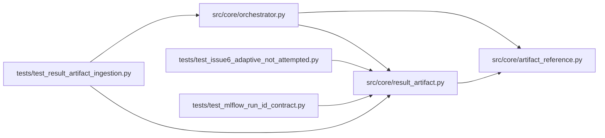

# result_artifact Module

**Path:** `src/core/result_artifact.py`

## Description

Result artifact preservation for autoresearch iterations.

## Imports

| Source | Symbols |
|--------|---------|
| `__future__` | `annotations` |
| `copy` | `deepcopy` |
| `hashlib` | `hashlib` |
| `json` | `json` |
| `os` | `os` |
| `pathlib` | `Path` |
| `shutil` | `shutil` |
| `src.core.artifact_reference` | `ARTIFACT_REFERENCE_KEYS`, `normalize_artifact_references_in_mapping`, `normalize_optional_artifact_ref` |
| `typing` | `Any`, `Mapping`, `MutableMapping`, `Optional` |

## Local dependency map

<!-- Auto-generated local dependency summary. Do not edit by hand. -->

### Internal neighbors

| Direction | Module |
|---|---|
| Inbound | [orchestrator](../modules/orchestrator.md) |
| Inbound | [test_issue6_adaptive_not_attempted](../modules/test_issue6_adaptive_not_attempted.md) |
| Inbound | [test_mlflow_run_id_contract](../modules/test_mlflow_run_id_contract.md) |
| Inbound | [test_result_artifact_ingestion](../modules/test_result_artifact_ingestion.md) |
| Outbound | [artifact_reference](../modules/artifact_reference.md) |

## Functions

| Function | Signature | Decorators | Description |
|----------|-----------|------------|-------------|
| `enrich_marker_from_result_artifact` | `(*, marker: MutableMapping[str, Any], workspace: str, iteration: int, logger: Any = None) -> Optional[dict[str, Any]]` | — | Copy and merge a result artifact referenced by a marker. |
| `merge_result_payload` | `(marker: MutableMapping[str, Any], payload: Mapping[str, Any]) -> None` | — | Merge promotion-relevant rich result evidence into a marker. |
| `_resolve_source_path` | `(raw_path: Any, workspace_path: Path) -> Optional[Path]` | — | — |
| `_is_allowed_source` | `(source: Path, workspace_path: Path) -> bool` | — | — |
| `_should_consume_source` | `(marker: Mapping[str, Any], source: Path, workspace_path: Path) -> bool` | — | — |
| `_add_flat_aliases` | `(marker: MutableMapping[str, Any], payload: Mapping[str, Any]) -> None` | — | — |
| `_deep_merge_result_wins` | `(marker_value: Mapping[str, Any], result_value: Mapping[str, Any]) -> dict[str, Any]` | — | — |
| `_dict_at` | `(root: Mapping[str, Any], key: str) -> dict[str, Any]` | — | — |
| `_first_present` | `(*values: Any) -> Any` | — | — |
| `_sha256_file` | `(path: Path) -> str` | — | — |
| `_log_debug` | `(logger: Any, message: str, *args: Any) -> None` | — | — |
