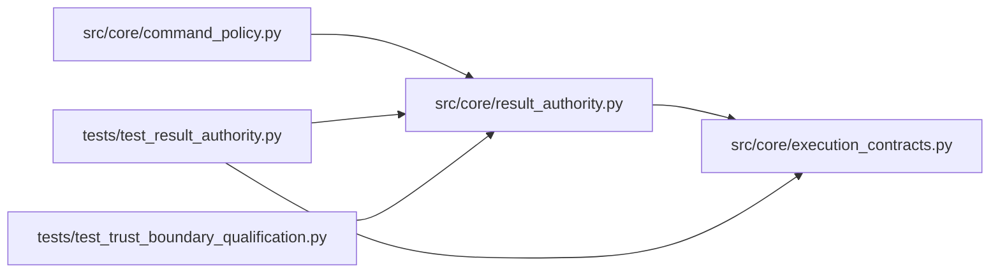

# result_authority Module

**Path:** `src/core/result_authority.py`

## Description

Authoritative evaluator results: receipts, verification, and honest labels.

Model-visible nonces never establish authority: the W11 echo check only
shows that a payload passed through a context that had seen the nonce.
This module binds result content to the server-created attempt and the
exact candidate/evaluator/dataset identities, and issues a receipt over
that binding so any change to metric, gate, candidate, or attempt identity
invalidates it. The receipt mirrors the kernel ``ResultReceipt`` contract
(``execution_contracts``) field-for-field so it can lift across a trust
boundary later; for local execution the trusted evaluator-to-server channel
is the authority and the receipt provides tamper evidence, replay
protection, and idempotent delivery.

Authority labels recorded on every ingested result (honest, never upgraded
retroactively):

* ``receipt_verified`` — delivered through the trusted evaluator channel
  and bound by an issued receipt.
* ``model_proposed`` — authored in model output; annotations/proposals
  only, regardless of any echoed nonce.
* ``unverified_imported`` — third-party or non-evaluator content.
* ``nonce_only`` — legacy echo-verification provenance with no receipt.

## Imports

| Source | Symbols |
|--------|---------|
| `__future__` | `annotations` |
| `hashlib` | `hashlib` |
| `hmac` | `hmac` |
| `json` | `json` |
| `secrets` | `secrets` |
| `src.core.execution_contracts` | `canonical_digest` |
| `typing` | `Any`, `Mapping`, `Optional`, `Sequence` |

## Local dependency map

<!-- Auto-generated local dependency summary. Do not edit by hand. -->

### Internal neighbors

| Direction | Module |
|---|---|
| Inbound | [command_policy](../modules/command_policy.md) |
| Inbound | [test_result_authority](../modules/test_result_authority.md) |
| Inbound | [test_trust_boundary_qualification](../modules/test_trust_boundary_qualification.md) |
| Outbound | [execution_contracts](../modules/execution_contracts.md) |

## Functions

| Function | Signature | Decorators | Description |
|----------|-----------|------------|-------------|
| `result_payload` | `(marker: Mapping[str, Any]) -> dict[str, Any]` | — | The canonical verified-content subset of a result marker. |
| `protected_result_names` | `(extension: Mapping[str, Any]) -> tuple[str, ...]` | — | Names candidate file tools must never write. |
| `_canonical` | `(value: Any) -> bytes` | — | — |
| `_receipt_material` | `(receipt: Mapping[str, Any]) -> bytes` | — | — |
| `_receipt_id` | `(material: bytes, key: Optional[str]) -> str` | — | — |
| `issue_result_receipt` | `(*, payload: Mapping[str, Any], attempt_id: str, candidate_digest: str, evaluator_digest: str, dataset_digests: Sequence[str], ownership_epoch: int, sequence: int, key: Optional[str] = None) -> dict[str, Any]` | — | Issue the receipt binding one result to one attempt. |
| `verify_result_receipt` | `(receipt: Mapping[str, Any], *, payload: Mapping[str, Any], attempt_id: Optional[str] = None, candidate_digest: Optional[str] = None, evaluator_digest: Optional[str] = None, dataset_digests: Optional[Sequence[str]] = None, key: Optional[str] = None) -> list[str]` | — | Validate a receipt against the content and identities it claims. |
