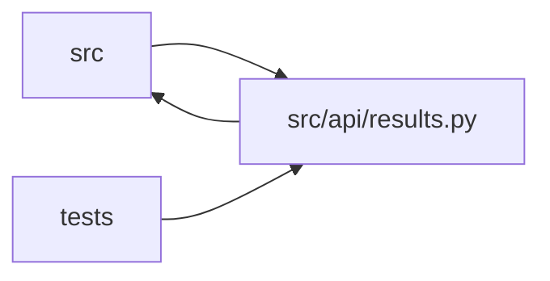

# results Module

**Path:** `src/api/results.py`

## Description

Experiment results query endpoints.

## Imports

| Source | Symbols |
|--------|---------|
| `__future__` | `annotations` |
| `fastapi` | `APIRouter`, `Depends`, `HTTPException`, `Query` |
| `fastapi.responses` | `FileResponse`, `Response` |
| `json` | `json` |
| `logging` | `logging` |
| `os` | `os` |
| `pathlib` | `Path` |
| `src.api.auth` | `require_api_auth` |
| `src.compat.ml_enrichment` | `_feature_readiness_metrics`, `_first_number`, `_rl_economic_replay`, `_rl_economic_replay_summary` |
| `src.core.artifact_reference` | `first_valid_artifact_ref` |
| `src.core.consistency_validator` | `build_consistency_report`, `parse_consistency_report` |
| `src.core.gate_status` | `training_gates_passed_from` |
| `src.core.legacy_alias` | `model_type_to_skill_id` |
| `src.core.log_writer` | `AgentLogWriter`, `_format_entry` |
| `src.core.objective_comparator` | `ObjectiveComparator`, `objective_comparator_for_skill_id` |
| `src.core.pagination` | `MAX_PAGE_SIZE`, `build_cursor_page`, `decode_cursor` |
| `src.core.research_state` | `build_research_state` |
| `typing` | `Any`, `Dict`, `List`, `Mapping`, `Optional` |

## Local dependency map

<!-- Auto-generated local dependency summary. Do not edit by hand. -->

> Module-level dependencies exceed the generated-diagram limits, so the diagram and table below group them by top-level package. Counts report the number of module neighbors in each package.

### Internal neighbors

| Direction | Module |
|---|---|
| Inbound | `src` (1) |
| Inbound | `tests` (7) |
| Outbound | `src` (10) |

### External packages

| Language | Used packages | Undeclared packages |
|---|---:|---:|
| python | 1 | 1 |

> All 18 module neighbor(s) are summarized by package because the module-level view exceeds the 12-node limit.

## Functions

| Function | Signature | Decorators | Description |
|----------|-----------|------------|-------------|
| `init` | `(store, *, mlflow_external_url: str = 'http://localhost:5000')` | — | — |
| `_iteration_cursor_extractor` | `(row: Mapping[str, Any]) -> tuple[Any, Any]` | — | Cursor extractor for iterations (sorted by iteration ASC, id ASC). |
| `_decode_pipeline_payload` | `(pipeline: Dict[str, Any]) -> Dict[str, Any]` | — | — |
| `_decode_session_payload` | `(session: Dict[str, Any]) -> Dict[str, Any]` | — | — |
| `_enrich_iteration` | `(row: Dict[str, Any], model_type: str, *, skill_id: str = '') -> Dict[str, Any]` | — | Add parsed metrics, MLflow link, and secondary metrics to an iteration dict. |
| `_enrich_iterations` | `(rows: List[Dict[str, Any]], model_type: str, skill_id: str = '') -> List[Dict[str, Any]]` | — | — |
| `_resolve_result_context` | *(async)* `(research_id: str) -> tuple[Optional[Dict[str, Any]], Optional[Dict[str, Any]], List[Dict[str, Any]]]` | — | Resolve a research or pipeline ID to the most relevant session context. |
| `_collect_log_entries` | `(sessions: List[Dict[str, Any]], *, after_line: int = 0) -> List[Dict[str, Any]]` | — | Read and flatten agent log entries across one or more sessions. |
| `_build_log_text` | `(entries: List[Dict[str, Any]]) -> str` | — | — |
| `get_results` | *(async)* `(research_id: str)` | `@router.get('/research/{research_id}/results')` | Full experiment history for a research session. |
| `get_iterations` | *(async)* `(research_id: str, limit: Optional[int] = Query(default=None, ge=1, le=MAX_PAGE_SIZE), cursor: Optional[str] = None)` | `@router.get('/research/{research_id}/iterations')` | Iterations with metrics and config snapshots. |
| `get_iteration` | *(async)* `(research_id: str, iteration_num: int)` | `@router.get('/research/{research_id}/iterations/{iteration_num}')` | Single iteration detail. |
| `get_best_iteration` | *(async)* `(research_id: str)` | `@router.get('/research/{research_id}/best')` | Best iteration (the objective comparator's winner among gates-passing runs). |
| `get_agent_log` | *(async)* `(research_id: str, after: Optional[int] = Query(default=None, description='Return only entries after this line number (0-based)'), format: Optional[str] = Query(default=None, description="Set to 'json' for raw structured entries"))` | `@router.get('/research/{research_id}/agent-log')` | Agent conversation log — full Claude transcript captured during execution. |
| `get_hpo_studies` | *(async)* `(research_id: str)` | `@router.get('/research/{research_id}/hpo-studies')` | HPO study results for a research session. |
| `get_research_state` | *(async)* `(research_id: str)` | `@router.get('/research/{research_id}/state')` | Operator-facing session state, reconstructable from DB rows only. |
| `_collect_audit_events` | *(async)* `(*, pipeline: Optional[Dict[str, Any]], session: Dict[str, Any], sessions: List[Dict[str, Any]]) -> List[Dict[str, Any]]` | — | — |
| `_resolve_workspace_file` | `(workspace: str, filename: str) -> Path` | — | Resolve a file within the workspace, guarding against path traversal. |
| `download_config` | *(async)* `(research_id: str)` | `@router.get('/research/{research_id}/download/config')` | Download the best_train.yaml config as a YAML file. |
| `download_agent_log` | *(async)* `(research_id: str)` | `@router.get('/research/{research_id}/download/agent-log')` | Download the agent_log.jsonl transcript as a file. |
| `download_results` | *(async)* `(research_id: str)` | `@router.get('/research/{research_id}/download/results')` | Download the full session + iterations as a JSON file. |
