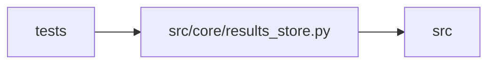

# results_store Module

**Path:** `src/core/results_store.py`

## Description

Deprecated back-compat shim (ARC-011 P1-006 / P1-007).

Canonical home is now :mod:`src.core.state_store`, which hosts the
``StateStore`` protocol and the ``SQLiteStateStore`` implementation (the 1:1
rename of the former ``ResultsStore``). This module re-exports both under their
historical names so the ~45 test files and production consumers that still write
``from src.core.results_store import ResultsStore`` keep working unchanged.

**Why the alias is the same class object (not a subclass):** ``ResultsStore``
is bound to ``SQLiteStateStore`` via ``import ... as``, so the two names refer
to the *same* class. ``tests/conftest.py`` monkeypatches
``ResultsStore.initialize`` at the class level to track instances for teardown;
a subclass or wrapper would break that patch. P1-008 migrates production
consumers to the ``StateStore`` protocol type; migrating the test imports to
``SQLiteStateStore`` is a follow-up sweep.

The module-level migration helpers (``_SCHEMA_SQL``, ``_MIGRATIONS``,
``_LATEST_SCHEMA_VERSION``, ``_add_column_if_missing``, ``_get_schema_version``,
``_set_schema_version``, ``_migrate_to_v1..v6``, ``_attempt_outcome``) are
re-exported because several tests import them directly.

## Imports

| Source | Symbols |
|--------|---------|
| `src.core.state_store` | `_LATEST_SCHEMA_VERSION`, `_MIGRATIONS`, `_MODEL_TO_SKILL`, `_SCHEMA_SQL`, `StateStore`, `_add_column_if_missing`, `_attempt_outcome`, `_consistency_failed`, `_counter_rows`, `_get_schema_version`, `_json_list`, `_json_object`, `_migrate_to_v1`, `_migrate_to_v2`, `_migrate_to_v3`, `_migrate_to_v4`, `_migrate_to_v5`, `_migrate_to_v6`, `_normalized_iteration_metrics_json`, `_reason_slug`, `_replay_status`, `_set_schema_version`, `_truthy_status`, `_value_rows`, `SQLiteStateStore` |

## Local dependency map

<!-- Auto-generated local dependency summary. Do not edit by hand. -->

> Module-level dependencies exceed the generated-diagram limits, so the diagram and table below group them by top-level package. Counts report the number of module neighbors in each package.

### Internal neighbors

| Direction | Module |
|---|---|
| Inbound | `tests` (43) |
| Outbound | `src` (1) |

> All 44 module neighbor(s) are summarized by package because the module-level view exceeds the 12-node limit.
