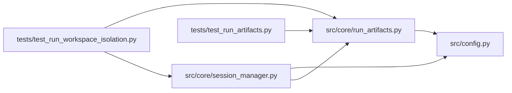

# run_artifacts Module

**Path:** `src/core/run_artifacts.py`

## Description

Local content-addressed artifact store: bundles, publication, retention.

Immutable run artifacts — multi-file candidate bundles, results, and parent
snapshots — live in a content-addressed store separate from mutable session
workspaces. Every object is named by its SHA-256 digest and written through
staging plus atomic rename, so a partial write is never visible and an
interrupted run leaves only cleanable staging. Reconstruction verifies every
digest; a tampered object is detected, never silently used.

Imports are confined and bounded: tree imports refuse symlinks and special
files, archive imports refuse traversal names, absolute names, and link
members, and both enforce file/size limits — an imported root can never widen
beyond its declared source. Retention (``gc``) deletes only objects outside a
supplied live-reference set and is idempotent, so an interrupted cleanup
resumes safely and live parent snapshots are never removed.

## Imports

| Source | Symbols |
|--------|---------|
| `__future__` | `annotations` |
| `dataclasses` | `dataclass` |
| `hashlib` | `hashlib` |
| `json` | `json` |
| `os` | `os` |
| `pathlib` | `Path` |
| `shutil` | `shutil` |
| `src.config` | `settings` |
| `tarfile` | `tarfile` |
| `time` | `time` |
| `typing` | `Any`, `Dict`, `Iterable`, `List`, `Mapping`, `Optional`, `Tuple` |
| `uuid` | `uuid` |
| `zipfile` | `zipfile` |

## Local dependency map

<!-- Auto-generated local dependency summary. Do not edit by hand. -->

### Internal neighbors

| Direction | Module |
|---|---|
| Inbound | [session_manager](../modules/session_manager.md) |
| Inbound | [test_run_artifacts](../modules/test_run_artifacts.md) |
| Inbound | [test_run_workspace_isolation](../modules/test_run_workspace_isolation.md) |
| Outbound | [config](../modules/config.md) |

## Classes

| Class | Line | Bases | Description |
|-------|------|-------|-------------|
| [ArtifactError](../entities/ArtifactError.md) | 40 | `ValueError` | Raised when an artifact violates the store's safety contract. |
| [ArtifactLimits](../entities/ArtifactLimits.md) | 45 | — | Bounds every import respects; a limit violation is an error. |
| [ArtifactStore](../entities/ArtifactStore.md) | 102 | — | Content-addressed bundles over a local root. |

## Functions

| Function | Signature | Decorators | Description |
|----------|-----------|------------|-------------|
| `default_artifact_root` | `(workspace_root: Optional[str] = None) -> Path` | — | — |
| `_sha256_bytes` | `(data: bytes) -> str` | — | — |
| `bundle_digest` | `(files: Mapping[str, Mapping[str, Any]]) -> str` | — | The bundle identity: SHA-256 over the canonical content map only. |
| `_publish_bytes` | `(dest: Path, data: bytes) -> None` | — | Atomic publication: staging + fsync + rename (never a torn file). |
| `_object_path` | `(root: Path, digest: str) -> Path` | — | — |
| `_bundle_path` | `(root: Path, digest: str) -> Path` | — | — |
| `_safe_relpath` | `(name: str) -> str` | — | Normalize a member name; traversal, absolute names, and tricks refuse. |
| `snapshot_parent_workspace` | `(workspace: Path \| str, store: ArtifactStore, *, includes: Iterable[str]) -> Dict[str, Any]` | — | Snapshot a parent run's candidate/result files as a bundle. |
