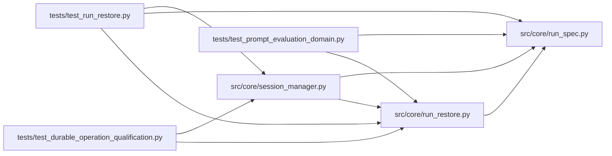

# run_restore Module

**Path:** `src/core/run_restore.py`

## Description

Explicit run restore and recovery assessment.

A restore never silently re-resolves a pinned run against today's defaults.
Given the persisted run spec of a session, :func:`assess_recovery` reports
whether the original contract (scorer references, dataset inputs, model
configuration, fixed parameters, limits, objective policy) can be satisfied
exactly, and lists actionable blockers when it cannot: a missing artifact, an
unbound credential reference, registry drift, or a tampered spec all produce
an explicit recovery state (:class:`RecoveryRequired`) instead of a fresh run
disguised as a resume.

Four recovery kinds are distinguished:

* ``pause_resume``     — the same session continues in place (the harness
  process still holds its state); no contract reconstruction happens.
* ``harness_resume``   — the native harness reopens its own session state in
  place; the stored spec is verified but never re-resolved.
* ``continuation``     — a new child session is created from the parent's
  pinned spec and artifacts; parent lineage is preserved.
* ``restart_recovery`` — after a restart, in-flight effects are unknown; the
  pinned contract must be verified before a continuation may be spawned.

## Imports

| Source | Symbols |
|--------|---------|
| `__future__` | `annotations` |
| `dataclasses` | `asdict`, `dataclass`, `field` |
| `os` | `os` |
| `src.core.run_spec` | `verify_run_spec` |
| `typing` | `Any`, `Dict`, `List`, `Mapping`, `Optional`, `Sequence` |

## Local dependency map

<!-- Auto-generated local dependency summary. Do not edit by hand. -->

### Internal neighbors

| Direction | Module |
|---|---|
| Inbound | [session_manager](../modules/session_manager.md) |
| Inbound | [test_durable_operation_qualification](../modules/test_durable_operation_qualification.md) |
| Inbound | [test_prompt_evaluation_domain](../modules/test_prompt_evaluation_domain.md) |
| Inbound | [test_run_restore](../modules/test_run_restore.md) |
| Outbound | [run_spec](../modules/run_spec.md) |

## Classes

| Class | Line | Bases | Description |
|-------|------|-------|-------------|
| [RecoveryBlocker](../entities/RecoveryBlocker.md) | 44 | — | One reason a restore cannot satisfy the pinned contract. |
| [RecoveryReport](../entities/RecoveryReport.md) | 56 | — | The assessment outcome for one restore request. |
| [RecoveryRequired](../entities/RecoveryRequired.md) | 79 | `RuntimeError` | A restore is blocked and needs explicit operator action. |

## Functions

| Function | Signature | Decorators | Description |
|----------|-----------|------------|-------------|
| `restore_contract` | `(run_spec: Mapping[str, Any]) -> Dict[str, Any]` | — | The pinned contract a restore must reproduce exactly. |
| `_secret_blockers` | `(secret_refs: Mapping[str, Any], env: Mapping[str, str]) -> List[RecoveryBlocker]` | — | — |
| `_artifact_blockers` | `(artifact_digests: Sequence[str], artifact_store: Any) -> List[RecoveryBlocker]` | — | — |
| `assess_recovery` | `(*, kind: str, session_id: str, run_spec: Mapping[str, Any], secret_refs: Optional[Mapping[str, Any]] = None, artifact_digests: Sequence[str] = (), artifact_store: Any = None, current_skill_version: Optional[str] = None, current_skill_digest: Optional[str] = None, manifest_integrity: Optional[Mapping[str, Any]] = None, allow_skill_drift: bool = False, env: Optional[Mapping[str, str]] = None) -> RecoveryReport` | — | Assess whether a restore can satisfy the pinned contract exactly. |
| `raise_unless_ready` | `(report: RecoveryReport) -> None` | — | Raise :class:`RecoveryRequired` when the restore is blocked. |
