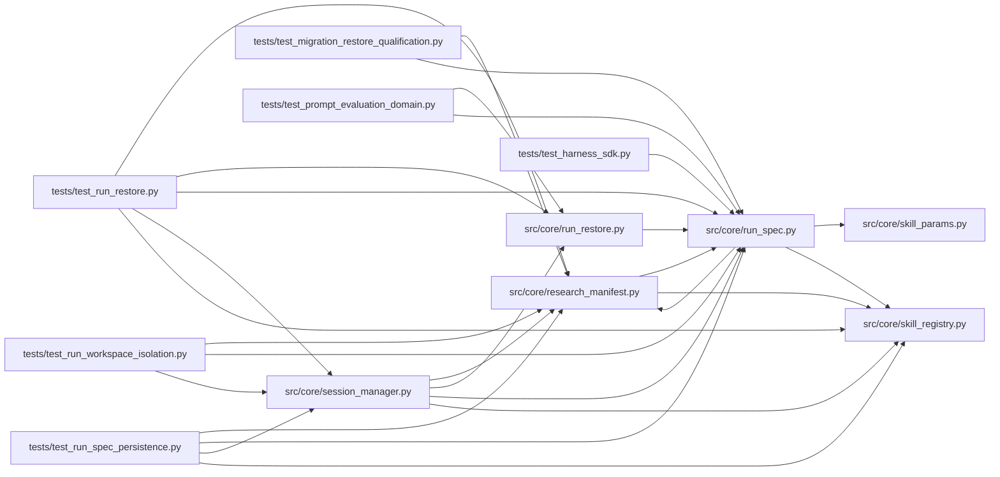

# run_spec Module

**Path:** `src/core/run_spec.py`

## Description

The resolved run specification: immutable inputs, digests, secret refs.

One session's *resolved* run spec is the canonical, versioned record of what
was actually run: parameter values after defaults, the objective/comparison
policy, evaluator/dataset/package content digests, runtime identity, and the
effective nonsecret configuration. It is hashed (``spec_sha256`` covers the
nonsecret spec) and read independently of the current registry or settings —
an interrupted run stays inspectable.

Secrets never enter the spec: a secret-named parameter is recorded as a
reference (environment variable + rebinding policy) and persisted in the
separate ``session_secret_refs`` store surface, never as a credential value.
Old artifacts without a spec are *reported* as missing provenance — never
backfilled with invented current facts.

## Imports

| Source | Symbols |
|--------|---------|
| `__future__` | `annotations` |
| `hashlib` | `hashlib` |
| `json` | `json` |
| `pathlib` | `Path` |
| `platform` | `platform` |
| `src.core.research_manifest` | `ResearchSessionManifest` |
| `src.core.skill_params` | `apply_defaults` |
| `src.core.skill_registry` | `DEFAULT_SKILLS_ROOT` |
| `sys` | `sys` |
| `typing` | `Any`, `Dict`, `Mapping`, `Optional`, `Tuple` |

## Local dependency map

<!-- Auto-generated local dependency summary. Do not edit by hand. -->

### Internal neighbors

| Direction | Module |
|---|---|
| Inbound | [research_manifest](../modules/research_manifest.md) |
| Inbound | [run_restore](../modules/run_restore.md) |
| Inbound | [session_manager](../modules/session_manager.md) |
| Inbound | [test_harness_sdk](../modules/test_harness_sdk.md) |
| Inbound | [test_migration_restore_qualification](../modules/test_migration_restore_qualification.md) |
| Inbound | [test_prompt_evaluation_domain](../modules/test_prompt_evaluation_domain.md) |
| Inbound | [test_run_restore](../modules/test_run_restore.md) |
| Inbound | [test_run_spec_persistence](../modules/test_run_spec_persistence.md) |
| Inbound | [test_run_workspace_isolation](../modules/test_run_workspace_isolation.md) |
| Outbound | [research_manifest](../modules/research_manifest.md) |
| Outbound | [skill_params](../modules/skill_params.md) |
| Outbound | [skill_registry](../modules/skill_registry.md) |

## Functions

| Function | Signature | Decorators | Description |
|----------|-----------|------------|-------------|
| `is_secret_param_name` | `(name: str) -> bool` | — | — |
| `_param_env_var` | `(name: str) -> str` | — | — |
| `split_secret_params` | `(resolved: Mapping[str, Any]) -> Tuple[Dict[str, Any], Dict[str, Dict[str, str]]]` | — | Split resolved params into (nonsecret values, secret references). |
| `file_digests` | `(paths: Mapping[str, Any]) -> Dict[str, str]` | — | Content digests for declared file-valued inputs that exist on disk. |
| `package_digests` | `(skill_dir: Optional[str]) -> Dict[str, str]` | — | Content digests of the skill package files the run executes. |
| `skill_package_dir` | `(skill_id: str) -> Optional[str]` | — | The installed skill package directory, when it resolves. |
| `runtime_identity` | `() -> Dict[str, str]` | — | — |
| `canonical_spec_json` | `(spec: Mapping[str, Any]) -> str` | — | — |
| `build_run_spec` | `(*, skill_params: Mapping[str, Any], param_schema: Optional[Mapping[str, Any]], skill_id: str, skill_version: Optional[str], skill_dir: Optional[str], objective_policy: Mapping[str, Any], policy: Mapping[str, Any], effective_config: Mapping[str, Any], parent_snapshot: Optional[Mapping[str, Any]] = None, pinned_param_state: Optional[Mapping[str, Any]] = None, harness: Optional[Mapping[str, Any]] = None) -> Dict[str, Any]` | — | Build the resolved, nonsecret run spec with its content digest. |
| `verify_run_spec` | `(spec: Mapping[str, Any]) -> bool` | — | True when the spec's recorded digest matches its nonsecret content. |
| `provenance_report` | `(raw_manifest: Mapping[str, Any]) -> Dict[str, Any]` | — | What a persisted artifact records, reports, and lacks — never invents. |
