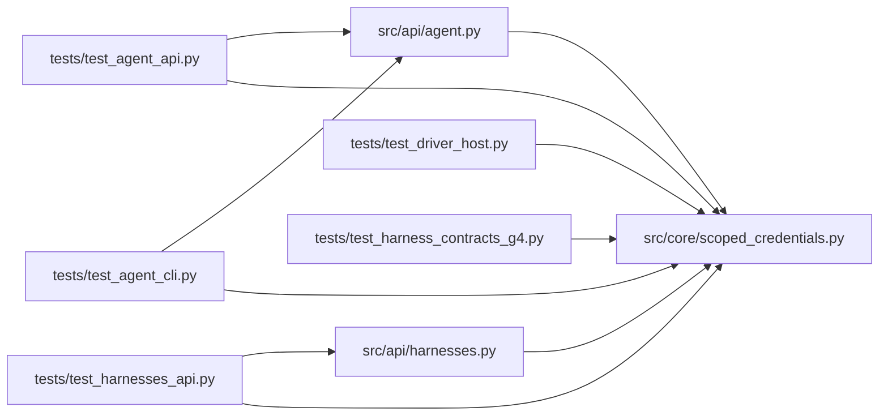

# scoped_credentials Module

**Path:** `src/core/scoped_credentials.py`

## Description

Run/attempt-scoped credentials for attached agents.

An attached agent authenticates with a short-lived, signed credential that
is scoped to one run (or attempt) and carries only research permissions.
Scoped authority is deliberately distinct from operator and promotion-
approver authority: those permissions cannot be granted to a scoped
credential at all. Revocation covers the service's lifetime; expiry bounds
what revocation cannot.

## Imports

| Source | Symbols |
|--------|---------|
| `__future__` | `annotations` |
| `dataclasses` | `dataclass` |
| `hashlib` | `hashlib` |
| `hmac` | `hmac` |
| `json` | `json` |
| `secrets` | `secrets` |
| `time` | `time` |
| `typing` | `Any`, `Iterable`, `Mapping`, `Optional` |

## Local dependency map

<!-- Auto-generated local dependency summary. Do not edit by hand. -->

### Internal neighbors

| Direction | Module |
|---|---|
| Inbound | [agent](../modules/agent.md) |
| Inbound | [harnesses](../modules/harnesses.md) |
| Inbound | [test_agent_api](../modules/test_agent_api.md) |
| Inbound | [test_agent_cli](../modules/test_agent_cli.md) |
| Inbound | [test_driver_host](../modules/test_driver_host.md) |
| Inbound | [test_harness_contracts_g4](../modules/test_harness_contracts_g4.md) |
| Inbound | [test_harnesses_api](../modules/test_harnesses_api.md) |

## Classes

| Class | Line | Bases | Description |
|-------|------|-------|-------------|
| [ScopedAuthError](../entities/ScopedAuthError.md) | 34 | `Exception` | A scoped credential was refused. |
| [CredentialExpired](../entities/CredentialExpired.md) | 38 | `ScopedAuthError` | The credential's short lifetime has passed. |
| [CredentialRevoked](../entities/CredentialRevoked.md) | 42 | `ScopedAuthError` | The credential was explicitly revoked. |
| [CredentialDenied](../entities/CredentialDenied.md) | 46 | `ScopedAuthError` | The credential's scope or permissions do not allow this operation. |
| [ScopedPrincipal](../entities/ScopedPrincipal.md) | 51 | — | The verified attached-agent identity behind a scoped credential. |

## Functions

| Function | Signature | Decorators | Description |
|----------|-----------|------------|-------------|
| `issue_scoped_credential` | `(*, subject: str, run_id: str, tenant_id: str = 'default', permissions: Iterable[str] = (PERM_READ, PERM_SUBMIT, PERM_EVALUATE), ttl_s: float = 900.0, key: str, now: Optional[float] = None) -> str` | — | Issue a signed, short-lived, run-scoped credential. |
| `revoke_scoped_credential` | `(token: str, *, key: str) -> str` | — | Revoke a credential by id (service-lifetime revocation). |
| `verify_scoped_credential` | `(token: str, *, key: str, run_id: Optional[str] = None, tenant_id: Optional[str] = None, required_permissions: Iterable[str] = (), now: Optional[float] = None) -> ScopedPrincipal` | — | Verify a scoped credential against the operation it guards. |
| `_encode` | `(payload: Mapping[str, Any], key: str) -> str` | — | — |
| `_decode` | `(token: str, key: str) -> dict[str, Any]` | — | — |
| `clear_revocations` | `() -> None` | — | Test hook: forget revocations (short-lived tokens expire anyway). |
