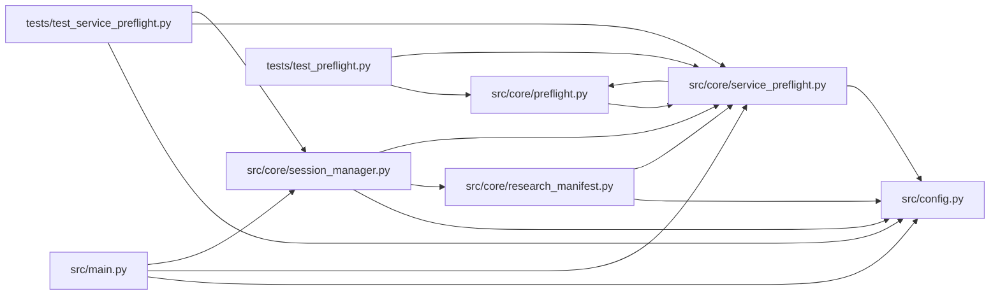

# service_preflight Module

**Path:** `src/core/service_preflight.py`

## Description

Service dependency preflight checks for autoresearch sessions.

## Imports

| Source | Symbols |
|--------|---------|
| `__future__` | `annotations` |
| `asyncio` | `asyncio` |
| `dataclasses` | `dataclass` |
| `datetime` | `datetime`, `timezone` |
| `httpx` | `httpx` |
| `src.config` | `settings` |
| `src.core.preflight` | `preflight_check_from_target` |
| `time` | `time` |
| `typing` | `Any` |
| `urllib.parse` | `urlsplit`, `urlunsplit` |

## Local dependency map

<!-- Auto-generated local dependency summary. Do not edit by hand. -->

### Internal neighbors

| Direction | Module |
|---|---|
| Inbound | [preflight](../modules/preflight.md) |
| Inbound | [research_manifest](../modules/research_manifest.md) |
| Inbound | [session_manager](../modules/session_manager.md) |
| Inbound | [src_main](../modules/src_main.md) |
| Inbound | [test_preflight](../modules/test_preflight.md) |
| Inbound | [test_service_preflight](../modules/test_service_preflight.md) |
| Outbound | [config](../modules/config.md) |
| Outbound | [preflight](../modules/preflight.md) |

### External packages

| Language | Used packages | Undeclared packages |
|---|---:|---:|
| python | 1 | 0 |

## Classes

| Class | Line | Bases | Description |
|-------|------|-------|-------------|
| [ServicePreflightTarget](../entities/ServicePreflightTarget.md) | 20 | — | — |
| [ServicePreflightError](../entities/ServicePreflightError.md) | 28 | `RuntimeError` | Raised when required service dependencies are not ready. |

## Functions

| Function | Signature | Decorators | Description |
|----------|-----------|------------|-------------|
| `sanitize_service_url` | `(raw: str \| None) -> str` | — | Return a URL safe for manifests by removing credentials and query data. |
| `build_not_run_preflight` | `(settings_obj = settings, *, targets: 'list[ServicePreflightTarget] \| tuple[()]' = (), model_type: str = '') -> dict[str, Any]` | — | Build a manifest-safe dependency snapshot when checks have not run. |
| `run_service_preflight` | *(async)* `(*, targets: 'list[ServicePreflightTarget]', settings_obj = settings, client: httpx.AsyncClient \| None = None) -> dict[str, Any]` | — | Check the declared service dependencies before launching a session. |
| `require_preflight_ready` | `(result: dict[str, Any]) -> None` | — | Raise when a preflight result should block session creation. |
| `format_preflight_error` | `(result: dict[str, Any]) -> str` | — | — |
| `_check_target` | *(async)* `(client: httpx.AsyncClient, target: ServicePreflightTarget) -> dict[str, Any]` | — | — |
| `_check_tcp_target` | *(async)* `(target: ServicePreflightTarget, timeout_s: float) -> dict[str, Any]` | — | — |
| `_join_health_path` | `(base_url: str, path: str) -> str` | — | — |
