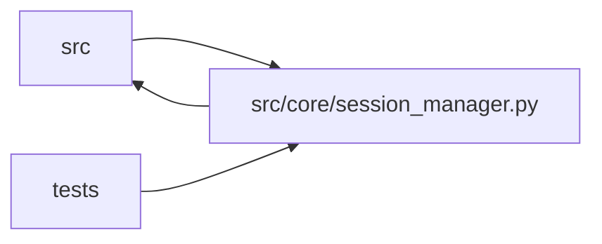

# session_manager Module

**Path:** `src/core/session_manager.py`

## Description

Session manager — tracks active asyncio tasks for research sessions.

## Imports

| Source | Symbols |
|--------|---------|
| `__future__` | `annotations` |
| `asyncio` | `asyncio` |
| `dataclasses` | `dataclass` |
| `datetime` | `datetime`, `timezone` |
| `json` | `json` |
| `logging` | `logging` |
| `pathlib` | `Path` |
| `secrets` | `secrets` |
| `shutil` | `shutil` |
| `src.config` | `settings` |
| `src.core` | `fs_safety` |
| `src.core.orchestrator` | `AgentOrchestrator`, `ResearchConfig` |
| `src.core.research_manifest` | `build_research_manifest`, `manifest_pretty_json` |
| `src.core.service_preflight` | `ServicePreflightTarget`, `require_preflight_ready`, `run_service_preflight` |
| `src.core.skill_paths` | `session_workspace_path` |
| `src.core.skill_registry` | `default_registry` |
| `src.core.state_machine` | `IllegalTransitionError`, `SessionEvent`, `SessionState`, `SessionStateMachine` |
| `src.core.state_store` | `StateStore` |
| `src.ws.events` | `broadcaster` |
| `typing` | `Any`, `Dict`, `Optional` |
| `uuid` | `uuid` |

## Local dependency map

<!-- Auto-generated local dependency summary. Do not edit by hand. -->

> Module-level dependencies exceed the generated-diagram limits, so the diagram and table below group them by top-level package. Counts report the number of module neighbors in each package.

### Internal neighbors

| Direction | Module |
|---|---|
| Inbound | `src` (1) |
| Inbound | `tests` (9) |
| Outbound | `src` (10) |

> All 20 module neighbor(s) are summarized by package because the module-level view exceeds the 12-node limit.

## Classes

| Class | Line | Bases | Description |
|-------|------|-------|-------------|
| [ActiveSession](../entities/ActiveSession.md) | 80 | — | — |
| [SessionManager](../entities/SessionManager.md) | 87 | — | Manages the lifecycle of research sessions as asyncio tasks. |

## Functions

| Function | Signature | Decorators | Description |
|----------|-----------|------------|-------------|
| `_derive_workspace_path` | `(*, skill_id: str, instrument: str, timeframe: str, model_type: str) -> str` | — | Session workspace path (ARC-012 P7-005 / D1). |
| `_hard_timeout_grace_s` | `(soft_timeout_s: int) -> int` | — | Bound hard-timeout grace to 5% of the soft timeout, 3-10 minutes. |
