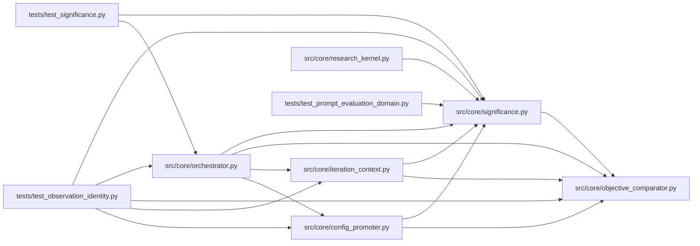

# significance Module

**Path:** `src/core/significance.py`

## Description

Multi-seed mean±std significance (P2 ops defaults).

The legacy keep/discard comparison is a **fixed-epsilon point test**: a single
metric must beat the session best by ``global_stagnation_epsilon``. For a
deterministic eval that is fine; for a noisy (multi-seed) eval one sample says
nothing — the same config re-run lands ±σ around its true mean, and the agent
chases noise.

This module is the pure-statistics core: when a skill declares
``metric_schema.significance``, the orchestrator groups repeated observations
of the same config (each rerun with a different seed is a new sample — the
trial-identity hash keeps them distinct) and asks whether the candidate
config's sample mean separates from the current best config's sample mean by
``min_sigma`` standard errors of the difference (a Welch-style test without
the t-distribution — auditable arithmetic, no scipy dependency).

Design decisions (house style):

* **Population std (÷n), not sample std (÷n−1).** With 2–5 replicates the
  Bessel correction inflates σ heavily; the gate wants a *conservative*
  band, and ÷n is the wider-undercount side that still resolves at n=1
  (σ=0 → deterministic semantics below).
* **σ=0 on both sides means deterministic.** Two configs whose samples are
  each bit-stable compare by raw means (the Track-D1 inert-change
  intuition, formalized); σ=0 on ONE side falls back to the other side's σ.
* **Sparse data is inconclusive, never a verdict.** Fewer than
  ``min_samples`` on either side returns ``inconclusive`` and the caller
  falls back to the legacy epsilon comparison — significance gating must
  never *block* exploration, only sharpen it.

## Imports

| Source | Symbols |
|--------|---------|
| `__future__` | `annotations` |
| `json` | `json`, `json`, `json` |
| `src.core.objective_comparator` | `ObjectiveComparator` |
| `typing` | `Any`, `Optional`, `Sequence` |

## Local dependency map

<!-- Auto-generated local dependency summary. Do not edit by hand. -->

### Internal neighbors

| Direction | Module |
|---|---|
| Inbound | [config_promoter](../modules/config_promoter.md) |
| Inbound | [iteration_context](../modules/iteration_context.md) |
| Inbound | [orchestrator](../modules/orchestrator.md) |
| Inbound | [research_kernel](../modules/research_kernel.md) |
| Inbound | [test_observation_identity](../modules/test_observation_identity.md) |
| Inbound | [test_prompt_evaluation_domain](../modules/test_prompt_evaluation_domain.md) |
| Inbound | [test_significance](../modules/test_significance.md) |
| Outbound | [objective_comparator](../modules/objective_comparator.md) |

## Functions

| Function | Signature | Decorators | Description |
|----------|-----------|------------|-------------|
| `mean_std` | `(values: Sequence[float]) -> tuple[float, float]` | — | Population mean and standard deviation (÷n; σ=0 for n≤1). |
| `significance_verdict` | `(candidate: Sequence[float], reference: Sequence[float], *, direction: str = 'higher_is_better', min_sigma: float = 1.0, min_samples: int = 2) -> str` | — | Compare two sample groups; one of SIGNIFICANT / REGRESSION / INCONCLUSIVE. |
| `samples_from_rows` | `(rows: Sequence[dict], *, canonical_config_hash: str, context_hash: Optional[str] = None) -> list[float]` | — | Collect primary-metric samples for one config hash from iteration rows. |
| `best_config_hash` | `(rows: Sequence[dict], *, direction: str = 'higher_is_better') -> Optional[str]` | — | The config hash behind the session's best recorded iteration, or None. |
| `best_other_config_hash` | `(rows: Sequence[dict], *, exclude_hash: Optional[str], direction: str = 'higher_is_better') -> Optional[str]` | — | The best recorded config hash other than ``exclude_hash``. |
| `qualification_status` | `(*, candidate: Sequence[float], reference: Optional[Sequence[float]] = None, config: Any = None, verdict: Optional[str] = None, holdout_evidence: Optional[bool] = None) -> dict` | — | Visible replication/qualification status for one candidate. |
