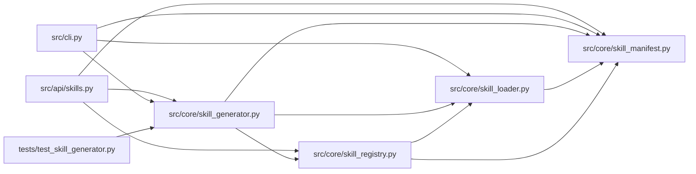

# skill_generator Module

**Path:** `src/core/skill_generator.py`

## Description

Skill generator (ARC-011 P5-021..026).

Drafts a new skill package (manifest + bootstrap + eval) from a natural-language
description by calling the configured ``LLMProvider`` directly (per the Phase-5
plan decision: a dedicated codegen module, NOT a meta-skill run through the
orchestrator loop). Drafts land in ``skills/_drafts/<id>/`` as ``draft`` status
(P5-010 gating keeps them out of production until promoted via P5-024).

Safety posture (X-004 §7 / R10 / P5-026):

* **Drafts are untrusted code by construction.** They get the strictest plugin
  caps, a mandatory ``--dry-bootstrap`` overlay preview during review (T5), and
  a command-policy over-permissiveness audit (P5-026) that flags dangerous
  patterns (``rm -rf``, shell metacharacters in allowed commands, etc.).
* **The generator is feature-flagged** (P5-025: ``Settings.skill_generator_enabled``,
  default off). Operator-initiated, auth-gated; the agent never reaches it (T4 —
  absent from the ``GovernedCommandRunner`` allow-list).
* **No draft is selectable for production until promoted** (P5-026 AC #1). The
  lifecycle machine (P5-010) enforces this independently.

Design decisions (P1-007 house style):

* **Plain Python string templates** over Jinja (no Jinja in the repo; house
  style is ``str.format`` + Pydantic). The generator emits the same file set a
  hand-authored skill ships.
* **Validate before write.** The emitted manifest is validated against
  ``research_skill.v1`` (P2-001); ``bootstrap.py`` / ``eval_run.py`` are
  ``ast.parse``-linted. A schema-invalid / unparseable draft is rejected and no
  files are written (P5-026 AC #4).
* **Idempotent draft id.** The caller supplies the ``skill_id``; re-generating
  with the same id overwrites the same draft (safe for retry).
* **The LLM is the only external dependency.** No new packages; the generator
  reuses the existing ``LLMProvider`` protocol.

## Imports

| Source | Symbols |
|--------|---------|
| `__future__` | `annotations` |
| `ast` | `ast` |
| `dataclasses` | `dataclass`, `field` |
| `json` | `json` |
| `logging` | `logging` |
| `pathlib` | `Path` |
| `re` | `re` |
| `src.core.skill_loader` | `load_skill_manifest` |
| `src.core.skill_manifest` | `ManifestValidationError` |
| `src.core.skill_registry` | `DRAFTS_SUBDIR`, `SkillRegistry` |
| `typing` | `Any`, `Optional` |
| `yaml` | `_yaml` |

## Local dependency map

<!-- Auto-generated local dependency summary. Do not edit by hand. -->

### Internal neighbors

| Direction | Module |
|---|---|
| Inbound | [src_api_skills](../modules/src_api_skills.md) |
| Inbound | [cli](../modules/cli.md) |
| Inbound | [test_skill_generator](../modules/test_skill_generator.md) |
| Outbound | [skill_loader](../modules/skill_loader.md) |
| Outbound | [skill_manifest](../modules/skill_manifest.md) |
| Outbound | [skill_registry](../modules/skill_registry.md) |

### External packages

| Language | Used packages | Undeclared packages |
|---|---:|---:|
| python | 1 | 0 |

## Classes

| Class | Line | Bases | Description |
|-------|------|-------|-------------|
| [CommandPolicyFinding](../entities/CommandPolicyFinding.md) | 66 | — | One over-permissiveness finding from the P5-026 audit. |
| [GeneratedDraft](../entities/GeneratedDraft.md) | 77 | — | A successfully drafted skill package (P5-023). |
| [SkillGenerationError](../entities/SkillGenerationError.md) | 97 | `ValueError` | Raised when a draft cannot be generated (LLM failure, schema invalid, …). |
| [SkillGenerator](../entities/SkillGenerator.md) | 208 | — | Draft a new skill package from a natural-language description (P5-023). |

## Functions

| Function | Signature | Decorators | Description |
|----------|-----------|------------|-------------|
| `audit_command_policy` | `(manifest_yaml: str) -> list[CommandPolicyFinding]` | — | Scan a generated manifest's ``command_policy`` for over-permissive grants. |
| `build_generation_prompt` | `(description: str) -> tuple[str, str]` | — | Build the (system, user) prompt pair for the generator LLM (P5-022). |
| `_extract_json` | `(text: str) -> dict[str, Any]` | — | Extract the first JSON object from ``text`` (tolerates code fences). |
