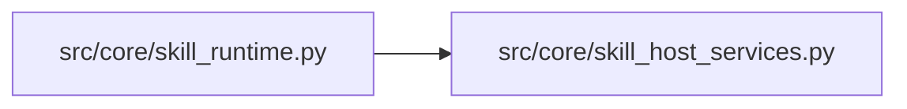

# skill_host_services Module

**Path:** `src/core/skill_host_services.py`

## Description

Skill host services: the explicit context a skill runtime may use.

A skill runtime builds prompts and reads resume/contract material through
this protocol — never through orchestrator-private helpers. The value
contracts are stable strings and paths over the run's configuration value
(any object exposing the run identity fields the host reads, such as
``subject_id`` and ``variant``), so a different agent harness can provide
the same services without inheriting the built-in loop.

## Imports

| Source | Symbols |
|--------|---------|
| `__future__` | `annotations` |
| `typing` | `Any`, `Protocol` |

## Local dependency map

<!-- Auto-generated local dependency summary. Do not edit by hand. -->

### Internal neighbors

| Direction | Module |
|---|---|
| Inbound | [skill_runtime](../modules/skill_runtime.md) |

## Classes

| Class | Line | Bases | Description |
|-------|------|-------|-------------|
| [SkillHostServices](../entities/SkillHostServices.md) | 15 | `Protocol` | The host's explicit, stable surface for skill runtimes. |
