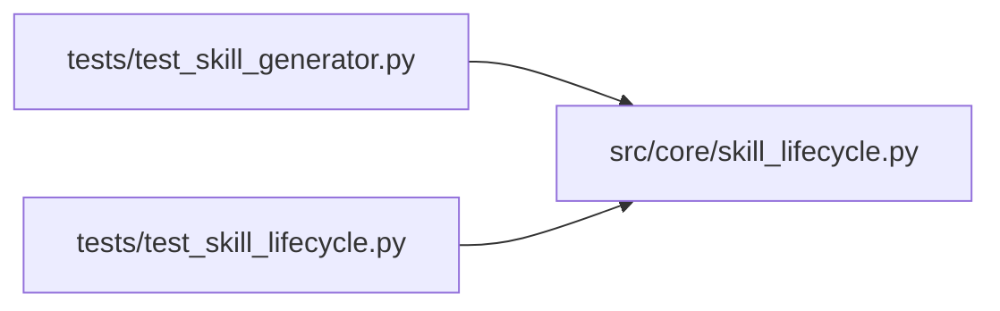

# skill_lifecycle Module

**Path:** `src/core/skill_lifecycle.py`

## Description

Skill lifecycle state machine (ARC-011 P5-010).

Models the ``draft → reviewed → stable → deprecated`` lifecycle a skill package
moves through, with gating that keeps drafts out of production sessions. The
shape mirrors ``SessionStateMachine`` (ARC-011 P0-002): states + events as
enums, a transition table, per-skill locking, and the "server owns status /
audit only — domain side-effects stay with the caller" house-style separation
(documented in ``state_machine.py`` §13).

Lifecycle semantics (X-004 D1 / ARC-011 §8.7):

* ``draft`` — newly installed or generator-output (P5-023). NOT selectable for
  production sessions; selectable for dev sessions only with operator opt-in.
* ``reviewed`` — an operator has signed off on review; still not production.
* ``stable`` — production-eligible. The default for operator-installed skills.
* ``deprecated`` — retired; not selectable for new sessions.

Transitions are monotone-forward except the operator ``un_retire`` path
(``deprecated → reviewed``). A skill can never move backward past ``draft``
(drafts are deleted, not demoted).

Design decisions (P1-007 house style):

* **Async + per-skill lock.** Promotion is a file-move + status update that
  must be atomic per skill; the lock serializes concurrent promotes of the
  same id. Mirrors ``SessionStateMachine``'s per-session ``asyncio.Lock``.
* **No DB handle here.** The machine owns only state transitions + returns a
  ``LifecycleTransitionResult`` describing the side-effects the caller should
  perform (audit, broadcast, file move). Keeps the machine free of the store.
* **Production gating is a predicate, not a transition.** ``selectable_for(production=…)``
  answers "can this state be used in this session scope?" — it does not mutate.

## Imports

| Source | Symbols |
|--------|---------|
| `__future__` | `annotations` |
| `asyncio` | `asyncio` |
| `dataclasses` | `dataclass` |
| `enum` | `Enum` |
| `typing` | `Optional` |

## Local dependency map

<!-- Auto-generated local dependency summary. Do not edit by hand. -->

### Internal neighbors

| Direction | Module |
|---|---|
| Inbound | [test_skill_generator](../modules/test_skill_generator.md) |
| Inbound | [test_skill_lifecycle](../modules/test_skill_lifecycle.md) |

## Classes

| Class | Kind | Line | Bases / Target | Description |
|-------|------|------|----------------|-------------|
| [SkillLifecycleState](../entities/SkillLifecycleState.md) | Enum | 42 | `str`, `Enum` | The four lifecycle states a skill package moves through (ARC-011 §8.7). |
| [SkillLifecycleEvent](../entities/SkillLifecycleEvent.md) | Enum | 61 | `str`, `Enum` | Operator-initiated lifecycle events. |
| [IllegalLifecycleTransitionError](../entities/IllegalLifecycleTransitionError.md) | Class | 85 | `ValueError` | Raised when a (state, event) pair is not a legal transition. |
| [LifecycleTransitionResult](../entities/LifecycleTransitionResult.md) | Class | 104 | — | Outcome of a lifecycle transition (the caller performs the side-effects). |
| [SkillLifecycleMachine](../entities/SkillLifecycleMachine.md) | Class | 149 | — | Per-skill lifecycle state machine (P5-010). |

## Functions

| Function | Signature | Decorators | Description |
|----------|-----------|------------|-------------|
| `is_legal_transition` | `(from_state: SkillLifecycleState, event: SkillLifecycleEvent) -> bool` | — | True if ``(from_state, event)`` is a legal transition. |
| `target_state` | `(from_state: SkillLifecycleState, event: SkillLifecycleEvent) -> Optional[SkillLifecycleState]` | — | The state ``event`` moves ``from_state`` to, or None if illegal. |
| `selectable_for` | `(state: SkillLifecycleState, *, production: bool) -> bool` | — | P5-010 gating predicate: can a skill in ``state`` be selected for a |
