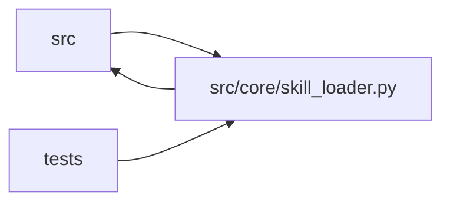

# skill_loader Module

**Path:** `src/core/skill_loader.py`

## Description

Skill-manifest loader (ARC-011 P2-002).

Loads a ``research_skill.v1`` ``SKILL.yaml`` (P2-001 schema) and resolves its
``{settings.<name>}`` / ``{skill_params.<name>}`` placeholders (G6). This module
owns the *loader semantics* that the schema deliberately leaves open (P2-001
only *allows* the placeholders; substitution happens here).

The split is deliberate (spike G6):

* ``skill_manifest.py`` (P2-001) — the schema. Allows placeholders as opaque
  strings; rejects structurally wrong manifests with field-specific errors.
* ``skill_loader.py`` (P2-002, this file) — yaml parse + G6 interpolation +
  version-compat gate + per-field defaults. Produces a ready ``ResearchSkillManifest``.

Design decisions (P1-007 house style):

* **Interpolation is pre-validation.** ``{settings.*}`` / ``{skill_params.*}``
  tokens are substituted in the raw YAML dict *before* pydantic sees it, so the
  schema validates the *resolved* value (e.g. a URL string, not a placeholder).
  This keeps validation errors field-specific against the post-substitution
  shape an operator would actually see.
* **``settings_obj`` is injectable.** Defaults to the singleton ``settings``
  (``src.config``), so production uses live server settings; tests inject a
  stub. Mirrors ``service_preflight.build_service_preflight_targets``'s
  ``settings_obj=settings`` parameter (P1-021 house style).
* **``skill_params`` interpolation is opt-in.** ``{skill_params.<name>}`` is only
  resolvable when a session supplies ``skill_params`` (P2-017); a manifest that
  references ``{skill_params.*}`` at load time (no session context) raises a
  field-specific error. ``settings.*`` is always resolvable.
* **Version-compat gate.** ``research_skill.v1`` is accepted; unknown versions
  raise ``ManifestVersionError``. N-1 support is forward-compat scaffolding
  (a v1.1 that drops to v1) — not exercised today.

## Imports

| Source | Symbols |
|--------|---------|
| `__future__` | `annotations` |
| `logging` | `logging` |
| `pathlib` | `Path` |
| `pydantic` | `BaseModel`, `ConfigDict`, `Field`, `ValidationError` |
| `re` | `re` |
| `src.config` | `settings` |
| `src.core.skill_manifest` | `SCHEMA_VERSION`, `ManifestValidationError`, `ManifestVersionError`, `PluginCaps`, `PluginEntry`, `PluginKind`, `ResearchSkillManifest` |
| `typing` | `Any`, `Mapping`, `Optional`, `Union` |
| `yaml` | `yaml` |

## Local dependency map

<!-- Auto-generated local dependency summary. Do not edit by hand. -->

> Module-level dependencies exceed the generated-diagram limits, so the diagram and table below group them by top-level package. Counts report the number of module neighbors in each package.

### Internal neighbors

| Direction | Module |
|---|---|
| Inbound | `src` (5) |
| Inbound | `tests` (12) |
| Outbound | `src` (2) |

### External packages

| Language | Used packages | Undeclared packages |
|---|---:|---:|
| python | 2 | 0 |

> All 19 module neighbor(s) are summarized by package because the module-level view exceeds the 12-node limit.

## Classes

| Class | Line | Bases | Description |
|-------|------|-------|-------------|
| [SkillLayout](../entities/SkillLayout.md) | 99 | `BaseModel` | Resolved on-disk layout of a skill package (ARC-011 §5.3, P5-001). |

## Functions

| Function | Signature | Decorators | Description |
|----------|-----------|------------|-------------|
| `_resolve_caps` | `(kind: PluginKind, declared: Optional[PluginCaps]) -> PluginCaps` | — | Return the effective capability grant for a plugin, honoring the X-004 |
| `load_layout` | `(skill_dir: Union[str, Path], manifest: Optional[ResearchSkillManifest] = None) -> SkillLayout` | — | Resolve the on-disk layout of a skill package (ARC-011 §5.3, P5-001). |
| `_interpolate_string` | `(value: str, *, settings_obj: Any, skill_params: Optional[Mapping[str, Any]], field_path: str) -> str` | — | Resolve ``{settings.*}`` / ``{skill_params.*}`` in one string. |
| `_interpolate` | `(node: Any, *, settings_obj: Any, skill_params: Optional[Mapping[str, Any]], field_path: str) -> Any` | — | Recursively interpolate placeholders in a raw YAML value (pre-validation). |
| `_wrap_validation_error` | `(exc: ValidationError) -> ManifestValidationError` | — | Turn a pydantic ``ValidationError`` into a field-specific, human-readable |
| `load_skill_manifest` | `(source: Union[str, Path, Mapping[str, Any]], *, settings_obj: Any = None, skill_params: Optional[Mapping[str, Any]] = None) -> ResearchSkillManifest` | — | Load and validate a ``research_skill.v1`` manifest. |
