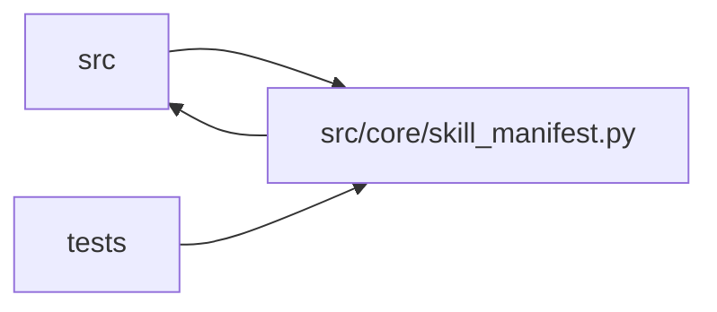

# skill_manifest Module

**Path:** `src/core/skill_manifest.py`

## Description

``research_skill.v1`` manifest schema (ARC-011 P2-001).

This module is the authoritative Pydantic v2 model for a *skill descriptor* —
the declarative ``SKILL.yaml`` that captures every domain-specific decision the
orchestrator used to hardcode behind ``if config.model_type == ...`` branches
(ARC-011 §5.2, §9). One validated schema serves all skills; the three incumbent
ML skills (``ml-direction`` / ``ml-volatility`` / ``ml-rl``) are authored
against it in Phase 2 (P2-005 / P2-009 / P2-013).

Requirements input: ``docs/adr/skill-manifest-drafts/`` (schema
punch-list, gaps G1–G13) and §4 (section-name canonicalization). The GO verdict
of that spike greenlights this schema; the gap list below maps each resolved
gap to the field that addresses it.

Design decisions (P1-007 house style):

* **Pydantic v2, not TypedDict.** Unlike the Phase-1 value types (``IterationResult``,
  ``Phase`` — TypedDict aliases over existing dict shapes, kept mutable for the
  orchestrator), a manifest is a *configuration document* that must be loaded,
  validated, and rejected with field-specific errors before a session ever
  starts. Pydantic v2 gives coercion, cross-field validators, and human-readable
  ``ValidationError`` messages for free — exactly P2-001 AC #3. Loaded manifests
  are converted to the Phase-1 ``TypedDict`` shapes at the ``ManifestSkillRuntime``
  boundary (P2-007) so callers downstream of the runtime keep using plain dicts.
* **``extra="forbid"``.** Unknown keys are a schema-version or authoring error;
  surface them loudly. Mirrors ``research_manifest.py``.
* **G6 split.** This schema only *allows* ``{settings.<name>}`` /
  ``{skill_params.<name>}`` placeholders in string fields (they must pass
  validation as opaque strings). The substitution semantics belong to the loader
  (P2-002 ``skill_loader.py``); this module does not resolve them.
* **G1 / G2 are the only two sanctioned plugin escapes in v1** (spike §6). The
  schema carries ``phase_advancement.plugin`` and ``trial_identity.resolve.plugin``
  slots; any other behavior that resists declarative expression is an authoring
  bug, not a schema gap.

Gap resolution map (spike §6/§7 → this module):

* **G1** hybrid phase advancement → ``PhaseAdvancement`` + per-phase ``Phase.advancement``.
* **G2** trial-identity synthesis → ``TrialIdentity.resolve`` (plugin slot).
* **G3** actionable-blocker / phase-evidence sets → ``BlockerClassification``.
* **G4** per-scope gate bundles → ``GateBundles``.
* **G5** production composite REST → ``RegistryApiTarget`` fields.
* **G6** ``{settings.*}`` interpolation → allowed as opaque strings here; loader owns resolution.
* **G7** marker dir template + JSONPath → ``OutputParserFallback``.
* **G8** success-value marker → ``DecisionVocabulary.success_values``.
* **G10** multi-file artifact bundle → ``ArtifactStoreTarget.bundle_manifest``.
* **G11** optimize vs satisfice → ``MetricSchema.goal``.
* **G12** non-ML subjects/variants → ``Subjects`` / ``Variants``.
* **G13** category advisory metadata → ``ResearchSkillManifest.category``.

Section names are canonicalized per spike §4: ``metric_schema`` (not
``metrics``), ``phase_plan`` (not ``phases``), ``promotion_target`` (not
``promotion``).

## Imports

| Source | Symbols |
|--------|---------|
| `__future__` | `annotations` |
| `pydantic` | `BaseModel`, `ConfigDict`, `Field`, `field_validator`, `model_validator` |
| `src.core.output_parser` | `FIELD_TYPE_VOCABULARY` |
| `src.core.promotion_policy` | `compile_scope_graph` |
| `src.core.skill_params` | `unsupported_schema_keywords` |
| `src.core.skill_paths` | `validate_path_template`, `_template_placeholder_tokens` |
| `typing` | `Any`, `Literal`, `Mapping`, `Optional`, `Union` |

## Local dependency map

<!-- Auto-generated local dependency summary. Do not edit by hand. -->

> Module-level dependencies exceed the generated-diagram limits, so the diagram and table below group them by top-level package. Counts report the number of module neighbors in each package.

### Internal neighbors

| Direction | Module |
|---|---|
| Inbound | `src` (11) |
| Inbound | `tests` (14) |
| Outbound | `src` (4) |

### External packages

| Language | Used packages | Undeclared packages |
|---|---:|---:|
| python | 1 | 0 |

> All 29 module neighbor(s) are summarized by package because the module-level view exceeds the 12-node limit.

## Classes

| Class | Kind | Line | Bases / Target | Description |
|-------|------|------|----------------|-------------|
| [Category](../entities/Category.md) | Type alias | 74 | `Literal['optimization', 'generative', 'exploratory', 'validation', 'design']` | — |
| [MetricGoal](../entities/MetricGoal.md) | Type alias | 78 | `Literal['optimize', 'satisfice']` | — |
| [AdvancementMode](../entities/AdvancementMode.md) | Type alias | 83 | `Literal['declarative', 'plugin']` | — |
| [IdentityResolveMode](../entities/IdentityResolveMode.md) | Type alias | 87 | `Literal['declarative', 'plugin']` | — |
| [ParserFormat](../entities/ParserFormat.md) | Type alias | 90 | `Literal['delimited_kv', 'json_marker']` | — |
| [PreflightKind](../entities/PreflightKind.md) | Type alias | 95 | `Literal['http_health', 'tcp', 'local_file']` | — |
| [PromotionKind](../entities/PromotionKind.md) | Type alias | 101 | `Literal['file_path', 'registry_api', 'artifact_store', 'git_branch', 'webhook']` | — |
| [PluginKind](../entities/PluginKind.md) | Type alias | 107 | `Literal['parser', 'preflight', 'resolve_identity', 'bootstrap', 'phase_advancement']` | — |
| [LLMConfig](../entities/LLMConfig.md) | Pydantic model | 117 | `BaseModel` | LLM tier routing (ARC-011 §9 ``llm``). |
| [WorkspaceConfig](../entities/WorkspaceConfig.md) | Pydantic model | 139 | `BaseModel` | Per-session workspace layout (ARC-011 §9 ``workspace``). |
| [SubjectField](../entities/SubjectField.md) | Pydantic model | 149 | `BaseModel` | One enumerated subject (e.g. an instrument / research topic). |
| [SubjectsConfig](../entities/SubjectsConfig.md) | Pydantic model | 158 | `BaseModel` | Subject enumeration (G12). ML skills glob config files today; non-ML |
| [VariantsConfig](../entities/VariantsConfig.md) | Pydantic model | 197 | `BaseModel` | Variant enumeration (G12). A variant is a per-subject sweep dimension |
| [ParamSchemaProperty](../entities/ParamSchemaProperty.md) | Pydantic model | 219 | `BaseModel` | One property in the ``param_schema`` JSON Schema (a subset of JSON-Schema |
| [ParamSchema](../entities/ParamSchema.md) | Pydantic model | 232 | `BaseModel` | JSON Schema describing the ``skill_params`` a skill accepts (ARC-011 |
| [PrimaryMetric](../entities/PrimaryMetric.md) | Pydantic model | 267 | `BaseModel` | The primary optimization metric (ARC-011 §9 ``metric_schema.primary``). |
| [MetricColumn](../entities/skill_manifest_MetricColumn.md) | Pydantic model | 282 | `BaseModel` | One gate badge, chart series, or iteration-table column. |
| [SignificanceConfig](../entities/SignificanceConfig.md) | Pydantic model | 294 | `BaseModel` | Multi-seed significance gate (P2 ops — ``metric_schema.significance``). |
| [MetricObjective](../entities/MetricObjective.md) | Pydantic model | 317 | `BaseModel` | One objective metric inside a multiobjective declaration. |
| [ObjectiveSpec](../entities/ObjectiveSpec.md) | Pydantic model | 327 | `BaseModel` | Objective semantics: scalar (legacy) or multiobjective (Pareto). |
| [MetricSchema](../entities/skill_manifest_MetricSchema.md) | Pydantic model | 363 | `BaseModel` | Metric presentation + semantics (ARC-011 §9 ``metric_schema``). |
| [DecisionVocabulary](../entities/DecisionVocabulary.md) | Pydantic model | 392 | `BaseModel` | Closed decision set + success marker (ARC-011 §9, G8). |
| [PhaseAdvancementOverride](../entities/PhaseAdvancementOverride.md) | Pydantic model | 409 | `BaseModel` | Per-phase advancement override (G1). Inherits the top-level mode when |
| [Phase](../entities/skill_manifest_Phase.md) | Pydantic model | 422 | `BaseModel` | One phase in the research playbook (ARC-011 §9 ``phase_plan[]``). |
| [PhaseAdvancement](../entities/PhaseAdvancement.md) | Pydantic model | 452 | `BaseModel` | Top-level phase-advancement mode (G1). When ``mode == plugin`` the |
| [CommandPolicy](../entities/CommandPolicy.md) | Pydantic model | 478 | `BaseModel` | Allowed scripts / executables / files for the skill (ARC-011 §9 |
| [PluginCaps](../entities/PluginCaps.md) | Pydantic model | 512 | `BaseModel` | Capability block for one skill plugin (ARC-011 X-004 §6). |
| [PluginEntry](../entities/PluginEntry.md) | Pydantic model | 548 | `BaseModel` | One declared skill plugin with its capability grant (X-004 §6). |
| [PluginsConfig](../entities/PluginsConfig.md) | Pydantic model | 571 | `BaseModel` | Declared skill plugins + their capability grants (ARC-011 §5.3 / X-004). |
| [OutputParserFallback](../entities/OutputParserFallback.md) | Pydantic model | 610 | `BaseModel` | Fallback iteration sources when the primary parse yields nothing |
| [FieldTypes](../entities/FieldTypes.md) | Pydantic model | 629 | `BaseModel` | Type hints for parser fields used during coercion. |
| [OutputParserConfig](../entities/OutputParserConfig.md) | Pydantic model | 660 | `BaseModel` | Parser contract (ARC-011 §9 ``output_parser``, G7). Reproduces |
| [PreflightEntry](../entities/PreflightEntry.md) | Pydantic model | 690 | `BaseModel` | One service-dependency preflight check (ARC-011 §9 ``preflight[]``). |
| [GateBundles](../entities/GateBundles.md) | Pydantic model | 730 | `BaseModel` | Per-scope promotion gate bundles + override location (G4). Pure paths. |
| [PromotionScope](../entities/skill_manifest_PromotionScope.md) | Pydantic model | 742 | `BaseModel` | One promotion scope declaration (ARC-011 §9 ``promotion_target.scopes``). |
| [FilePathPromotionTarget](../entities/skill_manifest_FilePathPromotionTarget.md) | Pydantic model | 757 | `BaseModel` | ``kind: file_path`` — write a config file to the host bind mount |
| [RegistryLookup](../entities/RegistryLookup.md) | Pydantic model | 785 | `BaseModel` | ``registry_api.lookup`` — how to find the composite to promote (G5). |
| [RegistryApiTarget](../entities/RegistryApiTarget.md) | Pydantic model | 796 | `BaseModel` | ``kind: registry_api`` — production composite REST promotion (G5). |
| [ArtifactStoreTarget](../entities/ArtifactStoreTarget.md) | Pydantic model | 817 | `BaseModel` | ``kind: artifact_store`` — promote a multi-file artifact bundle (G10). |
| [GitBranchTarget](../entities/GitBranchTarget.md) | Pydantic model | 830 | `BaseModel` | ``kind: git_branch`` — promote to a version-control branch |
| [WebhookTarget](../entities/WebhookTarget.md) | Pydantic model | 848 | `BaseModel` | ``kind: webhook`` — POST the winning config to an HTTP endpoint (P1-3). |
| [PromotionTargetKind](../entities/PromotionTargetKind.md) | Type alias | 868 | `Union[FilePathPromotionTarget, RegistryApiTarget, ArtifactStoreTarget, GitBranchTarget, WebhookTarget]` | — |
| [PromotionTarget](../entities/skill_manifest_PromotionTarget.md) | Pydantic model | 877 | `BaseModel` | Promotion surface (ARC-011 §9 ``promotion_target``). ``primary`` is the |
| [IdentityResolve](../entities/IdentityResolve.md) | Pydantic model | 910 | `BaseModel` | ``trial_identity.resolve`` — the G2 plugin selector. ``mode=declarative`` |
| [TrialIdentityConfig](../entities/TrialIdentityConfig.md) | Pydantic model | 936 | `BaseModel` | Dedup trial-identity contract (ARC-011 §9 ``trial_identity``, G2). |
| [BlockerClassification](../entities/BlockerClassification.md) | Pydantic model | 955 | `BaseModel` | Actionable-blocker + per-phase evidence-key sets (G3). Reproduces |
| [StructuredHPOConfig](../entities/StructuredHPOConfig.md) | Pydantic model | 966 | `BaseModel` | Optional structured-HPO capability (ARC-011 §9 ``structured_hpo``). |
| [InsightsConfig](../entities/InsightsConfig.md) | Pydantic model | 976 | `BaseModel` | Per-skill insights summarization (ARC-011 §9 ``insights``, G9). |
| [PromptConfig](../entities/PromptConfig.md) | Pydantic model | 986 | `BaseModel` | Prompt-assembly templates (ARC-011 §9 ``prompt``). |
| [ParameterBindings](../entities/ParameterBindings.md) | Pydantic model | 1024 | `BaseModel` | Declarative bindings from resolved ``skill_params`` into actual work. |
| [UIConfig](../entities/UIConfig.md) | Pydantic model | 1063 | `BaseModel` | UI hints (ARC-011 §9 ``ui``). Advisory; not behaviorally load-bearing. |
| [ExecutionConfig](../entities/ExecutionConfig.md) | Pydantic model | 1077 | `BaseModel` | Per-skill execution capabilities (P1-4). |
| [ResearchSkillManifest](../entities/ResearchSkillManifest.md) | Pydantic model | 1094 | `BaseModel` | A validated ``research_skill.v1`` skill descriptor (ARC-011 P2-001). |
| [ManifestValidationError](../entities/ManifestValidationError.md) | Class | 1255 | `ValueError` | Raised when a manifest fails structural validation. Wraps a pydantic |
| [ManifestVersionError](../entities/ManifestVersionError.md) | Class | 1272 | `ManifestValidationError` | Raised by the loader (P2-002) for an unrecognized ``schema_version``. |
