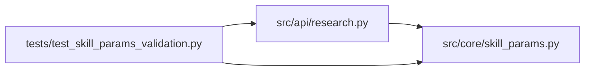

# skill_params Module

**Path:** `src/core/skill_params.py`

## Description

Skill-parameter resolution and validation over a declared schema subset.

Validator: the reference ``jsonschema`` implementation (the maintained
standard), pinned to the **Draft 2020-12** dialect. Skills declare
``param_schema`` using exactly this subset of JSON Schema keywords — anything
outside it is rejected at manifest load so it can never be silently
misinterpreted:

* structure: ``type`` (object / string / integer / number / boolean / array),
  ``properties``, ``required``, ``items``, and arbitrary nesting of these
* numeric/string/array bounds: ``minimum``, ``maximum``,
  ``exclusiveMinimum``, ``exclusiveMaximum``, ``minLength``, ``maxLength``,
  ``pattern``, ``minItems``, ``maxItems``
* value sets: ``enum``, ``const``
* extra-property policy: ``additionalProperties`` (true / false — unknown
  keys are permitted or rejected exactly as declared)

Canonical resolution path — one entry point, :func:`resolve_and_validate`:

1. an omitted or ``null`` parameter object resolves to ``{}`` (schemas that
   declare required fields then fail exactly as an empty submission does);
2. declared defaults are applied **deliberately** by :func:`apply_defaults`
   — validation never inserts values;
3. the resolved object is validated **once** against the schema;
4. violations come back field-addressed (``skill_params.a.b``) in the
   server-authoritative error contract that API responses and UI form
   validation share.

## Imports

| Source | Symbols |
|--------|---------|
| `__future__` | `annotations` |
| `jsonschema` | `Draft202012Validator` |
| `typing` | `Any`, `Mapping`, `Sequence` |

## Local dependency map

<!-- Auto-generated local dependency summary. Do not edit by hand. -->

### Internal neighbors

| Direction | Module |
|---|---|
| Inbound | [research](../modules/research.md) |
| Inbound | [test_skill_params_validation](../modules/test_skill_params_validation.md) |

### External packages

| Language | Used packages | Undeclared packages |
|---|---:|---:|
| python | 1 | 1 |

## Functions

| Function | Signature | Decorators | Description |
|----------|-----------|------------|-------------|
| `schema_to_json_schema` | `(schema: Any) -> dict[str, Any]` | — | Normalize a manifest ``ParamSchema`` (or plain mapping) to a dict. |
| `unsupported_schema_keywords` | `(schema: Any) -> frozenset[str]` | — | Keywords used by ``schema`` outside the declared subset (recursive). |
| `apply_defaults` | `(schema: Any, value: Mapping[str, Any] \| None) -> dict[str, Any]` | — | Resolve one parameter object by filling declared defaults. |
| `_apply_defaults_at` | `(node: Mapping[str, Any], value: dict[str, Any]) -> dict[str, Any]` | — | — |
| `validate_resolved` | `(skill_id: str, schema: Any, resolved: Mapping[str, Any]) -> list[dict[str, str]]` | — | Validate an already-resolved parameter object exactly once. |
| `_field_address` | `(absolute_path: Sequence[Any]) -> str` | — | — |
| `resolve_and_validate` | `(skill_id: str, schema: Any, raw: Mapping[str, Any] \| None) -> tuple[dict[str, Any], list[dict[str, str]]]` | — | The one canonical resolution path: resolve defaults, validate once. |
