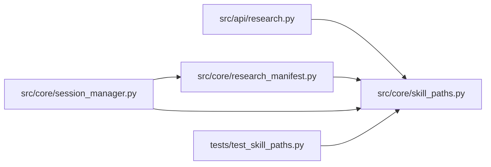

# skill_paths Module

**Path:** `src/core/skill_paths.py`

## Description

Skill path-template rendering (ARC-012 D4 / P7-005 / P7-007).

One closed placeholder vocabulary and one renderer for every path a skill
manifest can influence — the session workspace
(``workspace.session_path_template``) and the promotion target
(``promotion_target.primary.path_template``). Keeping the renderer in one
module is what makes the "add a skill directory, not a code change" guarantee
auditable: a template either renders here under the rules below or it fails
at skill-load time, never silently at first promotion.

Rules (D4, composed with the G6 loader semantics):

* Closed placeholder set. ``{skill_id}``/``{subject_id}``/``{variant}`` are
  the *identity* placeholders valid in path templates; ``{scope}``/
  ``{iteration}`` exist only in ``sidecar_extensions`` (they have no value at
  path-derivation time). Unknown single-word placeholders are rejected.
  Dotted namespaces — ``{settings.*}`` (resolved by the loader before
  validation) and ``{skill_params.*}`` (resolved at session build) — are G6
  vocabulary, pass through untouched, and are not rendered here.
* No ``..`` traversal, no backslashes. Absolute templates are NOT rejected:
  the G6 loader legitimately produces them by resolving
  ``{settings.host_configs_path}`` before validation — the sanctioned,
  operator-controlled escape hatch. Confinement is enforced where the
  untrusted values enter: rendered request-supplied segments.
* Rendered placeholder values are sanitized path segments: request-supplied
  ``subject_id``/``variant`` must not smuggle separators.

## Imports

| Source | Symbols |
|--------|---------|
| `__future__` | `annotations` |
| `re` | `re` |
| `typing` | `Any`, `Optional` |

## Local dependency map

<!-- Auto-generated local dependency summary. Do not edit by hand. -->

### Internal neighbors

| Direction | Module |
|---|---|
| Inbound | [research](../modules/research.md) |
| Inbound | [research_manifest](../modules/research_manifest.md) |
| Inbound | [session_manager](../modules/session_manager.md) |
| Inbound | [test_skill_paths](../modules/test_skill_paths.md) |

## Functions

| Function | Signature | Decorators | Description |
|----------|-----------|------------|-------------|
| `sanitize_path_segment` | `(value: str, *, field: str) -> str` | — | Reject values that cannot be a single safe path segment. |
| `validate_path_template` | `(template: str, *, allowed: frozenset[str] = PATH_TEMPLATE_IDENTITY_PLACEHOLDERS) -> None` | — | Validate a skill-declared path template at load time. |
| `render_path_template` | `(template: str, *, skill_id: str, subject_id: str, variant: str) -> str` | — | Render an identity-placeholder template into a relative path. |
| `_template_placeholder_tokens` | `(template: str) -> list[str]` | — | — |
| `session_workspace_path` | `(skill_manifest: Any, *, skill_id: str, subject_id: str, variant: str) -> Optional[str]` | — | Render a skill's ``workspace.session_path_template``. |
