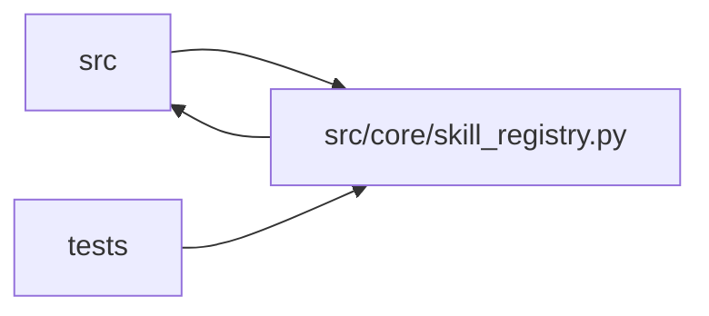

# skill_registry Module

**Path:** `src/core/skill_registry.py`

## Description

Skill registry — startup discovery + hot reload (ARC-011 P2-003).

The registry discovers ``skills/<id>/SKILL.yaml`` manifests under a
configurable root, caches the loaded ``ResearchSkillManifest`` objects keyed by
``id``, and reloads them on mtime change (hot reload). Manifests are loaded
lazily (the YAML is parsed on first access).

The discovery root defaults to the service's ``skills/`` directory — **not**
``Settings.skills_dir`` (which points at ``{workspace_root}/.github/skills``,
the workspace-side prompt-primer location). The two are distinct:

* ``skills/<id>/SKILL.yaml`` — the authoritative
  ``research_skill.v1`` manifest this registry loads (P2-005/009/013).
* ``{workspace}/.github/skills/<name>/SKILL.md`` — the legacy per-``model_type``
  prompt primer ``orchestrator._load_skill`` reads (removed in P2-021).

Design decisions (P1-007 house style):

* **Lazy + cached.** A manifest is parsed once on first ``get()``; subsequent
  calls return the cached object until the file's mtime changes. This keeps
  startup cheap and lets a skill author edit YAML and have the next session pick
  it up without a server restart (the X-003 hot-reload intent).
* **Not a singleton at import time.** ``SkillRegistry`` is instantiated where
  needed (a module-level ``default_registry`` is provided for convenience, but
  tests pass their own). Avoids import-time file-system access.
* **Unknown skill id raises, not returns ``None``.** A missing manifest is an
  authoring/deployment error, surfaced loudly.

## Imports

| Source | Symbols |
|--------|---------|
| `__future__` | `annotations` |
| `logging` | `logging` |
| `pathlib` | `Path` |
| `src.core.skill_loader` | `load_skill_manifest` |
| `src.core.skill_manifest` | `ResearchSkillManifest` |
| `typing` | `Any`, `Iterable`, `Optional` |

## Local dependency map

<!-- Auto-generated local dependency summary. Do not edit by hand. -->

> Module-level dependencies exceed the generated-diagram limits, so the diagram and table below group them by top-level package. Counts report the number of module neighbors in each package.

### Internal neighbors

| Direction | Module |
|---|---|
| Inbound | `src` (17) |
| Inbound | `tests` (16) |
| Outbound | `src` (2) |

> All 35 module neighbor(s) are summarized by package because the module-level view exceeds the 12-node limit.

## Classes

| Class | Line | Bases | Description |
|-------|------|-------|-------------|
| [SkillNotRegisteredError](../entities/SkillNotRegisteredError.md) | 56 | `KeyError` | Raised when a skill id is not present in the registry. |
| [SkillRegistry](../entities/SkillRegistry.md) | 69 | — | Discovers, caches, and serves ``research_skill.v1`` manifests. |
