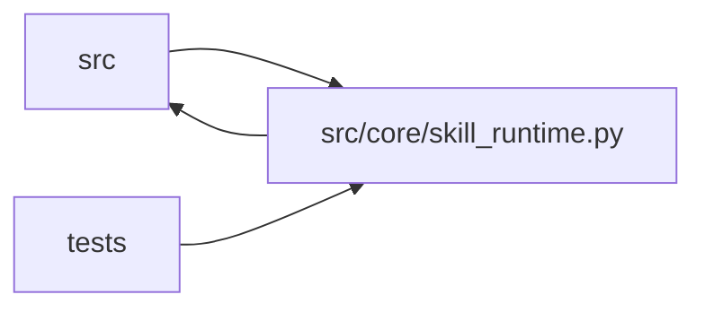

# skill_runtime Module

**Path:** `src/core/skill_runtime.py`

## Description

``SkillRuntime`` protocol — the single contract between skill author and
orchestrator (ARC-011 P1-023).

This module defines the ``SkillRuntime`` protocol: every domain-specific
decision the orchestrator used to make via ``if config.model_type == ...`` is
declared as a method on this protocol. The orchestrator (P1-027) materializes
one ``SkillRuntime`` per session and reaches every domain-specific behavior
through ``skill.<method>()``.

The only implementation is ``ManifestSkillRuntime``, driven entirely by a
validated ``ResearchSkillManifest`` loaded from ``skills/<id>/SKILL.yaml``.
(The transitional per-model runtimes that delegated to the orchestrator's
hardcoded ML code paths were removed together with the trading skills.)

Design decisions baked in here (D1-D3 from the plan):

* **Not ``@runtime_checkable``.** Typing-time contract only — mirrors
  ``LLMProvider`` / ``StateStore`` / ``OutputParser`` / ``PromotionTarget`` /
  ``PreflightCheck``.
* **Value types are ``TypedDict`` aliases over existing dict shapes (D1).**
  ``SessionRecord``, ``IterationRecord``, ``CommandPolicyExtension``, ``Phase``,
  ``AdvancementRule``, ``StructuredHPOPlan``, ``SubjectDescriptor``,
  ``VariantDescriptor`` are typing-only aliases so callers keep treating them as
  plain dicts (byte-identical behavior, zero construction churn). The storage
  layer returns dicts everywhere; a dataclass would force ``.to_dict()`` churn
  across the stack — rejected for a "behavior-identical" phase.
* **``session_nonce`` threading (D2).** ``parse_iteration`` accepts
  ``session_nonce: bytes``; manifest runtimes enforce the echoed-nonce contract
  when the skill declares ``output_parser.require_signed_metrics``.

P1-023 references protocols introduced by the three prerequisite epics:
``OutputParser`` (P1-010), ``PromotionTarget`` (P1-015), ``PreflightCheck``
(P1-019), ``StateStore`` (P1-006). All now exist.

## Imports

| Source | Symbols |
|--------|---------|
| `__future__` | `annotations` |
| `pathlib` | `Path` |
| `shlex` | `shlex` |
| `src.config` | `settings`, `settings` |
| `src.core.execution_request` | `PYTHON_BINDINGS`, `SUPPORTED_EXECUTABLE_BINDINGS`, `template_migration_reason` |
| `src.core.fs_safety` | `sha256_regular_file` |
| `src.core.gate_status` | `training_gates_passed_from_iteration` |
| `src.core.iteration_snapshot` | `build_trial_identity` |
| `src.core.orchestrator` | `ResearchConfig`, `PROMOTION_HANDOFF_INSTRUCTION`, `PROMOTION_HANDOFF_INSTRUCTION` |
| `src.core.output_parser` | `OutputParser`, `ResultSpec`, `parse_result_text`, `parse_and_verify_text`, `DelimitedKVParser`, `JSONMarkerParser`, `JSONMarkerParser` |
| `src.core.preflight` | `PreflightCheck`, `HTTPHealthCheck`, `LocalFileCheck`, `TCPConnectCheck` |
| `src.core.promotion_target` | `PromotionTarget`, `promotion_target_from_manifest` |
| `src.core.service_preflight` | `ServicePreflightTarget` |
| `src.core.skill_host_services` | `SkillHostServices` |
| `src.core.skill_registry` | `DEFAULT_SKILLS_ROOT`, `default_registry` |
| `src.core.state_store` | `StateStore` |
| `typing` | `TYPE_CHECKING`, `Any`, `Optional`, `Protocol`, `TypedDict`, `cast` |

## Local dependency map

<!-- Auto-generated local dependency summary. Do not edit by hand. -->

> Module-level dependencies exceed the generated-diagram limits, so the diagram and table below group them by top-level package. Counts report the number of module neighbors in each package.

### Internal neighbors

| Direction | Module |
|---|---|
| Inbound | `src` (3) |
| Inbound | `tests` (21) |
| Outbound | `src` (13) |

> All 36 module neighbor(s) are summarized by package because the module-level view exceeds the 12-node limit.

## Classes

| Class | Line | Bases | Description |
|-------|------|-------|-------------|
| [SkillConfigError](../entities/SkillConfigError.md) | 66 | `ValueError` | A skill manifest declares something the runtime cannot honor. |
| [SessionRecord](../entities/SessionRecord.md) | 83 | `TypedDict` | Alias over the session dict ``StateStore.get_session`` returns. Keys |
| [IterationRecord](../entities/IterationRecord.md) | 96 | `TypedDict` | Alias over the iteration dict ``StateStore.get_iteration`` returns |
| [CommandPolicyExtension](../entities/CommandPolicyExtension.md) | 102 | `TypedDict` | Per-skill extension to the orchestrator's base command policy. |
| [Phase](../entities/skill_runtime_Phase.md) | 142 | `TypedDict` | Alias over the phase dict shape in ``research_phase_plan.py`` |
| [UnsupportedPhaseAdvancementError](../entities/UnsupportedPhaseAdvancementError.md) | 156 | `ValueError` | Raised when a plugin phase-advancement declaration is unsupported. |
| [AdvancementRule](../entities/AdvancementRule.md) | 167 | `TypedDict` | Phase advancement evidence rule. Today advancement keys live in the |
| [StructuredHPOPlan](../entities/StructuredHPOPlan.md) | 180 | `TypedDict` | Alias over the HPO plan dict ``structured_hpo.build_structured_hpo_plan`` |
| [SubjectDescriptor](../entities/SubjectDescriptor.md) | 188 | `TypedDict` | A research subject a skill can enumerate (e.g. an instrument, a model |
| [VariantDescriptor](../entities/VariantDescriptor.md) | 197 | `TypedDict` | A variant under a subject (e.g. a timeframe, a parameterization). |
| [SkillRuntime](../entities/SkillRuntime.md) | 211 | `Protocol` | Contract every research skill implements (ARC-011 P1-023, §7.5). |
| [ManifestSkillRuntime](../entities/ManifestSkillRuntime.md) | 394 | — | A ``SkillRuntime`` driven entirely by a ``ResearchSkillManifest`` (P2-007). |

## Functions

| Function | Signature | Decorators | Description |
|----------|-----------|------------|-------------|
| `materialize_skill_runtime` | `(orchestrator: Any, config: 'ResearchConfig') -> SkillRuntime` | — | Build the ``SkillRuntime`` for a session. |
