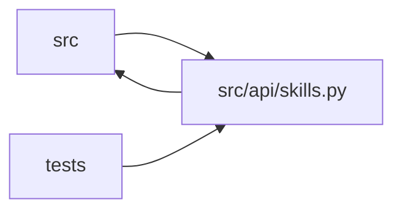

# skills Module

**Path:** `src/api/skills.py`

## Description

Skill descriptor endpoints — the generic skill API surface (ARC-011 P3-001..008, P3-011).

A new research domain is added by dropping a ``skills/<id>/`` directory and
reloading — **zero orchestrator or UI code changes** (ARC-011 §7.14). This
module exposes the installed skill manifests to the UI and API clients so the
*same* NewResearch form, MetricsChart, IterationsTable, and PromotionModal can
render any skill from descriptor data alone.

Endpoint family (all under ``/api/v1``):

* ``GET /skills``                       — list of installed skill summaries
* ``GET /skills/{id}``                  — full skill descriptor
* ``GET /skills/{id}/param-schema``     — the ``param_schema`` JSON Schema
* ``GET /skills/{id}/form-fields``      — UI form-field definitions
* ``GET /skills/{id}/metric-schema``    — the ``metric_schema`` (chart/table/gates)
* ``GET /skills/{id}/versions``         — declared versions
* ``GET /skills/{id}/changelog``        — the skill's ``CHANGELOG.md`` content
* ``POST /skills/reload``               — auth-gated hot reload (dev)

Design decisions (P1-007 house style):

* **Registry-backed, not import-time.** The ``SkillRegistry`` is injected via
  ``init()`` (same DI pattern as ``research``/``results``/``promotion``).
  Defaults to ``default_registry`` when not wired (tests can pass their own).
* **Manifest projection, not re-serialization.** Responses are built by calling
  ``.model_dump()`` on the validated Pydantic manifest models — the schema is the
  single source of truth, so the API and the runtime can never drift.
* **404 with installable-skills hint.** An unknown ``skill_id`` returns a 404
  whose body lists the available skills (P3-013 AC, §10 guarantee).

## Imports

| Source | Symbols |
|--------|---------|
| `__future__` | `annotations` |
| `fastapi` | `APIRouter`, `Depends`, `HTTPException`, `Query`, `Request` |
| `logging` | `logging` |
| `pathlib` | `Path` |
| `pydantic` | `BaseModel`, `Field` |
| `src.api.audit` | `record_api_audit_event` |
| `src.api.auth` | `require_api_auth` |
| `src.config` | `settings` |
| `src.core.legacy_alias` | `skill_id_to_model_type` |
| `src.core.llm_provider` | `build_provider` |
| `src.core.skill_generator` | `SkillGenerationError`, `SkillGenerator` |
| `src.core.skill_manifest` | `ResearchSkillManifest` |
| `src.core.skill_registry` | `DEFAULT_SKILLS_ROOT`, `SkillNotRegisteredError`, `SkillRegistry`, `default_registry` |
| `subprocess` | `subprocess` |
| `typing` | `Any`, `Dict`, `List`, `Literal`, `Optional` |

## Local dependency map

<!-- Auto-generated local dependency summary. Do not edit by hand. -->

> Module-level dependencies exceed the generated-diagram limits, so the diagram and table below group them by top-level package. Counts report the number of module neighbors in each package.

### Internal neighbors

| Direction | Module |
|---|---|
| Inbound | `src` (1) |
| Inbound | `tests` (5) |
| Outbound | `src` (8) |

### External packages

| Language | Used packages | Undeclared packages |
|---|---:|---:|
| python | 2 | 1 |

> All 14 module neighbor(s) are summarized by package because the module-level view exceeds the 12-node limit.

## Classes

| Class | Line | Bases | Description |
|-------|------|-------|-------------|
| [GenerateSkillRequest](../entities/GenerateSkillRequest.md) | 443 | `BaseModel` | Body for ``POST /skills/generate``. |

## Functions

| Function | Signature | Decorators | Description |
|----------|-----------|------------|-------------|
| `init` | `(registry: Optional[SkillRegistry] = None, store: Any = None) -> None` | — | Wire the skill registry and store into this module (called from lifespan). |
| `_skill_summary` | `(manifest: ResearchSkillManifest) -> Dict[str, Any]` | — | A lightweight summary for ``GET /skills`` list responses. |
| `_skill_descriptor` | `(manifest: ResearchSkillManifest) -> Dict[str, Any]` | — | The full descriptor for ``GET /skills/{id}`` — the validated manifest |
| `_form_fields` | `(manifest: ResearchSkillManifest) -> List[Dict[str, Any]]` | — | UI form-field definitions for ``GET /skills/{id}/form-fields``. |
| `_skill_dir` | `(manifest_id: str) -> Path` | — | Resolve the on-disk skill package directory for ``manifest_id``. |
| `_audit` | *(async)* `(request: Request, *, action: str, outcome: str, metadata: dict[str, Any] \| None = None, error_message: str \| None = None)` | — | — |
| `_get_or_404` | `(skill_id: str) -> ResearchSkillManifest` | — | Load a manifest by id, raising 404 with an installable-skills hint. |
| `list_skills` | *(async)* `(category: Optional[str] = None) -> List[Dict[str, Any]]` | `@router.get('/skills')` | List installed skill summaries. |
| `get_skill` | *(async)* `(skill_id: str)` | `@router.get('/skills/{skill_id}')` | Full skill descriptor (manifest + links). |
| `get_skill_param_schema` | *(async)* `(skill_id: str)` | `@router.get('/skills/{skill_id}/param-schema')` | The ``param_schema`` JSON Schema for ``skill_params`` validation. |
| `get_skill_form_fields` | *(async)* `(skill_id: str)` | `@router.get('/skills/{skill_id}/form-fields')` | UI form-field definitions for the dynamic form renderer. |
| `get_skill_metric_schema` | *(async)* `(skill_id: str)` | `@router.get('/skills/{skill_id}/metric-schema')` | The ``metric_schema`` — primary metric, gates, chart series, table columns. |
| `get_skill_leaderboard` | *(async)* `(skill_id: str, limit: int = Query(default=20, ge=1, le=100, title='Limit'))` | `@router.get('/skills/{skill_id}/leaderboard')` | Cross-session leaderboard for one skill. |
| `get_skill_versions` | *(async)* `(skill_id: str)` | `@router.get('/skills/{skill_id}/versions')` | Declared skill versions + best-effort git-tag history. |
| `_skill_git_tags` | `(skill_id: str) -> List[str]` | — | Git tags recorded for this skill (``skill/<id>/*``), newest-last. |
| `get_skill_changelog` | *(async)* `(skill_id: str)` | `@router.get('/skills/{skill_id}/changelog')` | The skill's ``CHANGELOG.md`` content. |
| `reload_skills` | *(async)* `(request: Request)` | `@router.post('/skills/reload')` | Auth-gated hot reload of all skill manifests (dev convenience). |
| `generate_skill` | *(async)* `(body: GenerateSkillRequest, request: Request)` | `@router.post('/skills/generate', status_code=201)` | Draft a new skill package from a goal (P2 Skill SDK). |
