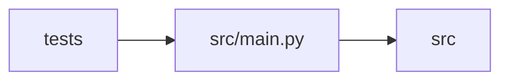

# main Module

**Path:** `src/main.py`

## Description

Autoresearch Agent — FastAPI application entry point.

## Imports

| Source | Symbols |
|--------|---------|
| `__future__` | `annotations` |
| `asyncio` | `asyncio` |
| `contextlib` | `asynccontextmanager` |
| `fastapi` | `Depends`, `FastAPI`, `HTTPException`, `Request`, `WebSocket`, `WebSocketDisconnect` |
| `fastapi.middleware.cors` | `CORSMiddleware` |
| `fastapi.responses` | `FileResponse`, `Response` |
| `fastapi.staticfiles` | `StaticFiles` |
| `logging` | `logging` |
| `os` | `os` |
| `secrets` | `secrets` |
| `src.api` | `harnesses`, `promotion`, `research`, `results`, `skills`, `subjects` |
| `src.api.agent` | `router` |
| `src.api.auth` | `require_api_auth`, `require_websocket_auth` |
| `src.api.harnesses` | `router` |
| `src.api.promotion` | `router` |
| `src.api.research` | `router` |
| `src.api.results` | `router` |
| `src.api.skills` | `router` |
| `src.api.subjects` | `router` |
| `src.config` | `secret_value`, `settings` |
| `src.core.config_promoter` | `ConfigPromoter` |
| `src.core.http_headers` | `ensure_app_request_headers` |
| `src.core.observability` | `PROMETHEUS_CONTENT_TYPE`, `empty_observability_snapshot`, `format_prometheus` |
| `src.core.postgres_state_store` | `build_state_store`, `is_postgres_dsn` |
| `src.core.service_preflight` | `build_not_run_preflight`, `run_service_preflight` |
| `src.core.session_manager` | `SessionManager` |
| `src.core.skill_registry` | `SkillRegistry` |
| `src.core.state_store` | `StateStore` |
| `src.ws.events` | `broadcaster`, `plan_catchup`, `poll_events`, `snapshot_with_cursor` |
| `typing` | `Any`, `AsyncIterator` |

## Local dependency map

<!-- Auto-generated local dependency summary. Do not edit by hand. -->

> Module-level dependencies exceed the generated-diagram limits, so the diagram and table below group them by top-level package. Counts report the number of module neighbors in each package.

### Internal neighbors

| Direction | Module |
|---|---|
| Inbound | `tests` (4) |
| Outbound | `src` (18) |

### External packages

| Language | Used packages | Undeclared packages |
|---|---:|---:|
| python | 1 | 1 |

> All 22 module neighbor(s) are summarized by package because the module-level view exceeds the 12-node limit.

## Functions

| Function | Signature | Decorators | Description |
|----------|-----------|------------|-------------|
| `_validate_runtime_configuration` | `() -> None` | — | Fail fast for settings that would break this service's invariants. |
| `lifespan` | *(async)* `(app: FastAPI) -> AsyncIterator[None]` | `@asynccontextmanager` | Startup and shutdown logic. |
| `_normalise_api_prefix` | `(prefix: str) -> str` | — | — |
| `_include_api_routers` | `(prefix: str, *, include_in_schema: bool = True) -> None` | — | — |
| `health` | *(async)* `() -> dict[str, Any]` | `@app.get('/health')` | — |
| `info` | *(async)* `(request: Request) -> dict[str, Any]` | `@app.get('/info')` | — |
| `readiness` | *(async)* `() -> dict[str, Any]` | `@app.get('/health/ready')` | — |
| `monitoring_health` | *(async)* `() -> dict[str, Any]` | `@app.get('/monitoring/health')` | — |
| `_collect_observability_snapshot` | *(async)* `() -> dict[str, Any]` | — | — |
| `metrics` | *(async)* `(request: Request) -> Response` | `@app.get('/metrics', include_in_schema=False)` | — |
| `observability_alerts` | *(async)* `() -> dict[str, Any]` | `@app.get(f'{_API_V1_PREFIX}/observability/alerts', dependencies=[Depends(require_api_auth)])`, `@app.get('/api/observability/alerts', include_in_schema=False, dependencies=[Depends(require_api_auth)])` | — |
| `api_v1_not_found` | *(async)* `(full_path: str) -> None` | `@app.api_route(f'{_API_V1_PREFIX}/{{full_path:path}}', methods=['GET', 'POST', 'PUT', 'PATCH', 'DELETE', 'OPTIONS', 'HEAD'], include_in_schema=False)` | — |
| `websocket_events` | *(async)* `(websocket: WebSocket) -> None` | `@app.websocket('/ws/events')` | — |
| `spa_fallback` | *(async)* `(full_path: str) -> FileResponse` | `@app.get('/{full_path:path}', include_in_schema=False)` | — |
