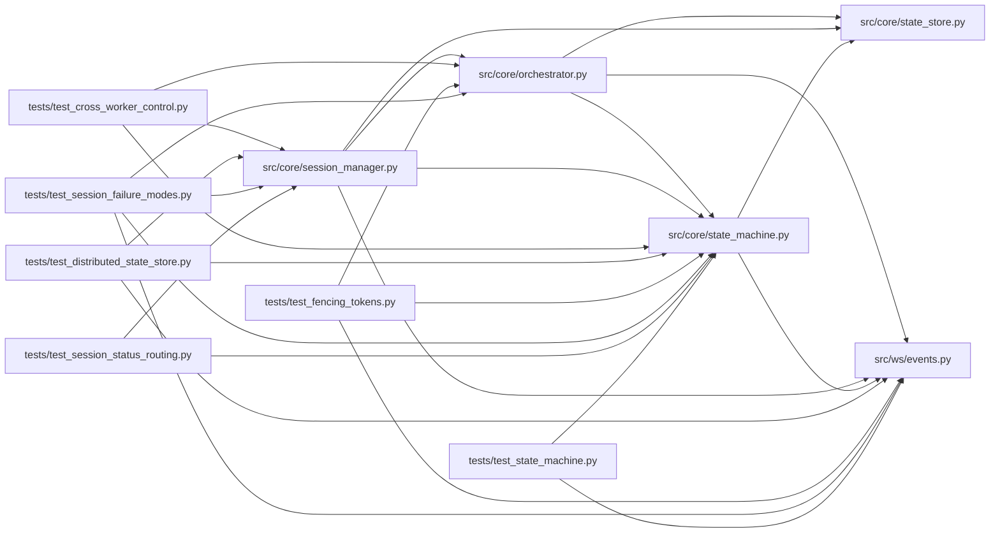

# state_machine Module

**Path:** `src/core/state_machine.py`

## Description

Session state machine — the authoritative session-lifecycle writer.

ARC-011 (P0-002) turns the session lifecycle into *data, not ad-hoc status
writes*. This module defines the 13-state diagram, a ``(from, event)`` base
transition table, the severity-override guards that close the W8 race, and
``SessionStateMachine.transition`` — the single legal status writer. ``transition``
holds a per-session ``asyncio.Lock`` across ``read -> guard -> write (transitional
then terminal) -> audit -> broadcast``, so concurrent ``stop`` / ``complete`` /
``timeout`` / ``fail`` intents are resolved by severity
(``fail > timeout > stop > complete``) rather than racing over an unsynchronized
flag.

Scope (P0-002): this module performs only status / audit / broadcast
side-effects. Domain side-effects — spawning the orchestrator task, setting /
clearing the pause & stop flags, auto-promotion, interrupting runtime commands
— stay with the caller and are signalled via ``TransitionResult``. Routing the
existing direct ``status=`` writers through ``transition()`` is P0-003 / P0-004;
the end-to-end W8 race replay is P0-005. See
ARC-011 P0-002 §3-§7 for the design consumed here (the full diagram and
transition tables are recorded in this module).

## Imports

| Source | Symbols |
|--------|---------|
| `__future__` | `annotations` |
| `asyncio` | `asyncio` |
| `contextlib` | `asynccontextmanager` |
| `dataclasses` | `dataclass` |
| `enum` | `Enum` |
| `logging` | `logging` |
| `src.core.state_store` | `StateStore` |
| `src.ws.events` | `EventBroadcaster` |
| `typing` | `Any`, `AsyncIterator`, `Dict`, `FrozenSet`, `Optional`, `Tuple`, `Union` |

## Local dependency map

<!-- Auto-generated local dependency summary. Do not edit by hand. -->

### Internal neighbors

| Direction | Module |
|---|---|
| Inbound | [orchestrator](../modules/orchestrator.md) |
| Inbound | [session_manager](../modules/session_manager.md) |
| Inbound | [test_cross_worker_control](../modules/test_cross_worker_control.md) |
| Inbound | [test_distributed_state_store](../modules/test_distributed_state_store.md) |
| Inbound | [test_fencing_tokens](../modules/test_fencing_tokens.md) |
| Inbound | [test_session_failure_modes](../modules/test_session_failure_modes.md) |
| Inbound | [test_session_status_routing](../modules/test_session_status_routing.md) |
| Inbound | [test_state_machine](../modules/test_state_machine.md) |
| Outbound | [state_store](../modules/state_store.md) |
| Outbound | [events](../modules/events.md) |

## Classes

| Class | Kind | Line | Bases / Target | Description |
|-------|------|------|----------------|-------------|
| [SessionState](../entities/SessionState.md) | Enum | 44 | `str`, `Enum` | The 13 session lifecycle states (ARC-011 §3). |
| [SessionEvent](../entities/SessionEvent.md) | Enum | 67 | `str`, `Enum` | Events that drive session state transitions (ARC-011 §4.1). |
| [IllegalTransitionError](../entities/IllegalTransitionError.md) | Class | 124 | `RuntimeError` | Raised when an event is not legal from the session's current state. |
| [TransitionResult](../entities/TransitionResult.md) | Class | 142 | — | Outcome of a ``transition()`` call. |
| [_TransitionSpec](../entities/TransitionSpec.md) | Class | 163 | — | Declarative description of a transition's writes and side-effects. |
| [SessionLockRegistry](../entities/SessionLockRegistry.md) | Class | 291 | — | Per-session ``asyncio.Lock`` registry for ``transition()``. |
| [SessionStateMachine](../entities/SessionStateMachine.md) | Class | 328 | — | The single legal writer of ``research_sessions.status``. |

## Functions

| Function | Signature | Decorators | Description |
|----------|-----------|------------|-------------|
| `_resolve_severity` | `(current: SessionState, evt: SessionEvent) -> Tuple[Optional[_TransitionSpec], bool, bool]` | — | Resolve an event against an in-flight transitional (intent) state. |
