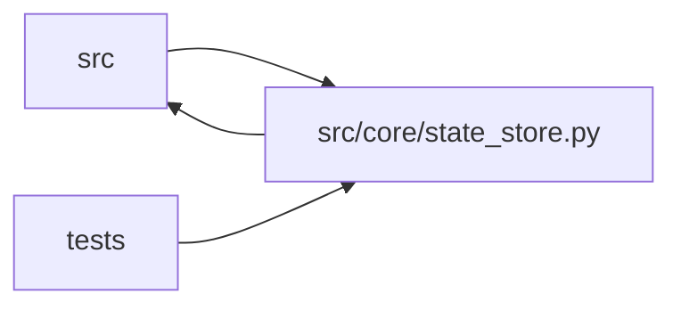

# state_store Module

**Path:** `src/core/state_store.py`

## Description

``StateStore`` protocol + ``SQLiteStateStore`` implementation
(ARC-011 P1-006 / P1-007).

This module introduces the ``StateStore`` protocol — the storage abstraction
every consumer reaches through — and extracts ``SQLiteStateStore``, the 1:1
rename of the former ``ResultsStore`` (canonical home moved here from
``src/core/results_store.py``, which is now a back-compat re-export shim).
``SQLiteStateStore`` is the single concrete implementation today; P6-001/P6-002
will add ``PostgresStateStore`` behind the same protocol.

The extraction is **behavior-identical**: every method body is unchanged, the
schema DDL + ``_MIGRATIONS`` registry stay inside the SQLite impl (P1-007 AC
#4), and the X-002 parity suite is preserved. Mirrors the P1-001/P1-002 LLM
precedent (``llm_provider.py`` co-locates ``LLMProvider`` + ``AnthropicProvider``).

Design decisions baked in here:

* **Not ``@runtime_checkable``.** ``isinstance`` against a ``Protocol`` only
  checks attribute presence (false confidence on signatures). This is a
  typing-time contract; consumers accept it as a typed parameter. Mirrors the
  ``LLMProvider`` decision (``llm_provider.py``).
* **``connection()`` is intentionally absent from the protocol.** It returns
  ``AsyncIterator[aiosqlite.Connection]`` and would leak the SQLite backend
  type through the abstraction. No external consumer calls it (only internal
  store methods do); it remains a private concern of ``SQLiteStateStore``.

P1-007 backlog AC deviations (the AC text predated grounding; recorded here in
the house-style of P1-002's ``D-retry`` CHANGELOG callout):

* **AC #2 ("``WEB_CONCURRENCY > 1`` guard remains here") is factually off.**
  The guard lives at ``src/main.py:_validate_runtime_configuration`` (a
  service-lifecycle concern checked at startup, never inside the store). It
  stays in ``main.py``; the single-instance *constraint* (W14 ceiling) is
  documented on ``SQLiteStateStore`` instead.
* **AC #3 names two methods that don't exist.** ``record_iteration`` → the
  real method is ``add_iteration``; ``list_iterations`` → the real method is
  ``get_iterations``. The protocol uses the real names.

Exception policy (ARC-011 P0-008): the full try/except inventory with rationale
lives in the ARC-011 exception inventory (not retained; the summary below is
the record). Summary —
every ``except`` here is either a narrow read-degrade
``(json.JSONDecodeError, TypeError)`` or, in two cases, a deliberate broad
catch: ``initialize()`` ``except Exception:`` re-raises after closing the
connection (cleanup, not swallowing — and it must stay broad to also surface
the version-skew ``RuntimeError``), and ``ping()`` is narrowed to
``aiosqlite.Error`` (health-probe degrade). There are no migration catch-alls:
``_add_column_if_missing`` uses a ``PRAGMA table_info`` pre-check (LBYL) so
genuine ``OperationalError`` propagate (P0-009).

## Imports

| Source | Symbols |
|--------|---------|
| `__future__` | `annotations` |
| `aiosqlite` | `aiosqlite` |
| `asyncio` | `asyncio` |
| `collections` | `Counter`, `defaultdict` |
| `contextlib` | `asynccontextmanager` |
| `datetime` | `datetime`, `timedelta`, `timezone` |
| `hashlib` | `hashlib` |
| `json` | `json` |
| `logging` | `logging` |
| `os` | `os` |
| `sqlite3` | `sqlite3` |
| `src.core.artifact_reference` | `normalize_artifact_references_in_mapping`, `normalize_optional_artifact_ref` |
| `src.core.gate_status` | `consistency_report_passed`, `normalize_training_gate_aliases` |
| `src.core.objective_comparator` | `ObjectiveComparator`, `select_best_row` |
| `src.core.observability` | `OBSERVABILITY_SCHEMA_VERSION`, `alert_suggestions`, `log_research_event` |
| `src.core.pagination` | `clamp_limit` |
| `typing` | `Any`, `AsyncIterator`, `Dict`, `List`, `Mapping`, `Optional`, `Protocol`, `Sequence` |
| `uuid` | `uuid` |

## Local dependency map

<!-- Auto-generated local dependency summary. Do not edit by hand. -->

> Module-level dependencies exceed the generated-diagram limits, so the diagram and table below group them by top-level package. Counts report the number of module neighbors in each package.

### Internal neighbors

| Direction | Module |
|---|---|
| Inbound | `src` (8) |
| Inbound | `tests` (17) |
| Outbound | `src` (5) |

### External packages

| Language | Used packages | Undeclared packages |
|---|---:|---:|
| python | 1 | 1 |

> All 30 module neighbor(s) are summarized by package because the module-level view exceeds the 12-node limit.

## Classes

| Class | Line | Bases | Description |
|-------|------|-------|-------------|
| [CapacityExceeded](../entities/CapacityExceeded.md) | 988 | `RuntimeError` | Raised when admitting work would exceed the configured global limit. |
| [BudgetExceeded](../entities/BudgetExceeded.md) | 992 | `RuntimeError` | Raised when a reservation would oversubscribe the strict known budget. |
| [StaleFenceError](../entities/StaleFenceError.md) | 996 | `ValueError` | Raised when a write carries a fence epoch older than the current one. |
| [StateStore](../entities/StateStore.md) | 1000 | `Protocol` | Storage abstraction for research sessions, iterations, and promotions. |
| [_TaskReentrantLock](../entities/TaskReentrantLock.md) | 1673 | — | An asyncio lock reentrant within one task. |
| [SQLiteStateStore](../entities/SQLiteStateStore.md) | 1703 | — | SQLite-specific implementation of :class:`StateStore`. |

## Functions

| Function | Signature | Decorators | Description |
|----------|-----------|------------|-------------|
| `_json_object` | `(raw: Any) -> Dict[str, Any]` | — | — |
| `_json_list` | `(raw: Any) -> List[Any]` | — | — |
| `_truthy_status` | `(payload: Dict[str, Any]) -> bool` | — | — |
| `_attempt_outcome` | `(row: Dict[str, Any], metrics: Dict[str, Any]) -> str` | — | — |
| `_consistency_failed` | `(row: Dict[str, Any]) -> bool` | — | True iff the row's consistency_report explicitly recorded passed=False. |
| `_replay_status` | `(metrics: Dict[str, Any]) -> str` | — | — |
| `_reason_slug` | `(value: Any) -> str` | — | — |
| `_counter_rows` | `(counter: Counter[tuple[Any, ...]], keys: tuple[str, ...]) -> List[Dict[str, Any]]` | — | — |
| `_value_rows` | `(values: Dict[str, float], key: str) -> List[Dict[str, Any]]` | — | — |
| `_normalized_iteration_metrics_json` | `(*, metrics_json: Optional[str], all_gates_passed: Optional[bool], consistency_report_json: Optional[str], context: str) -> tuple[Optional[str], Optional[bool]]` | — | Normalize additive gate aliases inside an iteration metrics payload. |
| `_add_column_if_missing` | *(async)* `(db: aiosqlite.Connection, table: str, column_def: str) -> None` | — | Idempotent ``ALTER TABLE ADD COLUMN`` migration. |
| `_get_schema_version` | *(async)* `(db: aiosqlite.Connection) -> int` | — | — |
| `_set_schema_version` | *(async)* `(db: aiosqlite.Connection, version: int) -> None` | — | — |
| `_migrate_to_v1` | *(async)* `(db: aiosqlite.Connection) -> None` | — | Reconcile the current pre-versioned SQLite schema. |
| `_migrate_to_v2` | *(async)* `(db: aiosqlite.Connection) -> None` | — | Add API idempotency records and audit query covering indexes. |
| `_migrate_to_v3` | *(async)* `(db: aiosqlite.Connection) -> None` | — | F9: structured ``terminal_reason`` on ``research_sessions``. |
| `_migrate_to_v4` | *(async)* `(db: aiosqlite.Connection) -> None` | — | Promotion waiver + effective-iteration counter on ``research_sessions``. |
| `_migrate_to_v5` | *(async)* `(db: aiosqlite.Connection) -> None` | — | Cursor-pagination supporting indexes (ARC-011 P0-015..019). |
| `_migrate_to_v6` | *(async)* `(db: aiosqlite.Connection) -> None` | — | P3-019: native canonical skill columns on ``research_sessions``. |
| `_migrate_to_v10` | *(async)* `(db: aiosqlite.Connection) -> None` | — | Transactional event outbox for cross-worker delivery and replay. |
| `_migrate_to_v11` | *(async)* `(db: aiosqlite.Connection) -> None` | — | Comparable-context identity for direction-aware leaderboard ranking. |
| `_migrate_to_v9` | *(async)* `(db: aiosqlite.Connection) -> None` | — | Usage ledger and budget reservations (append-only accounting). |
| `_migrate_to_v8` | *(async)* `(db: aiosqlite.Connection) -> None` | — | Work reservations: atomic admission and ownership fencing. |
| `_migrate_to_v7` | *(async)* `(db: aiosqlite.Connection) -> None` | — | Secret references live separately from the value-bearing manifest. |
