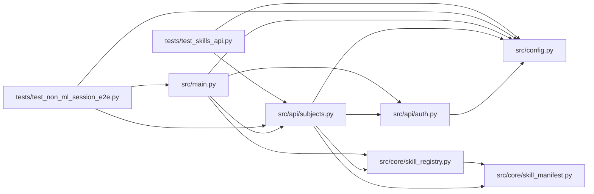

# subjects Module

**Path:** `src/api/subjects.py`

## Description

Subject & variant enumeration endpoints.

A *subject* is the entity a research session tunes (an instrument for ML skills,
a database for db-config-tuning, a code repo for code-refactor). A *variant* is
a per-subject sweep dimension (a timeframe, a question set, etc.). Together
they replace the legacy hardcoded ``instrument`` / ``timeframe`` pair with a
generic, skill-declared enumeration (G12).

Endpoints (all under ``/api/v1``):

* ``GET /subjects?skill_id=…``                — subjects for a skill
* ``GET /subjects/{subject_id}/variants?skill_id=…``  — variants for a subject

The legacy ``GET /instruments`` alias was removed with the trading-skills
cleanup; the canonical skill-parameterized ``GET /subjects`` surface below
is the only enumeration API.

## Imports

| Source | Symbols |
|--------|---------|
| `__future__` | `annotations` |
| `fastapi` | `APIRouter`, `Depends`, `HTTPException` |
| `logging` | `logging` |
| `src.api.auth` | `require_api_auth` |
| `src.config` | `settings` |
| `src.core.skill_manifest` | `ResearchSkillManifest` |
| `src.core.skill_registry` | `SkillNotRegisteredError`, `SkillRegistry`, `default_registry` |
| `typing` | `Any`, `Dict`, `List`, `Optional` |

## Local dependency map

<!-- Auto-generated local dependency summary. Do not edit by hand. -->

### Internal neighbors

| Direction | Module |
|---|---|
| Inbound | [src_main](../modules/src_main.md) |
| Inbound | [test_non_ml_session_e2e](../modules/test_non_ml_session_e2e.md) |
| Inbound | [test_skills_api](../modules/test_skills_api.md) |
| Outbound | [auth](../modules/auth.md) |
| Outbound | [config](../modules/config.md) |
| Outbound | [skill_manifest](../modules/skill_manifest.md) |
| Outbound | [skill_registry](../modules/skill_registry.md) |

### External packages

| Language | Used packages | Undeclared packages |
|---|---:|---:|
| python | 1 | 1 |

## Functions

| Function | Signature | Decorators | Description |
|----------|-----------|------------|-------------|
| `init` | `(registry: Optional[SkillRegistry] = None) -> None` | — | — |
| `_get_manifest_or_404` | `(skill_id: str) -> ResearchSkillManifest` | — | Load a manifest by id, raising 404 with the installable-skills hint. |
| `_enumerate_subjects` | `(manifest: ResearchSkillManifest) -> List[Dict[str, Any]]` | — | Resolve a skill's subject list. |
| `_enumerate_variants` | `(manifest: ResearchSkillManifest, subject_id: str) -> List[str]` | — | Resolve a skill's variant list for a given subject. |
| `list_subjects` | *(async)* `(skill_id: str) -> List[Dict[str, Any]]` | `@router.get('/subjects')` | List subjects for a skill. |
| `list_subject_variants` | *(async)* `(subject_id: str, skill_id: str) -> Dict[str, Any]` | `@router.get('/subjects/{subject_id}/variants')` | List variants for a subject under a skill. |
