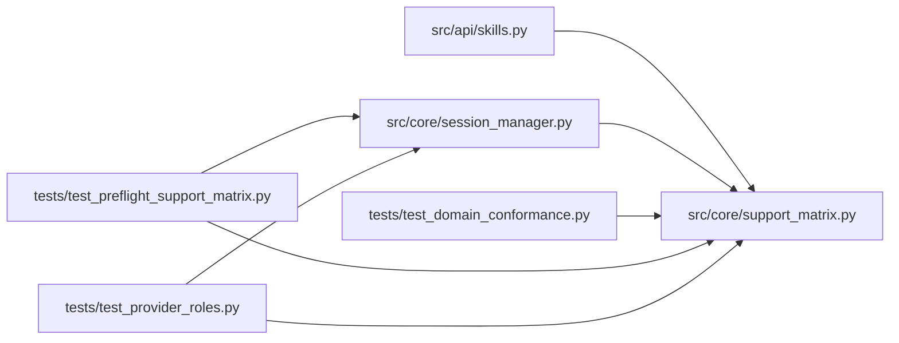

# support_matrix Module

**Path:** `src/core/support_matrix.py`

## Description

Machine-readable support matrix for manifest declarations.

Schema parsing is never proof that a skill can execute: every accepted
manifest feature maps here to its implementing handler and its conformance
case. Declarations outside the supported sets are rejected before launch with
a specific unsupported-capability reason; declarations that are accepted but
have no independent behavior are published as ``accepted_advisory`` so they
are visible rather than silently inert.

This module validates and describes only — it never grants execution
authority. Toolchain checks inspect availability (path lookup) and change
nothing about what may run.

## Imports

| Source | Symbols |
|--------|---------|
| `__future__` | `annotations` |
| `shutil` | `shutil` |
| `typing` | `Any`, `Mapping` |

## Local dependency map

<!-- Auto-generated local dependency summary. Do not edit by hand. -->

### Internal neighbors

| Direction | Module |
|---|---|
| Inbound | [src_api_skills](../modules/src_api_skills.md) |
| Inbound | [session_manager](../modules/session_manager.md) |
| Inbound | [test_domain_conformance](../modules/test_domain_conformance.md) |
| Inbound | [test_preflight_support_matrix](../modules/test_preflight_support_matrix.md) |
| Inbound | [test_provider_roles](../modules/test_provider_roles.md) |

## Functions

| Function | Signature | Decorators | Description |
|----------|-----------|------------|-------------|
| `_declared` | `(value: Any) -> list[str]` | — | — |
| `validate_manifest_support` | `(manifest: Any) -> list[Mapping[str, Any]]` | — | Specific unsupported-capability diagnostics for one manifest. |
| `toolchain_diagnostics` | `(manifest: Any, *, which: Any = shutil.which) -> list[Mapping[str, Any]]` | — | Availability diagnostics for declared toolchain names. |
| `support_descriptor` | `(manifest: Any, *, which: Any = shutil.which) -> Mapping[str, Any]` | — | The machine-readable support/diagnostics descriptor for one skill. |
