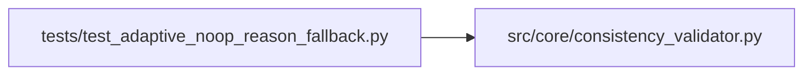

# test_adaptive_noop_reason_fallback Module

**Path:** `tests/test_adaptive_noop_reason_fallback.py`

## Description

Tests for adaptive_feature_noop_reason fallback logic in direction prepare.py.

When the training pipeline returns `requested: false` for adaptive_features,
the noop_reason should fall back to 'adaptive_features_unavailable' so that
the adaptive_feature_sweeps phase completes (ACCEPTED_ADAPTIVE_NOOP_REASONS).

## Imports

| Source | Symbols |
|--------|---------|
| `__future__` | `annotations` |
| `pytest` | `pytest` |
| `src.core.consistency_validator` | `ACCEPTED_ADAPTIVE_NOOP_REASONS` |
| `typing` | `Any`, `Dict` |

## Local dependency map

<!-- Auto-generated local dependency summary. Do not edit by hand. -->

### Internal neighbors

| Direction | Module |
|---|---|
| Outbound | [consistency_validator](../modules/consistency_validator.md) |

### External packages

| Language | Used packages | Undeclared packages |
|---|---:|---:|
| python | 1 | 1 |

## Classes

| Class | Line | Bases | Description |
|-------|------|-------|-------------|
| [TestAdaptiveNoopReasonFallback](../entities/TestAdaptiveNoopReasonFallback.md) | 33 | — | — |

## Functions

| Function | Signature | Decorators | Description |
|----------|-----------|------------|-------------|
| `_resolve_noop_reason` | `(adaptive_features: Dict[str, Any], results: Dict[str, Any]) -> str` | — | Mirrors direction prepare.py extract_metrics noop_reason logic. |
