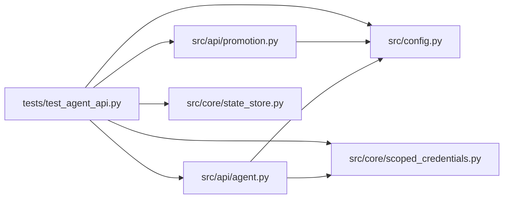

# test_agent_api Module

**Path:** `tests/test_agent_api.py`

## Description

Attached-agent API: scoped authority, validation, and contract tests.

An attached agent completes research with a run-scoped credential and no
global operator token; it can only touch its own run and can never declare
its own results verified or approve production promotion.

## Imports

| Source | Symbols |
|--------|---------|
| `__future__` | `annotations` |
| `asyncio` | `asyncio` |
| `fastapi` | `FastAPI` |
| `fastapi.testclient` | `TestClient` |
| `hashlib` | `hashlib` |
| `pytest` | `pytest` |
| `src.api.agent` | `init`, `router` |
| `src.api.promotion` | `router` |
| `src.config` | `settings` |
| `src.core.scoped_credentials` | `PERM_EVALUATE`, `PERM_LIFECYCLE`, `PERM_READ`, `PERM_SUBMIT`, `issue_scoped_credential`, `revoke_scoped_credential`, `CredentialDenied`, `verify_scoped_credential`, `CredentialDenied`, `issue_scoped_credential` |
| `src.core.state_store` | `SQLiteStateStore` |

## Local dependency map

<!-- Auto-generated local dependency summary. Do not edit by hand. -->

### Internal neighbors

| Direction | Module |
|---|---|
| Outbound | [agent](../modules/agent.md) |
| Outbound | [promotion](../modules/promotion.md) |
| Outbound | [config](../modules/config.md) |
| Outbound | [scoped_credentials](../modules/scoped_credentials.md) |
| Outbound | [state_store](../modules/state_store.md) |

### External packages

| Language | Used packages | Undeclared packages |
|---|---:|---:|
| python | 2 | 2 |

## Classes

| Class | Line | Bases | Description |
|-------|------|-------|-------------|
| [_OrchestratorProbe](../entities/OrchestratorProbe.md) | 30 | — | — |

## Functions

| Function | Signature | Decorators | Description |
|----------|-----------|------------|-------------|
| `store` | `(tmp_path)` | `@pytest.fixture` | — |
| `client` | `(store)` | `@pytest.fixture` | — |
| `_token` | `(run_id = 'res-scoped', subject = 'agent-1', tenant = 'tenant-a', **kw)` | — | — |
| `_auth` | `(token)` | — | — |
| `test_agent_completes_research_without_operator_token` | `(client)` | — | — |
| `test_cross_run_identity_denial` | `(client)` | — | — |
| `test_cross_tenant_identity_denial` | `()` | — | — |
| `test_expired_and_revoked_tokens_are_refused` | `(client)` | — | — |
| `test_forged_authority_is_never_upgraded` | `(client)` | — | — |
| `test_duplicate_submission_is_idempotent_and_conflict_safe` | `(client)` | — | — |
| `test_digest_mismatch_size_and_rate_limits` | `(client)` | — | — |
| `test_scoped_authority_is_distinct_from_operator_and_approver` | `()` | — | — |
| `test_scoped_token_cannot_approve_production_promotion` | `(monkeypatch)` | — | — |
